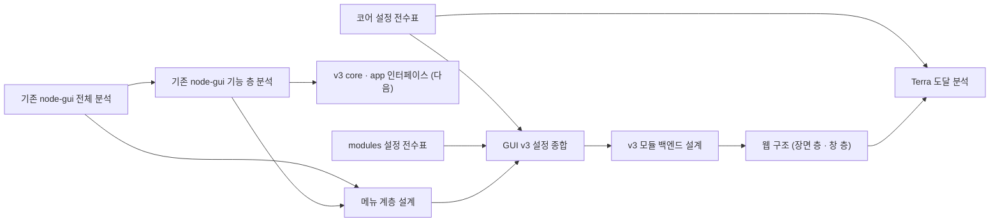

# Terra GUI v3 문서 MOC

GUI v3는 **화면은 새로 짓고, Terra 코어와 붙는 기능 층은 기존 [`lab.stellaxia.node-gui`](../../lab.stellaxia.node-gui/README.md)에서 이어받는다.**
기존 GUI 분석 둘이 출발점이고, 그 위에 v3 설계를 쌓는다.

## 읽는 순서

| 하려는 일 | 문서 |
| --- | --- |
| 기존 GUI가 어떻게 생겼고 무엇이 부채인지 | [[legacy-node-gui-overview\|기존 node-gui 전체 분석]] |
| 기존 GUI에서 Terra와 붙는 코드 중 무엇을 그대로 가져가는지 | [[legacy-app-layer\|기존 node-gui 기능 층 분석]] |
| v3의 메뉴 · 화면 갈래 · 그릇 · 기존 입구와의 대응 | [[menu-hierarchy\|메뉴 계층 설계]] |
| v3가 관리할 설정 · 변수가 어디에 있고, 시안의 설정 창 항목이 무엇에 대응하는지 | [[settings-inventory\|GUI v3 설정 종합]] |
| Terra 코어의 설정 파일 · 키 · env · 포트 · API 전부 | [[settings-terra-core\|Terra 코어 설정 전수표]] |
| modules의 매니페스트 · 모듈별 저장 상태 · node-gui 저장소 · 모듈 env 전부 | [[settings-modules\|modules 설정 전수표]] |
| v3 모듈의 백엔드(프로세스 · 계약 · 노드에 붙는 GUI 데이터) | [[backend\|v3 모듈 백엔드 설계]] |
| 실제 웹 빌드의 구조 — 왜 웹인가, 장면 층(WebGL2 · Worker) · 창 층(DOM · signals) · API · 측정 | [[web-architecture\|GUI v3 웹 구조]] |
| Terra 코어 프로세스 · 모듈 기능 중 GUI 가 끌어낼 수 있는 것 — 계약 327개 대조, 앱 자격 · 위임 문 · 셸 모드 선택지 | [[terra-reach\|Terra 도달 분석]] |

## 폴더

| 폴더 | 문서 |
| --- | --- |
| `docs/` | 이 MOC |
| `docs/analysis/` | [[legacy-node-gui-overview\|전체 분석]] · [[legacy-app-layer\|기능 층 분석]] · [[settings-inventory\|설정 종합]] · [[settings-terra-core\|코어 설정 전수표]] · [[settings-modules\|modules 설정 전수표]] · [[terra-reach\|Terra 도달 분석]] |
| `docs/design/` | [[menu-hierarchy\|메뉴 계층 설계]] · [[backend\|v3 모듈 백엔드 설계]] · [[web-architecture\|웹 구조]] |

## 기준

설계 문서는 저마다 머리의 `based_on`에 기준을 적는다. 두 분석은 modules `main` `9d37f62`(2026-10-22) 시점의 `common/lab.stellaxia.node-gui`(모듈 0.4.5)를 읽은 것이다. 앱을 실행하거나 시험을 돌리지는 않았다.

## 관련 문서

- 모듈 README — `../README.md`
- 기존 GUI의 개발 문서 MOC — `../../lab.stellaxia.node-gui/web/docs/README.md`
