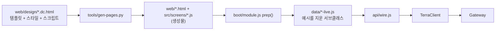
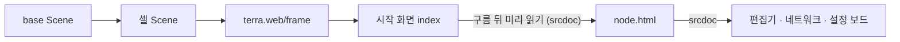

# 기존 node-gui 전체 분석

## 1. 한 줄

디자인 파일(`.dc.html`) 하나에서 화면 코드를 **생성**하고, 그 위에 "예시 데이터를 지우고 실데이터를 채우는" 서브클래스 층을 얹은 구조다.
연동 · 데이터 층은 탄탄하지만, 화면 층은 거대한 단일 클래스와 자체 미니 런타임이라 v3에서 가장 큰 부채다.

## 2. 구조

Terra 안에서는 다음 순서로 뜬다.

| 영역 | 규모 |
| --- | --- |
| 디자인 원본 `design/*.dc.html` | 약 20,500줄 (노드 화면 `Artboard-qcfu` 8,697줄) |
| 화면 코드 `src/screens` (생성물) | 약 12,500줄 (`node.js` 6,533줄) |
| 연동 층 `src/api` | 약 3,800줄 |
| 실데이터 층 `src/data` | 약 2,000줄 |
| 시험 `tests/` | 약 4,500줄 (모듈 README 기준 236개 통과) |

## 3. 유지할 만한 것

- **연동 층** — `TerraClient`, operation 대응표, frame 토큰 갱신, SSE(fetch 스트림), 올리기 · 받기 이어서, Master 위임 입구(읽기 28 op 표 + CI 대조). 실측과 시험이 붙어 있어 UI와 분리해 재사용할 가치가 가장 크다 — [[legacy-app-layer|기능 층 분석]].
- **"지어내지 않는다" 원칙** — 값이 없으면 빈 상태나 "닿지 않음", 권한이 없으면 숨기지 않고 잠금 + 이유.
- **LayoutStore** — 브라우저에 먼저, 사용자 문서(서버)에 뒤따라, 새 쪽이 이긴다. 노드 이름이 바뀌어도 `node_id`로 따라간다.
- **개발 문서** — Obsidian 호환 MOC와 백로그.

## 4. v3에서 다룰 부채

1. **단일 거대 클래스** — `node.js` 한 클래스에 메서드 약 330개, `setState` 269회, 상태 키 수십 개. 렌더는 `renderVals()` 전체 재계산 후 키 없는 DOM 비교라, 조타륜 · 바다 · 애니메이션은 렌더 밖 루프로 돈다. 맵 진입도 평균 20.1초에서 굽기 최적화로 7.3초까지 줄인 상태다.
2. **예시 데이터가 생성자에 박혀 있다** — 서브클래스가 첫 렌더 전에 지우는 역전 구조라 부트 순서에 민감하다. 픽스처는 시험 · 디자인 전용으로 분리한다.
3. **디자인 파일이 곧 코드** — 로직이 `.dc.html` 안 스크립트에 있고, 생성기가 템플릿 글귀를 치환한다(못 찾으면 생성이 멈춘다). maingui를 은퇴시킨 뒤 `design/`이 단독 원본이라 이 파이프라인을 유지할 이유가 약해졌다.
4. **스타일 토큰이 없다** — CSS 변수 0개, 노드 화면에만 인라인 `style` 1,074개. `#9aa1ab` 242회, `#ede9e1` 184회. 팔레트는 `design/SKIN.md`에만 있다.
5. **코드 중복** — 타일 굽기(`bakeTile`)가 노드 화면과 필드 편집기에 각각 복사돼 있다.
6. **낡은 문서** — `design/SKIN.md`의 경로(`v2/tools/gen.py`, `/tmp/…`), 웹 README의 maingui 기준 서술.

## 5. v3가 지켜야 할 외부 제약

| 제약 | 이유 |
| --- | --- |
| `terra.web/frame` 안에서 돈다 · `frame-boot.js`가 첫 import | 셸 handshake 10초 — 무거운 마운트 뒤에 hello를 보내면 늦는다 |
| 외부 폰트를 쓰지 않는다 | CSP `font-src 'self' data:` · `style-src 'self'` — 시스템 글꼴 · 번들 글꼴만 |
| 같은 앱 페이지를 끼울 때 `srcdoc` | 게이트웨이 CSP `frame-ancestors`가 앱 origin을 빼고 있다 |
| 웹은 비밀번호를 받지 않는다 | 로그인은 셸의 `/login` Route가 받는다 — 스코프 토큰 교집합 우회 방지 |
| Master 쓰기 · 관리자 · SSE는 잠겨 있다 | ADR-GW-003 2차 — 허가 만들기 · bind · 사용자 관리 · SVI 흐름 이벤트 · 설정의 클러스터 탭 |

구현이 없는 것: 노드 데스크톱(디자인 보드 `NodeDesktop.dc.html`과 구상 문서만, 맵 원형 메뉴의 "노드 창 열기" 칸은 숨김) · 클러스터 창(데모 값) · 다른 tree 전환(뺐다).

같은 저장소의 `io.terra.agent` GUI는 이미 Vite + TypeScript + Vitest로 `.dc.html`을 번들로 다시 쓰는 길을 택했다 — v3 기술 선택의 선례다.

## 6. v3 결정에 필요한 것

| 질문 | 메모 |
| --- | --- |
| 런타임 · 프레임워크 | 기존 문서도 "먼저 이 런타임으로 연동 검증 → 화면별로 프레임워크 이식"을 권했다. v3는 처음부터 이식할지 |
| 화면 분리 단위 | 맵 · 노드 데스크톱 · 보드(편집기 · 네트워크 · 설정) · 시작 화면의 경계 |
| 맵 표현 | 육각 타일 필드를 유지할지, 그래프로 바꿀지 |
| 디자인 토큰 · 파이프라인 | 토큰화, `.dc.html` 생성 파이프라인을 버릴지 |
| 재사용 경계 | `src/api` · `src/store` · `src/model`과 시험을 UI와 분리해 가져간다 — [[legacy-app-layer|기능 층 분석]] |

## 관련 문서

- [[docs/README|GUI v3 문서 MOC]]
- [[legacy-app-layer|기존 node-gui 기능 층 분석]]
- 기존 GUI의 구조 문서 — `common/lab.stellaxia.node-gui/web/docs/architecture.md`
- 기존 GUI의 남은 일 — `common/lab.stellaxia.node-gui/web/docs/guides/implementation-backlog.md`

## 관련 모듈

- `common/lab.stellaxia.node-gui/web/src/screens/node.js` · `src/runtime/dc.js` · `tools/gen-pages.py`
- `common/lab.stellaxia.node-gui/web/src/boot/module.js` · `src/data/*-live.js`
