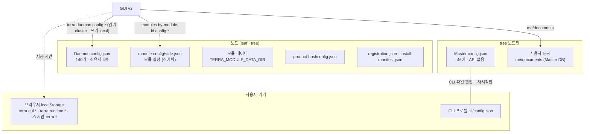

# GUI v3가 관리할 설정 · 변수 — Terra · modules · v3 시안 종합

> **2026-10-31 점검** — 이 문서 이후 코어가 바뀌었다(모듈 설치·제거 길 #236·#237, 모듈 설정 #230, 화면 안 창 #247, 런처 제거). 맞춘 내용과 남은 격차는 [[replacement-readiness]].

## 1. 한 줄

Terra의 설정은 **전부 JSON**이고, Daemon · Master 설정 키마다 **소유자**(installer · operator · derived · secret)가 정해져 있다.
GUI가 편집할 수 있는 것은 사실상 **노드 Daemon 설정의 operator 키**(로컬 노드, `node.config` 권한)와 **모듈 설정**(스키마 기반), **사용자 문서**(`me/documents`) 셋뿐이다.

v3 시안의 설정 창은 지금 **목업 값**을 보여 준다. 실제로 저장되는 것은 스킨 · 프로필 · 스타메이커 보관함뿐이고, 그것도 브라우저 `localStorage`에 들어간다.
이 문서는 세 곳(코어 · 모듈 · 시안)의 설정을 한 지도에 놓고, **시안의 항목을 실제 저장소에 하나씩 대응**시킨다.

키 하나하나의 표는 두 전수표에 있다.

- [[settings-terra-core|Terra 코어 설정 전수표]] — 설정 파일 21종 · Daemon 140키 · Master 46키 · env · 플래그 · 포트 · API · 비밀
- [[settings-modules|modules 설정 전수표]] — 매니페스트 · 모듈별 저장 상태 · node-gui 저장소 · 모듈 env · Gateway 경로 · 계약

## 2. 설정이 사는 곳

| # | 저장소 | 무엇 | GUI가 닿는 길 | GUI 권한 |
| --- | --- | --- | --- | --- |
| A | Daemon `config.json` | 노드 동작 전부 (이름 · 공유 폴더 · 로그 · 업데이트 정책 · 네트워크 · 모듈 정책) | `terra.daemon.config.{get,schema.get,patch}` · `POST /config/save · /apply · /restart` | 읽기 `node.read`(클러스터) · 쓰기 `node.config`(**로컬만**) |
| B | Master `config.json` | 트리 표시 이름 · 경보 · TURN · DB · 로그인 공개 | **API 없음** — `terra master config set`(파일 편집) + 재시작 | 없음 |
| C | `module-config/<id>.json` | 모듈별 설정 (매니페스트 `configuration.schema`) | `terra.daemon.modules.by-module-id.config.{schema.get,get,patch}` | `module.manage` |
| D | 모듈 자체 데이터 | agent 공급자 · MCP 서버, io-weave `settings.json`, nodetalk `peers.json` 등 | 모듈마다 다름 (op가 있는 것은 io-weave `settings.get/set` 하나) | 모듈 계약 |
| E | 사용자 문서 `me/documents/{ns}/{key}` | 사용자 단위 데이터 (node-gui 레이아웃 · 편집 자산) | `terra.gateway.me.documents.*` | 로그인 사용자 |
| F | 브라우저 `localStorage` · IndexedDB | 이 기기 설정 · 캐시 | 직접 | — |
| G | Scene Store | 자격 핸들 · 세션 · 로그인 | `terra.frame.*` | 셸 |
| H | 환경 변수 | Daemon 76 · Master 30 · CLI 17 · 모듈 주입 약 11 | 읽기 불가 (GUI는 출처를 모른다) | — |
| I | 고정값 | 포트 표 `endpoints.json`(생성물) · 빌드 변수 | 읽기 | — |
| J | 비밀 | 토큰 · 자격 · 키 (약 20종, 이름 · 위치만 기록) | `***` 로만 보임 · config API로 설정 불가 | — |

## 3. v3 시안이 지금 쓰는 설정 · 저장

### 3.1 브라우저 저장소 키

| 키 | 내용 | 쓰는 곳 | 읽는 곳 | 실제로 옮길 곳 (권고) |
| --- | --- | --- | --- | --- |
| `terra.star.index` | 스타메이커 보관함 목록 `{folders, files:[{id,name,path,kind,bytes,frames,thumb}]}` | StarMaker | StarMaker · 전역 제어(star 폴더) · 설정 창(스킨) | 사용자 문서 E (`app:<v3 id>/star/index`) — 사용자 자산이라 기기에 묶이면 안 된다 |
| `terra.star.f.<id>` | 구 파일 본문 (terra.sphere v1 JSON, 표면 그림은 data URL) | StarMaker | StarMaker · 장면(스킨) | E — 크기가 커서 문서 하나에 하나. 용량 한도 확인 필요 |
| `terra.skin` | `{지도 노드 id: 구 id}` | 설정 창(스킨) | 장면(행성 겉면) | **사용자 문서 E** `app:lab.stellaxia.gui-v3/skin` (§5-1) |
| `terra.fs` | 노드별 파일 · 속성 `{nodes:{id:{files:{rel:{mime,size,at}}, props:{profile:{image}}}}}` | 설정 창(프로필) | 전역 제어(VFS 데이터 폴더) · 장면(프사) | **v3 백엔드** `node-props.*` (§5-2) |
| `terra.fs.f.<id>:<rel>` | 노드 파일 본문 (data URL) | 설정 창(프로필) | 장면(프사) | **v3 백엔드** `node-files.*` (§5-2) |

알림 이벤트는 `terra-skin`(스킨 적용 → 장면이 바로 다시 읽음) · `terra-fs`(노드 파일 적용 → 전역 제어 · 장면이 다시 읽음) 둘이다. 전역 객체는 `window.__terraScene`(로그인 층이 통합 화면 글자 장을 읽음) 하나다.

기존 node-gui의 키(`terra.gui.layout|<node_id>|<principal>` · `terra.gui.buildings` · `terra.gui.roads` · `terra.gui.assetsAt` · `terra.gui.innerHelp` · `terra.gui.winOpacity` 등)와 runtime UI의 키(`terra.runtime.connection.v1` 등)는 [[settings-modules|modules 전수표]] §2.1과 [[settings-terra-core|코어 전수표]] §10.7에 있다.
v3 시안의 키는 이름이 겹치지 않는다.

### 3.2 설정 창 항목 → 실제 저장소

설정 창(NodeConf)의 항목은 **스킨 · 프로필을 빼면 전부 목업**이다(창 안에서만 바뀌고 저장되지 않는다).
실제로 붙일 때의 대응은 아래와 같다. "키"는 Daemon 설정 키, 소유자는 O(operator) · I(installer) · D(derived) · S(secret).

| 분류 | 시안 항목 (키) | 실제 대응 | 소유자 · 재시작 | v3 처리 권고 |
| --- | --- | --- | --- | --- |
| GUI › 표시 | 이름표 `label` · 궤도 선 `orbit` · 노드 색 `color` · 표시 방식 `proj` | 코어에 없음 — GUI 표시 설정 | — | 사용자 문서 E (`app:<v3 id>/prefs`). 노드마다면 키에 노드 id |
| GUI › 프로필 | `profile` (이미지 · GIF) | 코어에 노드 파일 저장소 없음 | — | §5 결정 2 |
| GUI › 스킨 | `skin` (구 id) | 코어에 없음 | — | §5 결정 1 |
| GUI › 뷰 | 기본 진입 뷰 `view` · 두 번 눌러 진입 `dbl` · 알림 배지 `badge` | 코어에 없음 | — | 사용자 문서 E |
| 클러스터 › 역할 | 역할 `role` | `daemon.roles` | D · 즉시 | **읽기만** — 역할 변경은 인스톨러 재구성 |
| | 부모 트리 `parent` | `registration.json` · Master 트리 구조 | — | 읽기만 |
| | 노드 ID | `registration.json` 의 node_id (코드 주석상 노출 안전) | — | 읽기만 (시안은 이름 해시로 지어냄 → 교체) |
| | (시안에 없음) 표시 이름 | `daemon.device_name` | O · **즉시** | **편집 — 1순위**. 시안에 칸을 더한다 |
| 클러스터 › 연결 | 주소 `addr` | 실제 키 없음 — 연결 주소는 `master.url`(O) · 광고 주소는 `wireguard.advertise_endpoint`(O) | O · 재시작 | 항목을 둘로 나눠 이름을 바로잡는다 |
| | 포트 `port` | 포트는 생성된 표 `endpoints.json`에 고정 (leaf Gateway 8787 · tree 8788 · Local API 17321 · Master 8080 · direct_tcp 17322 · mesh 17323 · gRPC 17325 · WireGuard 51820) | — | **편집 금지 · 읽기만**. 바꾸면 모든 미러와 어긋난다 |
| | 다시 연결 `recon` | `master.reconnect` — **런타임에서 읽는 곳 없음** | O | 칸을 뺀다. 지연은 `master.reconnect_{initial,max}_delay_ms`(고급) |
| | heartbeat 주기 `hb` | `heartbeat.interval_sec` (기본 10, ≥1) | O · 재시작 | 고급 칸. 시안 기본값 5는 틀림 → 10 |
| 클러스터 › 권한 | 관리자 `admins` | Master 사용자 · 권한 (`/api/v1/admin/users…`, master_admin) | — | tree 화면(클러스터 관리)으로 옮긴다. 노드 설정이 아님 |
| | 읽기 전용 `ro` | 대응 키 없음 — 앱 매니페스트의 `node.config` 유무가 사실상 같은 효과 | — | 칸을 빼고 "이 앱에 쓰기 권한 없음" 표시로 |
| 클러스터 › 자원 공개 | 공개 토글 `pub` | 공유 폴더 `storage.shared_dirs`(O, **핵심 사용자 설정**) · `storage.memos_dir`(O) · `local_fs.{enabled,roots,deny}`(O, 즉시) · SVI 선언(`/svi/declarations`, node.config) | O | 목록을 실제 키로 다시 짠다. 시안의 `mcp:7000` 같은 이름은 목업 |
| 클러스터 › 업데이트 | 코어 버전 `ver` | 빌드 변수 `main.version` · 코어 배포 상태 | — | 읽기만 |
| | 채널 `chan` (stable · beta) | **채널 개념 없음** — 코어 업데이트는 Tree가 정함, 인스톨러 카탈로그는 빌드 시 고정 | — | 칸을 뺀다 |
| | 자동 업데이트 `auto` | `core_distribution.{hold, hold_reason, maintenance_window, allow_apply, disk_quota_mb(4096), enabled}` · `module_distribution.{enabled, disk_quota_mb}` | O · 재시작 | **편집** — "자동" 토글 하나 대신 보류 · 적용 허용 · 정비 시간 · 용량 |
| 클러스터 › 위험 | 노드 다시 시작 | `POST /restart` (`terra.daemon.restart.post`, node.config) | — | 유지. `restart_required` 키를 저장한 뒤 제안하는 흐름에도 쓴다 |
| | 트리에서 빼기 | 대응 op 확인 안 됨 (enrollment는 등록 · 코드 발급뿐) | — | §6 질문 |

설정 창에 **없는데 v3가 다뤄야 할 것**(코어 전수표 §12의 편집 1순위):
`logging.level`(즉시)과 `logging.max_size_mb` · `max_backups`, `service_tunnels.enabled`, `feature.enable_svi`, 네트워크 토글(`direct_tcp.*` · `wireguard.{enabled, listen_port, advertise_endpoint, stun_servers, nat_mapping_mode}` · `webrtc.{enabled, stun_servers}`), 모듈별 설정 폼.

### 3.3 보드 속성 — 사용자 설정 후보와 디자인 상수

캔버스 보드의 속성(편집기에 보이는 값)은 지금 디자인을 맞추는 손잡이다. 실제 GUI로 옮길 때 **사용자 설정으로 내릴 것**과 **코드 상수로 굳힐 것**을 나눴다.
보드별 전체 목록은 부록 A에 있다.

| 구분 | 속성 | 저장 권고 |
| --- | --- | --- |
| 사용자 설정 — 화면 | `palette`(은하수 · 성운 · 단색) · `cell`(글자 크기) · `motion`(움직임) · `speed`(글자 장 흐름) · `bgMove` · `bgSpeed` | "이 기기 설정" — localStorage (움직임 줄이기는 OS 설정 `prefers-reduced-motion`이 먼저) |
| 사용자 설정 — 성능 | `renderScale`(자동 · 1.5 · 1) · `underTiles` | 이 기기 설정 (기기마다 다름) |
| 사용자 설정 — 표시 | `starMask`(마스크 · 레거시) · `trails` · `satRestore` | 사용자 문서 E (기기 무관) |
| 데이터로 바꿀 것 | `preset`(트리 모양) · `leaf`(보는 리프) · `planets`(행성 수) · `star`(항성 종류) · Login `installed`(Tree · Leaf) | 실제 클러스터 · 노드 데이터에서 온다 (§4) |
| 디자인 상수 | 단계(`stage1~3` · `holeDim` · `hitBand`) · 재생(`overlap` · `tempo` · `glowMs`) · 인식 영역(`region*` · `showRegion`) · 항성계(`viewTilt` · `orbitSpread` · `orbitScale` · `planetSize` · `trailScale` · `leafSat`) · `parallaxCenter` · `glowGap` · `starMix` · `logoWidth` | 코드 상수 (사용자에게 안 보임) |
| 숨은 상수 (속성 선언 없이 코드가 읽음) | 통합 화면이 읽는 28개 — 카메라 `camDist · camBack · camLeft · camUp · camZoom · camTurn · camPitch · camOffTurn`, 시선 `look{Left,Right,Up,Down}` · `lookBase{Left,Up}`, 리소스 `resAnchorX/Y · resBgGain`, 위성 `satMin · satMax · satScale · satNameScale`, 기타 `orbitMax · planetAmbient · tickGap · mixBack · dataDir · dim · showZones` | 한곳(상수 표)으로 모은다. 지금은 코드 곳곳에 `?? 기본값` 으로 흩어져 있다 |

그 밖의 코드 상수 표: 창 자리 `WSLOT` (제어기 6 · 스타메이커 1 · 설정 1 · 상태 3) · 창 크기 `WSIZE` · 창 틀 `CTLW` · 길게 누르기 `HOLD_MS`(550) · 진입 `ENTER_TL` · 이동 `NAV_TL` · 최소화 레벨 바 한계(50, +5) · 프로필 파일 한도(2.5MB, localStorage 때문).

### 3.4 시안의 목업 → 실제 데이터 출처

| 시안에서 보이는 것 | 지금 | 실제 출처 |
| --- | --- | --- |
| 트리 · 리프 · 리소스 구조 | `preset`으로 지어낸 트리, 리프마다 `ssh:22 · tty0 · gpio · mqtt · video0` 중 2~4개 | Master 클러스터 트리 · 노드 카탈로그(node-address catalog) · 각 노드 SVI 선언 |
| 계정 이름 · 권한 (전역 틀 `admin · 관리자`) | 고정 문자열 | `whoami` (Gateway) |
| 로그인 화면의 설치 타입 (Tree · Leaf) | `installed` 속성 | `daemon.roles` (D) · `/.well-known/terra-product.json` |
| 상태 창 (동작 · CPU · MEM · NET · healthcheck · 이벤트) | 1초마다 난수 | `GET /health` · Daemon 상태 · SSE `terra.daemon.events.get` (신호 표는 modules 전수표 §3.7) |
| VFS의 데이터 폴더 기본 파일 (`config.toml` · `state.db` · `logs` …) | 이름만 있는 자리 | 실제로는 Daemon data dir (`~/.terra/terra/` — `config.json` · `registration.json` · `logs/{daemon,job,audit}.log` …). 형식도 TOML이 아니라 JSON |
| 공유 자원 폴더 | 이름 해시로 고른 `mcp:7000 · store/data …` | `storage.shared_dirs` · SVI 선언 |
| 유틸 · 설정 폴더의 도구 | 자리만 (`tool`) | 기존 node-gui 앱 · 모듈 기여(`contributions.gui.apps`) |

## 4. 저장 위치 원칙

1. **노드 동작** → Daemon 설정(A). 폼은 `GET /config/schema`의 `type · owner · restart_required`로 만든다. operator만 편집, installer · derived는 읽기, secret은 `***`.
2. **사용자 취향(어느 기기에서든 같아야 하는 것)** → 사용자 문서(E). 표시 설정 · 스킨 · 스타메이커 보관함.
3. **노드에 붙는 GUI 데이터(보는 사람 모두에게 같은 것)** → v3 백엔드의 모듈 데이터 영역(D). 프로필 · 노드 속성.
4. **이 기기에만 맞는 것** → localStorage(F). 화면 크기 · 성능 · 도움말 · 투명도.
5. **모듈 자신의 설정** → 매니페스트 `configuration.schema`(C). 지금 쓰는 모듈은 0개.
6. **환경 변수 · 포트 · 빌드 변수** → GUI에서 바꾸지 않는다. 다만 env로 덮인 키는 "파일 값과 실제 값이 다를 수 있음"을 알려야 하는데, 지금 API는 출처를 주지 않는다.

## 5. 권고 (2026-10-29 확정 방향)

v3는 화면만 있는 Scene이 아니라 **모듈**이다 — 프로세스 진입점과 API 계약을 더하면 노드마다 백엔드를 둘 수 있다. 근거와 설계는 [[backend|v3 모듈 백엔드 설계]].
이 사실을 넣어 다섯 가지를 아래처럼 정한다.

| # | 정할 것 | 권고 | 이유 |
| --- | --- | --- | --- |
| 1 | 스킨 · 스타메이커 보관함 | **사용자 문서** `app:lab.stellaxia.gui-v3/{skin, star/index, star/f/<id>}` | 사용자가 만든 자산 · 내 화면의 취향 — 사람을 따라가야 한다. 문서 크기 한도를 넘으면 보관함만 v3 백엔드(사용자별 디렉터리)로 (Q-S4) |
| 2 | 프로필 사진 · 노드 속성 | **v3 백엔드** — 노드의 `TERRA_MODULE_DATA_DIR/node-data/{profile/image/<파일>, properties.json}`, op `lab.stellaxia.gui-v3.node-files.* · node-props.*` | 그 노드를 보는 모두에게 같아야 한다. 코어에는 GUI가 노드에 파일을 쓰는 길이 없고, 공유 폴더는 사용자 파일과 섞인다. 화면의 경로 표기(`/<노드>/데이터/…`)는 그대로 |
| 3 | `node.config` 권한 | **v3 앱에 준다** + 저장 전 확인 | 없으면 노드 설정이 통째로 읽기 화면. 화면이 막는다: 비밀 숨김 · 인스톨러 키 읽기 · 위험 키 두 번 확인 · 바뀐 키 목록과 재시작 여부를 보여 주고 `PATCH /config {set, save:true}` 한 번. **`path` 인자는 절대 넘기지 않는다** |
| 4 | 원격 노드 설정 | **읽기 + "그 노드에서 열기"** | 코어 계약상 쓰기는 로컬 전용. v3 백엔드가 대신 쓰지 않는다(그러면 v3 op 권한만으로 노드 설정이 바뀌는 권한 세탁). 원격 쓰기는 코어 쪽 과제로 분리 |
| 5 | Master 설정 화면 | **코어에 API 요청, v3는 기다리지 않음** — 그때까지 읽기 + CLI 안내 | 요청 범위는 `config.get · schema.get · patch` 세 개, Daemon과 같은 모양이면 폼을 함께 쓴다 |

함께 하는 것:

- **설정 창 정리 (시안 반영 완료, 캔버스 v246)** — 노드 쪽을 실제 Daemon 키로: 정체(`daemon.device_name` 편집 · 역할 · 부모 · 노드 ID 읽기) · 연결(`master.url` · `wireguard.advertise_endpoint` · `heartbeat.interval_sec` 10 · 포트 표 읽기) · 공유(`storage.shared_dirs` 목록 편집 · `memos_dir` · `local_fs.enabled`) · 업데이트(`core_distribution.{hold, hold_reason, allow_apply, maintenance_window, disk_quota_mb}`) · 로그(`logging.{level, max_size_mb, max_backups}`) · 위험(다시 시작). 줄마다 키 이름 · 편집/읽기 · 재시작 필요를 보이고, 적용 뒤 재시작이 필요하면 "지금 다시 시작". 원격 노드는 전부 읽기, 계정 · 리소스는 "노드가 아니에요". `recon` · `chan` · `ro` · 관리자 칸은 뺐다
- **env 출처** — 코어에 `GET /config` 응답의 `sources`를 요청한다. 그 전까지 env로 덮일 수 있는 키 옆에 작게 표시
- **코어에 올릴 정리 항목** — 비밀로 분류 안 된 비밀 2개 · 설정 저장의 임의 경로 · 효과 없는 키 7개 (§6)

## 6. 두 저장소에서 나온 어긋남 (설계에 영향이 큰 것)

| # | 내용 | 출처 |
| --- | --- | --- |
| 1 | **효과 없는 키** — `master.reconnect` · `heartbeat.timeout_sec` · `feature.enable_docker / screen_share / experimental` · `task_queue.max_retry_count` · `security.{private,public}_key_path`. GUI에 두면 "아무 일도 안 하는 스위치"가 된다 | 코어 §13-3 |
| 2 | **env 오버라이드가 보이지 않는다** — `TERRA_DAEMON_*` 76개는 저장되지 않는데 `GET /config`가 출처를 안 준다. GUI에서 바꿔도 재시작 뒤 env가 다시 이긴다 | 코어 §13-12 |
| 3 | **모듈 env 설정이 호스트 아래에서 닿지 않는다** — 모듈 호스트는 허용 목록(PATH · HOME · LANG · TZ 등)만 넘긴다. file 2 · nodetalk 7 · treebench 1 · agent 1개 변수는 단독 실행용 | modules S-2 |
| 4 | **비밀로 분류되지 않은 비밀** — `webrtc.ice_servers[].credential`, Master `database_url` | 코어 §13-5 |
| 5 | `PATCH /config` · `POST /config/save`가 `path`를 받아 **임의 경로에 설정 파일(비밀 포함)을 쓸 수 있다** (로컬 토큰 보유자) | 코어 §13-10 |
| 6 | 스키마 키 수 — 코드 주석 118 · node-gui 사본 135 · 실제 스키마 140 | 코어 §2 · modules §2.2 |
| 7 | `configuration` 선언 모듈 0개 — 범용 모듈 설정 길은 준비돼 있는데 쓰지 않는다 | modules S-1 |
| 8 | 위험한 모듈 op의 권한이 빈 배열 — io-weave `settings.set`(원격 커서 주입), io-inventory 승인 | modules S-4 |
| 9 | 바이너리 기본값 ≠ 설치값 (data dir `~/.terra` vs `~/.terra/terra` 등) — GUI는 기본값이 아니라 **실행 중 값**을 보여야 한다 | 코어 §13-8 |
| 10 | `terra.config.changed` 신호를 받고 다시 읽는 앱이 없다 — v3 설정 창은 이 신호로 다시 읽는다 | modules S-12 |

## 7. 열린 질문

코어 전수표의 질문 11개와 modules 전수표의 질문 12개(Q-C1~Q-C12)는 각 문서 끝에 있다. v3 시안에서 새로 생긴 질문만 적는다.

| ID | 질문 |
| --- | --- |
| Q-S1 | ~~스킨 · 보관함 · 프로필의 집~~ → §5-1, 5-2로 정함 |
| Q-S2 | ~~노드에 붙는 GUI 데이터의 길~~ → v3 백엔드 자체 op로 정함 ([[backend\|백엔드 설계]]) |
| Q-S3 | "트리에서 빼기"에 대응하는 코어 동작이 있나 (등록 해제 · 좌석 반납) |
| Q-S4 | 사용자 문서의 문서 하나 크기 한도 — 구 파일(표면 그림 data URL)과 GIF 프로필이 들어가는가 |
| Q-S5 | 숨은 상수 28개를 상수 표 하나로 모으면서, 그중 사용자 설정으로 내릴 것이 있나 (예: 시선 범위 `look*`) |

## 부록 A. 보드 속성 (캔버스 편집기에 보이는 값)

함수형 속성(`on*` · 창 크기 등 자식에게 넘기는 값)은 뺐다. 설정 창 · 상태 창 · 스타메이커 · 노드 데스크톱의 속성은 노드 이름 · 종류 · 경로 · 창 크기 같은 **입력값**이라 설정이 아니다.

| 보드 | 속성 | 구역 | 편집기 | 기본값 | 고를 수 있는 값 |
| --- | --- | --- | --- | --- | --- |
| Field | `path` | 전역 틀 | enum | /계정/01/01·c | /계정 · /계정/01 · /계정/01/01·c · /계정/01/01·c/serial/COM3 |
| Field | `logoWidth` | 전역 틀 | range | 0.2 |  |
| Field | `showZones` | 전역 틀 | boolean | false |  |
| Field | `holeDim` | 전역 틀 | range | 0.6 |  |
| Field | `tempo` | 모션 | range | 1 |  |
| Field | `palette` | 글자 장 | enum | 은하수 | 은하수 · 성운 · 단색 |
| Field | `speed` | 글자 장 | range | 1 |  |
| Field | `cell` | 글자 장 | int | 14 |  |
| Field | `dim` | 글자 장 | range | 1 |  |
| Field | `motion` | 글자 장 | boolean | true |  |
| Login | `embed` | 삽입 | boolean | false |  |
| Login | `palette` | 글자 장 | enum | 은하수 | 은하수 · 성운 · 단색 |
| Login | `speed` | 글자 장 | range | 1 |  |
| Login | `cell` | 글자 장 | int | 15 |  |
| Login | `motion` | 글자 장 | boolean | true |  |
| Login | `installed` | 로그인 | enum | Leaf | Tree · Leaf · Tree + Leaf |
| Scene | `login` | 로그인 | boolean | true |  |
| Scene | `renderScale` | 성능 | enum | 자동 | 자동 · 1.5 · 1 |
| Scene | `underTiles` | 성능 | boolean | false |  |
| Scene | `stage1_create` | 단계 | boolean | true |  |
| Scene | `stage2_dissolve` | 단계 | boolean | true |  |
| Scene | `stage3_rise` | 단계 | boolean | true |  |
| Scene | `holeDim` | 단계 | range | 0.6 |  |
| Scene | `hitBand` | 단계 | range | 12 |  |
| Scene | `overlap` | 재생 | range | 0.5 |  |
| Scene | `tempo` | 재생 | range | 1 |  |
| Scene | `glowMs` | 재생 | range | 200 |  |
| Scene | `preset` | 트리 | enum | 깊이 3 | 자식 2 · 자식 3 · 자식 5 · 깊이 3 |
| Scene | `speed` | 트리 | range | 1 |  |
| Scene | `palette` | 글자 장 | enum | 은하수 | 은하수 · 성운 · 단색 |
| Scene | `cell` | 글자 장 | int | 11 |  |
| Scene | `bgMove` | 글자 장 | enum | 없음 | 없음 · 상 · 하 · 좌 · 우 |
| Scene | `bgSpeed` | 글자 장 | range | 3 |  |
| Scene | `motion` | 글자 장 | boolean | true |  |
| Scene | `regionFocus` | 인식 영역 | range | 4 |  |
| Scene | `regionLeaf` | 인식 영역 | range | 2.3 |  |
| Scene | `regionPlanet` | 인식 영역 | range | 16 |  |
| Scene | `regionChild` | 인식 영역 | range | 8 |  |
| Scene | `showRegion` | 인식 영역 | boolean | false |  |
| Scene | `parallaxCenter` | 트리 | range | 2 |  |
| Scene | `leaf` | 리프 | enum | 01 | 01 · 02 · 03 · 04 · 01.02 · 03.01 |
| Scene | `star` | 리프 | enum | 청백 거성 | 청백 거성 · 태양 · 청록 왜성 · 백색 별 |
| Scene | `glowGap` | 리프 | range | 0.2 |  |
| Scene | `starMix` | 리프 | range | 0.5 |  |
| Scene | `planets` | 항성계 | int | 6 |  |
| Scene | `viewTilt` | 항성계 | range | 68 |  |
| Scene | `orbitSpread` | 항성계 | range | 4 |  |
| Scene | `trailScale` | 항성계 | range | 1.5 |  |
| Scene | `leafSat` | 항성계 | range | 0.55 |  |
| Scene | `orbitScale` | 항성계 | range | 1.5 |  |
| Scene | `planetSize` | 항성계 | range | 0.0225 |  |
| Scene | `trails` | 항성계 | boolean | true |  |
| Scene | `starMask` | 리프 | boolean | true |  |
| Scene | `satRestore` | 리소스 | enum | 어두운 화면 복원 | 어두운 화면 복원 · 어두운 배경 복원 · 배경 복원 · 복원 안 함 |
| Scene | `logoWidth` | 전역 틀 | range | 0.2 |  |

## 관련 문서

- [[settings-terra-core|Terra 코어 설정 전수표]]
- [[settings-modules|modules 설정 전수표]]
- [[legacy-app-layer|기존 node-gui 기능 층 분석]] — 그대로 가져갈 기능 층 (설정 저장 · LiveSource)
- [[menu-hierarchy|메뉴 계층 설계]] — 설정이 놓일 메뉴 자리
- [[backend|v3 모듈 백엔드 설계]] — 노드에 붙는 GUI 데이터를 저장하는 v3 자체 op
- [[docs/README|GUI v3 문서 MOC]]
