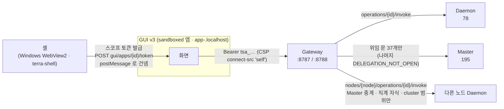

# Terra 도달 분석 — GUI v3가 끌어낼 수 있는 것

> 질문: GUI v3(시안 · 웹 빌드)가 Terra 코어 프로세스와 모듈 기능을 **얼마나** 화면으로 끌어낼 수 있나.
> 답을 두 축으로 나눈다 — **설계 축**(시안에 그 기능의 화면이 있나)과 **도달 축**(지금 GUI v3의 자격으로 그 operation을 실제로 부를 수 있나).
> 지금 시안의 값은 전부 예시이고 실제 호출은 0이다. 이 문서는 연결을 시작하기 전에 어디까지 닿는지를 정한다.

## 1. 결론

| 계약 | operation | 화면 설계됨(일부 포함) | 앱 자격으로 닿음 | 설계됐는데 막힘 |
| --- | ---: | ---: | ---: | ---: |
| Daemon (리프) | 78 | 75 | 76 | 2 |
| Master (트리) | 195 | 94 | 37 | 68 |
| Gateway | 54 | 29 | 45 | 6 |

- **리프는 거의 다 끌어낸다.** Daemon 78개 중 75개가 시안에 화면이 있고, 앱 자격으로 76개가 닿는다. 막히는 둘은 `node.enroll`(등록 코드 · 등록)이다. 다만 26개는 **그 노드에서만**(`local`) — 원격 제어기에서는 잠긴다(시안의 잠금 표시와 같다).
- **트리는 절반 아래.** Master 195개 중 앱이 닿는 것은 **위임 문을 여는 37개뿐**(노드 · 네트워크 읽기 · 경로 · SVI 공유 · 작업). 시안의 Tree 로그인 · Tree 설정(클러스터 · 사용자 · 등록 · 배포 · 경보) · 자원 값 흐름은 **앱 자격으로는 못 부른다.**
- **가장 큰 갈림길은 실행 모드다.** 지금 GUI v3는 `contributions.gui.apps`의 sandboxed 앱이라 **스코프 토큰**(사용자 권한 ∩ 앱 선언, Master는 위임 문 37개)으로만 부른다. GUI v3가 **로그인을 스스로 하는 제품 셸**이 되면 사용자 세션(자격 핸들)으로 사용자 권한 전부가 닿는다 — 막힌 68개 대부분이 풀린다(§6).

## 2. 코어 프로세스

| 프로세스 | 자리 · 기동 | GUI로 끌어낼 수 있는 것 | 시안의 자리 |
| --- | --- | --- | --- |
| terra-daemon (리프, :17321) | installer 가 서비스로 등록(systemd `Restart=on-failure` · Windows 작업) | 상태 · health · live · ready · `restart.post`(로컬, 확인 필요) · 설정 · 모듈 · 장치 · WireGuard · 작업 · 파일 · SVI 선언 | 상태 창 · 설정 창 Terra · 제어기 전부 |
| terra-gateway (:8787 리프 · :8788 트리) | daemon 또는 Master 의 자식, 실패하면 다시 띄움 | `/api/v1/health`(공개) · 앱 호출 길 · GUI 앱 · 스트림 · 사용자 문서 | 모든 화면의 호출 길 · 브라우저 창 |
| terra-master (트리, :8080) | 서비스 | 앱 자격: 위임 37개 / 사용자 세션: 권한만큼 전부 | 지도 · Tree 설정 · 자원 · Tree 로그인 |
| 모듈 프로세스 | 모듈 호스트가 exec(리프 = daemon, 트리 = Master). 기본 재시작 never, on-failure 선택 | start · stop · restart · logs · config · uninstall · offers | 모듈 상태 창 · 제어기 › 모듈 · 노드 폴더 › 모듈 |
| terra-host (:17421 · :17422) | 역할별 서비스 | `/live` 만 | — |
| terra-network-helper | WireGuard 특권 helper | daemon `wireguard.*`(로컬) 로만 | 제어기 › 네트워크 |
| core applier | `--core-apply-plan` 으로 따로 실행, 배포는 staging 만 | Master `core.releases.apply`(core.publish) | 설정 › Tree › 배포 |
| 데스크톱 셸 | Windows WebView2 셸 · Linux/mac terra-shell | API 없음 | — |

daemon 안의 하위 체계(fleethost · moduledistrib · coredistrib)는 각자 API 가 없고 위 operation 과 Master 배포로 드러난다.

## 3. GUI v3가 Terra에 닿는 길

| 길 | 규칙 | GUI v3에 뜻하는 것 |
| --- | --- | --- |
| 스코프 토큰(`tsa_`) | 셸이 발급해 postMessage 로 넘김. 권한 = 사용자 ∩ 앱 선언, 수명 1시간(최대 24), `agent.*` 는 늘 빠짐, 토큰으로 토큰을 못 받음 | GUI v3 는 스스로 토큰을 못 만든다 — 셸이 있어야 한다 |
| `POST /api/v1/operations/{id}/invoke` | 그 Gateway 에 게시된 route 만. 리프 = daemon 78 + Master 위임 37 + 모듈, 트리 = Master 195(앱은 위임 37만) + 모듈, **트리 Gateway 에는 daemon 이 없다** | 트리에서 GUI v3 를 열면 그 트리 노드의 daemon 기능은 노드 주소 호출로 |
| `POST /api/v1/nodes/{node}/operations/{id}/invoke` | Gateway 는 판정 없이 중계, Master 는 **직계 자식(또는 트리 자기)** 만, 대상 daemon 은 `scopes ∋ cluster` · 스트림 아님 | 원격 제어기 · 원격 모듈 상태가 이 길. 손자 노드는 `DELEGATION_REQUIRED`(via) — 한 단계씩 |
| 스트림(`streams/tickets` → `streams/{ticket}`) | 티켓이 invoke 와 같은 문을 지남 | 앱이 받을 수 있는 흐름은 **리프 daemon `events.get` · 작업 출력** 뿐. Master 이벤트 · ws · SVI handle 흐름은 위임 37개에 없어 막힘 |
| `/api/v1/me/documents` | Master 중계, 앱은 `app:<앱 id>` 이름 공간에 고정 | GUI 설정 · Tree 세션 표시 · 스킨 · 바탕화면을 localStorage 대신 계정에 둘 수 있다(지금 안 씀) |
| 공개 · 셸 전용 | `gui/apps`(목록 · 자산) · `modules` 목록 · 카탈로그는 공개. 앱 토큰 발급 · 원격 앱 목록 · 원격 자산 동기화 · 원격 앱 토큰은 **세션 · 자격 핸들 전용** | 브라우저 창의 원격 앱(목록 · 동기화)은 앱 자격으로 못 한다 |

**확인(confirmation)은 Gateway 가 강제하지 않는다.** 계약의 `confirmation.mode`(필수 4 · 조건부 13)는 "부르는 UI 의 정책"이다. GUI v3 가 직접 확인을 띄워야 한다(시안의 노드 관리 '한 번 더 누르면'이 그 자리). Master 의 승인 대기 처리(`confirmations.*`)는 세션 전용이라 앱은 못 한다.

## 4. 기능별 — 끌어낼 수 있는 정도

표의 `설계`는 시안에 화면이 있는 수(일부 포함), `닿음`은 앱 자격으로 부를 수 있는 수.

### 4.1 리프 Daemon

| 갈래 | 수 | 설계 | 닿음 | 시안 | 메모 |
| --- | ---: | ---: | ---: | --- | --- |
| status · health · live · ready · node · capabilities | 6 | 6 | 6 | 상태 창 · 전역 틀 정보 | live · ready 는 로컬만 |
| config (get · schema · validate · patch · apply · save) | 6 | 6 | 6 | 설정 창 Terra · 제어기 › 노드 설정 | 쓰기 넷은 로컬만 + `node.config`(기본 사용자에게 없음) |
| restart | 1 | 1 | 1 | 노드 관리 | 로컬만 · 확인 필요 |
| modules (목록 · 카탈로그 · scan · 하나 · logs · start/stop/restart · config · uninstall · offers) | 15 | 15 | 15 | 모듈 상태 창 · 제어기 › 모듈 · 노드 폴더 › 모듈 | 모두 cluster — 원격도 됨. config patch · uninstall 은 `module.manage`(기본 사용자에게 없음) |
| io (장치 16) | 16 | 16 | 16 | 제어기 › 자원 관리 | `io.watch` 둘은 로컬 흐름. `io.scan` 은 planned |
| svi 선언 | 5 | 5 | 5 | 자원 창 · 설정 › Leaf › 자원 | |
| wireguard | 9 | 9 | 9 | 제어기 › 네트워크 | 적용 · 키 · 동기화 단추는 시안에 아직 없음 |
| tasks · commands | 7 | 7 | 7 | 제어기 › 작업 관리자 · 터미널 · 파일에서 설치 | commands 는 로컬만, 한 줄 셸 |
| files · local-fs | 3 | 3 | 3 | 제어기 › 파일 관리자 | local-fs 는 로컬만 |
| enrollment | 3 | 3 | 1 | 제어기 › 등록 | 등록 · 코드는 `node.enroll` — 앱 선언에 없음 |
| service-tunnels | 3 | 3 | 3 | Tree 로그인 창(터널 포트) | 터널을 여는 화면은 없음 |
| events | 1 | 1 | 1 | — | 흐름을 받는 화면 없음(상태 창 이벤트는 예시) |
| desktop · debug | 3 | 0 | 3 | — | |

### 4.2 트리 Master

| 갈래 | 수 | 설계 | 닿음(위임 문) | 시안 | 막는 것 |
| --- | ---: | ---: | ---: | --- | --- |
| nodes | 24 | 19 | 6 | 지도 · 전역 틀 · 노드 폴더 · 원격 모듈 화면 | 목록 · 하나 · 모듈 목록 · 코어 · 배포 지정(넣기 · 빼기)만 위임. 노드 고치기 · 지우기 · 원격 모듈 화면 파일은 앱 불가(원격 호출 자체는 Gateway 노드 주소 길로 됨) |
| svi | 18 | 18 | 13 | 자원 창 · 자원 상태 창 | 자원 · 끝점 · 공유(grants) · 연결(bindings) 됨. **handles 만들기 · stream · events · write 는 앱 불가** — 자원 상태 창의 값 모니터링이 막힌다 |
| network | 16 | 16 | 8 | 설정 › 네트워크 (일부) | 읽기만 위임. 쓰기 · 로그 흐름 불가 |
| route | 9 | 0 | 6 | — | 읽기 위임. 화면 없음 |
| jobs | 4 | 0 | 4 | — | 위임됨(재실행은 본인 작업 · `process.execute.delegated`). 화면 없음 |
| crossboundary (login-routes · sessions · peer-grants) | 9 | 6 | 0 | Tree 로그인 창 | **전부 앱 불가** — Tree 로그인 창의 길 찾기 · 주소 묻기가 막힌다 |
| admin (clusters · users) | 7 | 7 | 0 | 설정 › Tree › 클러스터 · 사용자 | `master.admin` 앱 선언에 없음 + 위임 문 밖 |
| enroll | 1 | 1 | 0 | 설정 › Tree › 노드 등록 | 위임 문 밖 |
| monitor (alerts · snapshot) | 5 | 3 | 0 | 설정 › Tree › 경보 | 위임 문 밖 |
| core (releases · bundles) | 7 | 7 | 0 | 설정 › Tree › 배포 (코어) | `core.publish` + 위임 문 밖 |
| modules (publications · promotions · packages · prefixes · upstreams …) | 30 | 11 | 0 | 설정 › Tree › 배포 (모듈) | `module.publish` · `module.approve` · `master.admin` + 위임 문 밖 |
| auth | 3 | 3 | 0 | 메인 로그인 | 셸이 한다(앱은 Gateway auth 로) |
| fleets · connection-groups · delegations · service-tunnels · devices · files · commands · confirmations · ws · events · documents · health · ready | 39 | 3 | 0 | — | 앱 불가(세션 · 장치 · 서비스 자격 전용) |
| daemon (노드 ↔ Master 내부) | 23 | 0 | 0 | — | 노드 자격 전용 — GUI 대상 아님 |

### 4.3 Gateway

| 갈래 | 수 | 설계 | 닿음 | 시안 | 메모 |
| --- | ---: | ---: | ---: | --- | --- |
| operations · nodes(invoke · catalog) | 3 | 3 | 3 | 모든 화면의 호출 길 | |
| modules (목록 · 하나 · logs · 카탈로그 · scan · start/stop · enable/disable · rollback) | 10 | 10 | 10 | 제어기 › 모듈 | 목록 · 카탈로그는 공개. enable · disable · rollback 은 daemon 백엔드가 501 — 지금은 화면에 넣지 말 것 |
| gui (apps · scenes · extensions · remote · diagnostics) | 18 | 11 | 13 | 모듈 상태 › GUI ↗ · 브라우저 창 | 로컬 앱 목록 · 자산 · window health 됨. **앱 토큰 발급 · 원격 앱 목록 · 동기화 · 원격 토큰은 셸 전용** |
| auth (login · credentials) | 3 | 3 | 2 | 메인 로그인 · Tree 로그인 · auto | login · credentials 는 공개 — §6 |
| streams | 2 | 2 | 2 | 자원 상태 값 흐름 | 앱이 받을 수 있는 흐름은 리프 daemon 것뿐(§3) |
| me.documents | 4 | 0 | 4 | — | GUI 설정 저장처로 쓸 수 있음 |
| catalog · routes · cli | 6 | 0 | 6 | — | operation 설명 · 예시 · CLI 명령 목록 — 터미널 자동 완성 · 설정 폼 자동 생성에 쓸 수 있음 |
| agent · health · lease | 8 | 0 | 5 | — | agent grants 는 세션 전용 |

### 4.4 모듈 체계

| 기능 | 어디로 | GUI v3 |
| --- | --- | --- |
| kind — application · runtime · scene · service · adapter · extension | 매니페스트 v2 | 노드 폴더 › 모듈의 종류 표시(시안은 service · scene · runtime · extension · core) |
| 수명 — install · scan · start · stop · restart · uninstall | daemon(node.control · module.manage) · Gateway | 모듈 상태 창 · 제어기 › 모듈. install 은 API 가 아니라 `terra module install`(commands.execute, 로컬) |
| enable · disable · rollback | Gateway 만 — daemon 백엔드 501 | 넣지 않는다 |
| config — `configuration.schema` (`x-terra-secret` · `x-terra-restart`) | daemon config get · schema · patch | 제어기 › 모듈 › 설정 — 비밀 값 가림 · 재시작 표시를 스키마로 |
| logs | daemon · Gateway | 모듈 상태 창 › 최근 로그 |
| offers · consent · withdraw | daemon(node.control) | 제어기 › 모듈 (제안) |
| Tree 배포 — publications · rollout · promotions · node assignments | Master(module.publish · approve) + assignments(위임, module.manage) | 설정 › Tree › 배포 — 배포 지정만 앱 자격으로 됨 |
| contributions — `gui.apps`(static · proxied · window, 늘 sandboxed, capabilities blob-images · workers · wasm) · `gui.scenes` · `gui.extensions` · `cli` · service 어댑터 · `svi.sink` | Gateway 발견 길(`/api/v1/gui/*` · `/api/v1/cli/commands`) | 앱 → 브라우저 창. scenes · extensions · cli 는 아직 화면 없음 |

## 5. 막히는 이유 — 다섯 가지

| 이유 | 수(설계된 것 중) | 예 |
| --- | ---: | --- |
| 앱 선언에 없는 권한 | 21 | `master.admin` 7 · `core.publish` 5 · `module.publish` 5 · `module.approve` 2 · `node.enroll` 2 |
| Master 위임 문 밖(앱은 37개만) | 49 | crossboundary 전부 · svi handles · monitor · enroll · core/modules 읽기 · 노드 고치기 |
| 셸 전용(세션 · 자격 핸들) | 6 | 앱 토큰 발급 · 원격 GUI 앱 목록 · 동기화 · 원격 토큰 · 자격 지우기 |
| 그 노드에서만(local) | 26(daemon) | config 쓰기 · restart · commands · wireguard 쓰기 · local-fs · events · live · ready — 로컬에선 되고 원격 제어기에서 잠김 |
| 기본 사용자 권한 | — | 새 사용자에게 `node.config` · `module.manage` · `node.enroll` · `module.approve` 가 없다 — 교집합에서 daemon 설정 쓰기 8 · 모듈 관리 9 가 더 빠진다(관리자가 줘야 함) |

## 6. 선택지

| | A. 앱 모드 유지 (지금) | B. 제품 셸 모드 | C. A + Terra 위임 문 넓히기 |
| --- | --- | --- | --- |
| 무엇 | `gui.apps` sandboxed 앱, 셸이 준 스코프 토큰 | GUI v3 가 직접 로그인(`auth.credentials` → 자격 핸들)해 사용자로 부른다 — 셸 자리를 맡는다 | A 그대로 + Terra 에 위임 문 확장을 제안 |
| 리프 | 거의 다(등록 둘 빼고) | 다 | 거의 다 |
| 트리 | 위임 37 — 지도 · SVI 공유 · 네트워크 읽기 · 배포 지정 | 사용자 권한만큼 전부(관리 · 배포 · 경보 · Tree 로그인 · 값 흐름) | 넓힌 만큼 |
| 원격 GUI 앱 | 못 엶 | 됨 | 넓힌 만큼 |
| 위험 | 낮음 — Terra 의 축소 원칙 그대로 | 앱 sandbox 축소를 건너뛴다. 비밀번호를 GUI v3 가 받는다 → **셸로 출하할 때만**(Windows WebView2 런처 · terra-shell 의 첫 화면), 모듈 앱으로는 하지 않는다 | Terra 쪽 결정 필요 |
| 시안 영향 | Tree 로그인 · Tree 설정 · 자원 값 흐름 · 원격 앱을 "셸에서 열기"로 바꿔야 함 | 시안 그대로 | 넓힌 것만 그대로 |

**제안: B 를 기본으로, A 를 남긴다.** GUI v3 는 노드의 첫 화면(로그인 장면부터)으로 설계됐고, Tree 로그인 · 경로 · 관리 화면은 사용자 세션이 있어야 의미가 있다.
제품 셸로 띄울 때는 B(자격 핸들), 다른 셸 안에 모듈 앱으로 들어갈 때는 A(스코프 토큰)로 — 같은 코드가 호출 직전에 길을 고른다(`api/terra.js` 에 자격 종류를 두 갈래로).
C 는 B 와 상관없이 올릴 만하다: **crossboundary login-routes 읽기 · svi handles(만들기 · stream) · monitor alerts 읽기**를 위임 문에 여는 것 — 앱으로 들어간 GUI 도 Tree 로그인 · 자원 값 · 경보를 띄울 수 있게.

## 7. 연결 순서 (제안)

1. **호출 층** — `api/terra.js` 에 자격 두 갈래(스코프 토큰 · 자격 핸들) · 확인 정책(계약의 `confirmation.mode` 를 읽어 UI 가 묻기) · 로컬만 잠금(이미 `op-scope.json`).
2. **리프 읽기** — 상태 창 · 전역 틀 정보 · 노드 폴더 › 모듈 · 모듈 상태 창(daemon status · health · modules). 시안의 예시 값을 바꾼다. 원격은 노드 주소 호출로.
3. **리프 쓰기** — 모듈 start · stop · restart · config, 장치, 작업 · 터미널, 설정 저장 · 적용(로컬).
4. **스트림** — daemon `events.get` 을 상태 창 이벤트 · 작업 출력에.
5. **트리(B 모드)** — 지도(nodes) · Tree 로그인(crossboundary) · 자원(svi grants · bindings · handles) · Tree 설정(admin · enroll · monitor · core/modules 배포).
6. **GUI 데이터** — Tree 세션 표시 · 스킨 · 바탕화면 · 도움말을 `me/documents`(app 이름 공간) 또는 v3 백엔드로.

## 관련 문서

- [[settings-terra-core|Terra 코어 설정 전수표]] — 설정 키 · 포트 · API 원본
- [[settings-modules|modules 설정 전수표]] — 매니페스트 · 모듈별 상태
- [[settings-inventory|GUI v3 설정 종합]] — 시안의 설정 창 항목 대응
- [[web-architecture|GUI v3 웹 구조]] — 호출 층(`api/terra.js` · `op-scope.json`)
- [[backend|v3 모듈 백엔드 설계]] — 노드에 붙는 GUI 데이터
