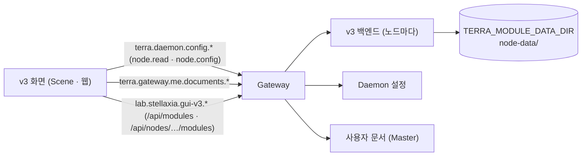

# GUI v3 모듈 백엔드 설계 — 프로세스 · 계약 · 노드 데이터

## 1. 한 줄

GUI v3는 화면만 있는 Scene이 아니라 **모듈**이다. 매니페스트에 프로세스 진입점과 API 계약을 더하면, 노드마다 v3 백엔드가 돌면서 **자기 operation**을 Gateway에 게시할 수 있다.
v3 백엔드가 맡을 일은 하나로 좁힌다. **노드에 붙는 GUI 데이터**(프로필 사진 · 노드 속성)를 그 노드의 모듈 데이터 영역에 저장하는 것이다.
노드 설정(Daemon)과 사용자 취향(사용자 문서)은 지금처럼 화면이 코어 operation을 직접 부른다. 백엔드가 대신 부르지 않는다.

## 2. 근거 — 모듈이 할 수 있는 것 (확인한 사실)

| 사실 | 근거 |
| --- | --- |
| 프로세스를 띄울지는 **kind가 아니라 프로세스 진입점이 있는지**로 정한다. `scene` kind도 모듈 호스트가 받는 kind이고, 진입점이 없으면 `Discovered`에 머물 뿐이다 | Terra `products/common/packages/terra-module-host/manifest.go:117-126` · `manager.go:561-573` |
| 매니페스트 스키마의 `entrypoints`는 `process · worker · library · runtime · scene`을 함께 가질 수 있다 | modules `schemas/manifest-v2.schema.json` (`entrypoints`) |
| 프로세스 모듈은 SDK(`github.com/StellaxiaLab/terra-sdk/modulesdk`)로 리스너를 열고 readiness · operation 처리기를 건다 | `common/io.terra.sample.window/src/main.go:33-62` |
| operation은 모듈의 API 계약(`contracts/api/terra-api.json`)에 선언하고, Gateway가 `/api/modules/<모듈>/v1/…`로 묶는다 | `io.terra.agent/contracts/api/terra-api.json` (`bindings.type: gateway-http`) |
| 계약은 자기 권한 어휘를 정의할 수 있다 (예: `agent.use` · `agent.external`) — GUI 앱은 그 권한을 `contributions.gui.apps[].permissions`에 적는다 | agent 계약 `permissions` · `module.json` |
| `permissions.storage: ["module-data"]`면 호스트가 `TERRA_MODULE_DATA_DIR`(노드의 모듈 전용 디렉터리)를 준다 | `terra-module-host/manager.go:795-800,812-814` |
| Gateway는 모듈에 호출자 머리글(`X-Terra-Principal` · `X-Terra-Subject` · `X-Terra-Delegate` · `X-Terra-Grants`)을 붙인다 — 누가 불렀는지 모듈이 안다 | [[settings-modules\|modules 전수표]] §3 · `tree/io.terra.fleet/src/api.go:17` |
| 원격 노드의 모듈은 `/api/nodes/<노드>/modules/<모듈>/v1/…`로 부른다 (Master 중계) | `node-gui/web/src/api/client.js:208-220` · `ui/nodetalk.js:52` |
| 웹 앱은 frame 프로토콜로 상대 경로에만 Bearer를 붙인다 — 자기 모듈 API를 별도 자격 없이 부를 수 있다 | node-gui `terra-frame-client.js:8,171` |
| 모듈 env 설정은 호스트 아래에서 전달되지 않는다(허용 목록뿐). 모듈 설정은 매니페스트 `configuration.schema`로 받는다 | `terra-module-host/process.go:98-110` |

**확인 못 한 것:** `scene` kind 모듈에 프로세스 진입점을 함께 둔 선례가 이 두 저장소에는 없다. 프로세스와 GUI를 함께 가진 모듈은 전부 `service` kind다(agent · nodetalk · fleet · treebench · sample.window).
그래서 1차는 **kind를 `service`로 바꾸고 Scene 기여를 유지**하는 쪽을 권한다(§7 Q-B1).

## 3. 무엇을 어디서 처리하나



| 일 | 맡는 곳 | 이유 |
| --- | --- | --- |
| 노드 설정 읽기 · 쓰기 | 화면 → 코어 `terra.daemon.config.*` | 권한(`node.config`)이 사람에게 붙어 있어야 한다. 백엔드가 대신 쓰면 v3 operation 권한만 가진 사람이 노드 설정을 바꾸게 된다(권한 세탁) |
| 사용자 취향 (표시 · 뷰 · 스킨 · 스타메이커 보관함) | 화면 → 사용자 문서 `app:lab.stellaxia.gui-v3/…` | 사람을 따라가야 한다. 노드에 둘 이유가 없다 |
| 이 기기 설정 (성능 · 글자 크기 · 도움말) | 화면 → localStorage | 기기마다 다르다 |
| **노드에 붙는 GUI 데이터 (프로필 · 노드 속성)** | **v3 백엔드 → 모듈 데이터 영역** | 그 노드를 보는 모두에게 같아야 하고, 코어에는 GUI가 노드에 파일을 쓰는 길이 없다 |
| 상태 창 집계 (2차) | v3 백엔드 (코어 읽기 op를 모아 한 번에) | 화면이 여러 op를 매초 부르는 대신 한 번 — 단, 읽기 op만 `coreOperations`에 선언 |

## 4. 매니페스트 변경안

지금 `module.json`은 `kind: scene` · `entrypoints.scene`뿐이다. 바꿀 것:

```json
{
  "schemaVersion": 2,
  "id": "lab.stellaxia.gui-v3",
  "version": "0.1.0",
  "kind": "service",
  "entrypoints": {
    "process": {
      "linux-amd64": "bin/linux-amd64/terra-gui-v3",
      "linux-arm64": "bin/linux-arm64/terra-gui-v3",
      "windows-amd64": "bin/windows-amd64/terra-gui-v3.exe"
    },
    "scene": "scene/scene.json"
  },
  "contracts": { "api": "contracts/api/terra-api.json" },
  "permissions": {
    "storage": ["module-data"]
  },
  "readiness": {
    "operationId": "lab.stellaxia.gui-v3.status.get",
    "versionRange": ">=0.1.0 <1.0.0",
    "timeoutMs": 15000
  }
}
```

- `coreOperations`는 1차에 두지 않는다. 상태 집계(2차)를 할 때 읽기 op만 더한다.
- GUI 앱 기여(`contributions.gui.apps[]`)를 만들 때 `permissions`에 화면이 직접 부르는 것(`node.read` · `node.config` · `session.identity`)과 v3 계약 권한(`gui-v3.view` · `gui-v3.customize`)을 함께 적는다.
- 매니페스트를 실제로 바꾸는 것은 백엔드 바이너리가 생길 때다. 진입점만 먼저 적으면 호스트가 실행 파일을 찾지 못해 모듈이 오류 상태가 된다.

## 5. API 계약 초안 (`lab.stellaxia.gui-v3.api`)

모든 operation은 **그 노드 자신의** 데이터만 다룬다. 다른 노드의 것은 그 노드의 v3 백엔드를 `/api/nodes/<노드>/modules/lab.stellaxia.gui-v3/v1/…`로 부른다.

| operation | 바인딩 | 권한 | 위험 | 내용 |
| --- | --- | --- | --- | --- |
| `lab.stellaxia.gui-v3.status.get` | `GET /status` | — | read | readiness · 버전 · 저장 용량 |
| `lab.stellaxia.gui-v3.node-props.get` | `GET /node/props` | `gui-v3.view` | read | `properties.json` 전체 (예: `{profile:{image:"/<노드>/데이터/profile/image/me.gif"}}`) |
| `lab.stellaxia.gui-v3.node-props.patch` | `PATCH /node/props` | `gui-v3.customize` | write | 키 단위로 바꾸기 · 지우기(`null`). 스키마로 검증 |
| `lab.stellaxia.gui-v3.node-files.list` | `GET /node/files?dir=` | `gui-v3.view` | read | 상대 경로 · 크기 · 형식 · 시각 |
| `lab.stellaxia.gui-v3.node-files.get` | `GET /node/files/{path}` | `gui-v3.view` | read | 파일 내용 (형식 머리글 그대로) |
| `lab.stellaxia.gui-v3.node-files.put` | `PUT /node/files/{path}` | `gui-v3.customize` | write | 올리기. 형식 허용 목록 · 크기 한도 · 이름 정리 |
| `lab.stellaxia.gui-v3.node-files.delete` | `DELETE /node/files/{path}` | `gui-v3.customize` | write | 지우기 |

계약이 정의하는 권한 두 개:

| 권한 | 위험 | 뜻 |
| --- | --- | --- |
| `gui-v3.view` | read | 이 노드의 GUI 데이터(프로필 · 속성)를 본다 — 기본 권한 |
| `gui-v3.customize` | write | 이 노드의 GUI 데이터를 바꾼다 — 노드 관리자에게 |

프로필 바꾸기는 화면에서 두 번 부른다: `node-files.put profile/image/<파일>` → `node-props.patch {profile:{image:…}}` → 지난 파일 `node-files.delete`. 원자성이 필요하면 3차에 `profile.put` 하나로 묶는다.

## 6. 저장 구조 · 지킬 것

```text
$TERRA_MODULE_DATA_DIR/
└─ node-data/                ← 화면에서 보이는 "/<노드>/데이터/" 의 v3 부분
   ├─ properties.json        ← node-props
   └─ profile/
      └─ image/<파일>         ← 프로필 하나만 (바꾸면 지난 것은 지운다)
```

| 규칙 | 값 (제안) |
| --- | --- |
| 경로 | 상대 경로만, `..` · 절대 경로 · 심볼릭 링크 거부, `node-data/` 밖으로 못 나감 |
| 형식 | `image/png · image/jpeg · image/gif · image/webp` 만 (내용 앞부분으로 다시 확인) |
| 크기 | 파일 하나 8MB · 노드 전체 64MB (설정 `configuration.schema`로 바꿀 수 있게) |
| 권한 | 파일 0600 · 디렉터리 0700 |
| 감사 | 쓰기 · 지우기는 호출자(`X-Terra-Principal`)와 함께 모듈 로그에 남긴다 |
| 이름 | 파일 이름의 `\ / : * ? " < > |` 는 `_` 로 (시안과 같은 규칙) |

전역 제어 목록의 VFS는 지금처럼 `/<노드>/데이터/` 아래에 이 내용을 얹는다. 화면 쪽 경로 표기는 바뀌지 않고, 저장 위치만 브라우저에서 노드로 옮겨진다.

## 7. 열린 질문

| ID | 질문 |
| --- | --- |
| Q-B1 | `kind: scene` 그대로 프로세스 진입점을 더해도 되나, `service`로 바꿔야 하나 — 호스트 코드상 막는 곳은 없지만 선례가 없다. base Scene · Player 쪽이 `scene` kind만 Scene 후보로 보는지 확인 필요 |
| Q-B2 | 백엔드 언어 — 참조 모듈은 모두 Go + `terra-sdk/modulesdk`. v3도 Go로 할지 |
| Q-B3 | `gui-v3.customize`를 누구에게 주나 — 노드 관리자(`node.config`를 가진 사람)와 같게 할지, 따로 둘지 |
| Q-B4 | 2차 상태 집계에 쓸 코어 읽기 op 목록 (health · 이벤트 · 모듈 상태) |
| Q-B5 | 사용자 문서 한 개의 크기 한도 — 스타메이커 구 파일(표면 그림)이 들어가는지. 안 되면 보관함도 v3 백엔드(사용자별 디렉터리)로 |

## 8. 단계

1. **1차** — 계약 초안 확정 · 백엔드(Go) `status · node-props · node-files` · 매니페스트 변경 · 화면의 프로필을 localStorage에서 백엔드 호출로 교체
2. **2차** — 상태 집계 op(읽기 `coreOperations`) · 원격 노드 프로필 보기
3. **3차** — `profile.put` 묶음 op · 용량 설정(`configuration.schema`)

## 관련 문서

- [[settings-inventory|GUI v3 설정 종합]] — 저장 위치 원칙 · 권고
- [[settings-modules|modules 설정 전수표]] — 매니페스트 필드 · Gateway 경로 · 호출자 머리글
- [[settings-terra-core|Terra 코어 설정 전수표]] — Daemon 설정 API · 권한
- [[menu-hierarchy|메뉴 계층 설계]]
- [[docs/README|GUI v3 문서 MOC]]
