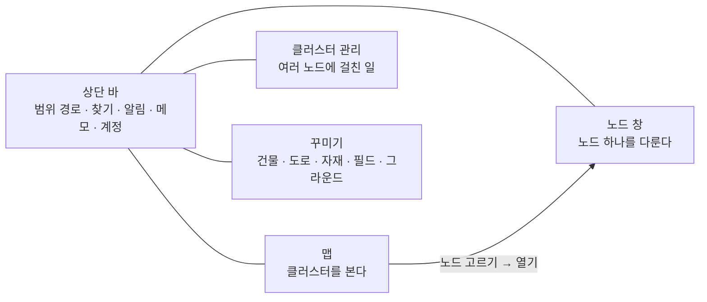
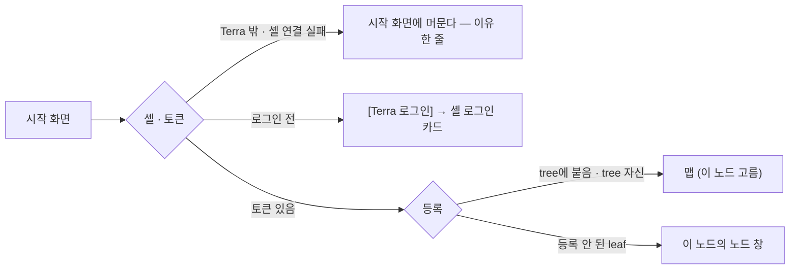

# GUI v3 메뉴 계층 설계

## 1. 한 줄

기존 노드 화면은 같은 기능을 **여러 입구**(조타륜 앱 · 유틸 서랍 · 오버헤드 패널 · 보드 · 노드 데스크톱)에 흩어 놓고, 입구 대부분을 **몸짓**(끌기 · 누르고 있기 · 휠)과 **비유 이름**(조타륜 · 오버헤드 · 서랍)으로 숨겼다.
v3는 **범위(클러스터 · 노드 · 이 기기)를 먼저 고르고 그 안에서 기능을 고르는** 세 단계 이하의 계층으로 바꾼다. 기능 하나에는 집이 하나이고, 다른 곳에서는 그 집으로 가는 링크만 둔다.



## 2. 기존 입구 — 전부

`common/lab.stellaxia.node-gui` 0.4.5 기준. 경로는 그 모듈의 `web/` 아래다.

| # | 입구 | 여는 법 | 담긴 기능 | 대상 범위 |
| --- | --- | --- | --- | --- |
| E-1 | 오버헤드 패널 · 가운데 띠(세션 · 전체 창 리스트) | 띠 누르기 → 리스트가 선체 뒤에서 내려옴 | 세션 · 권한 표시, 전체 화면으로 연 창 목록 | 화면 |
| E-2 | 오버헤드 패널 · 왼쪽 계기판(선택 상태) | 늘 보임 | 선택한 칸의 종류 · 이름 · 램프 9개 | 선택 |
| E-3 | 오버헤드 패널 · 오른쪽 계기판(폴더 보관함) | 계기판 · 램프 누르기 → 사이드 바 | Terra 저장소(공유 폴더) · 폴더 탐색기(local-fs) · 메모장 | 지금 맵 노드 · 개인 |
| E-4 | 관리 노드 창(프사) | 누르기 = 펼침 · 프사 짧게 = 맵 이동 · 누르고 있기 · Ctrl = tree 목록 | tree 전환 · 로그인 창 · 노드 이름 | 클러스터 |
| E-5 | MAP 탭 → 지도 창 | 펼친 관리 노드 창 뒤의 탭을 **끌어서** 놓기 | 트리 계층 지도 · 노드 누르면 이동 | 클러스터 |
| E-6 | 조타륜 | 테이블 네임 박스 누르기 · 아래로 40px 끌기 = 로컬 맵 / 부모 맵 | 맵 이동 · 앱 바 열기 | 지금 맵 노드 |
| E-7 | 조타륜 앱 바(10개) + 앱 전체 화면 | 조타륜 가운데 로고 · ⛶ | SVI 자원 · 자원 선언 · 허가·연결 · I/O 장치 · 공유 폴더 · 파일 전송 · 서비스 터널 · WireGuard · 명령·작업 · 모듈 | 지금 맵 노드(드러나지 않음) |
| E-8 | 유틸 서랍(13칸) | 손잡이 · 휠 순환 · 카드를 옆으로 빼내기 | 속성 · 편집 · 알림 · 메모장 · 네트워크 · 클러스터 · 설정 · 건물 · 도로 · 필드 · 자재 편집기 · 모듈 · 사용자 | 섞임 |
| E-9 | 서브 창(17종) · 서랍창 | 유틸 카드 · 각 동작 · 오른쪽 아래 1/4 구역에 놓기 | 위 기능의 창, 치워 둔 창 카드 | — |
| E-10 | 전체 화면 · 보드(iframe) | 창 ⛶ · 파인 곳 누르면 맵으로 | 편집기 5종 · 네트워크 · 설정 보드 | — |
| E-11 | 타일 선택 → 컴포넌트 상태 창(캡슐) | 칸 누르기 → 캡슐 누르기 | 연결하기 · 도로 종류 · 설정 → 상태 화면(`rst`) · 자원 설정(`rcfg`) | 노드 · 자원 · 도로 |
| E-12 | 원형 메뉴 | 오른쪽 클릭 | 슬롯 8개 — **모두 비어 있음**(첫 칸만 "노드 창 열기", 모듈에서는 숨김) | 칸 |
| E-13 | 편집 창 탭 | 유틸 `편집` | 타일 · 그라운드 · 건물 배치, 편집 모드 | 지금 맵 |
| E-14 | 네트워크 보드 | 유틸 `네트워크` → 창 `graph · board` 탭 → 보드에서 열기 | 사설망 · 연결 진단·라우팅 · 서비스 터널 · 로컬 WireGuard · 조작 이력 | 클러스터 + 노드 |
| E-15 | 설정 보드 | 유틸 `설정` → 보드 | 일반(기기) · 계정 · 로컬 노드(135키) · 로컬 자원 · 클러스터 · 서버 | 기기 + 노드 + 클러스터 |
| E-16 | 클러스터 창(`adm`) | 유틸 `클러스터` | 사용자 · 코어 업데이트 · Fleet · Tree의 Tree (뒤 둘은 틀만) | 클러스터 |
| E-17 | 모듈 GUI 창(`mgui`) | 모듈 카드 🖥 | 모듈이 내놓은 앱 | 노드 |
| E-18 | 노드 데스크톱(구상 · 디자인 보드) | 원형 메뉴 첫 칸 | 자원 · 파일 · 네트워크 · 작업 · 터미널 · 모듈 · 설정 · 정보 | 노드 |

## 3. 문제

| ID | 문제 | 근거 |
| --- | --- | --- |
| **P-1** | **같은 기능의 입구가 여럿이다** | 모듈 = 조타륜 `모듈` 앱 · 유틸 `모듈` 창 · 모듈 GUI 창 · 설정의 모듈·업데이트 분류 · 노드 데스크톱 `모듈` 앱(5곳). 네트워크 = 조타륜 터널 · WireGuard 앱 · 유틸 `네트워크` 창(그래프/보드) · 네트워크 보드 · 설정의 네트워크 분류(5곳). 파일 = 폴더 보관함 · 조타륜 공유 폴더 · 파일 전송 · 설정의 로컬 자원 · 노드 데스크톱(5곳). 사용자 = 유틸 `사용자` · 클러스터 창 사용자 탭 · 설정의 계정 · 클러스터 탭(4곳) |
| **P-2** | **대상 노드가 드러나지 않는다** | 조타륜 앱은 "지금(가는) 맵의 노드"(`hbNode`)의 자원을 다룬다. 맵을 옮기면 같은 버튼이 다른 노드를 겨눈다. 맵의 경로 · 제목 글자는 지워져 있어 지금 어디인지 화면에 없다 |
| **P-3** | **범위가 한 화면 안에 섞인다** | 설정 보드 탭 여섯이 기기(일반) · 계정 · 노드(로컬 노드 · 로컬 자원) · 클러스터(클러스터 · 서버)를 한 줄에 둔다. 네트워크 보드도 T · L 묶음이 섞인다. 유틸 서랍은 선택 · 맵 · 클러스터 · 편집기를 한 줄로 순환한다 |
| **P-4** | **입구가 몸짓에 숨어 있다** | 지도 = 탭 끌어 놓기, tree 목록 = 프사 누르고 있기 · Ctrl, 로컬 맵 = 조타륜 40px 끌어내리기, 유틸 = 휠 순환 · 옆으로 빼내기, 서랍 = 화면 1/4 구역, 맵 복귀 = 파인 곳 누르기. 눈에 보이는 단추가 없다 |
| **P-5** | **창 그릇이 넷이다** | 서브 창 · 서랍창 · 유틸 서랍의 빈칸 · 전체 화면 리스트가 각자 "치워 둔 창"을 갖는다. 같은 창이 어디 있는지 사용자가 기억해야 한다 |
| **P-6** | **선택 정보가 다섯 곳에 나뉜다** | 오버헤드 선택 상태 · 속성 창 · 컴포넌트 상태 창 · 상태 화면 · 자원 설정 창이 같은 칸을 각자 보인다 |
| **P-7** | **비유가 기능을 가린다** | 조타륜 · 오버헤드 패널 · 테이블 · 좌석 · 서랍은 이름만으로 무엇을 하는지 알 수 없다 |
| **P-8** | **빈 자리와 안 되는 자리가 메뉴에 있다** | 원형 메뉴 슬롯 8개가 비어 있다. 설정 `서버` 탭은 "API 없음" 안내뿐이다. 클러스터 창 Fleet · Tree의 Tree 탭은 틀만 있다 |
| **P-9** | **맵 이동 길이 넷이다** | 더블클릭 · 프사 · 지도 창 · 조타륜 끌어내리기. 지금 위치를 보이는 경로(빵 부스러기)가 없다 |

## 4. 원칙

| ID | 원칙 | 푸는 문제 |
| --- | --- | --- |
| **R-1** | **범위 먼저.** 맨 위 갈래는 범위다 — 클러스터(맵 · 클러스터 관리) · 노드(노드 창) · 나와 이 기기(계정 메뉴). 범위가 다른 것을 한 화면에 섞지 않는다 | P-2 · P-3 |
| **R-2** | **집은 하나.** 기능 하나에는 계층 안의 자리가 하나다. 다른 곳에서 필요하면 **그 자리로 가는 링크**를 둔다(복사본을 두지 않는다) | P-1 · P-6 |
| **R-3** | **세 단계 이하.** 영역 → 갈래 → 화면(예: `노드 창 › 자원 › I/O 장치`). 화면 안의 탭 · 분류 · 동작은 계층으로 치지 않는다. 어느 화면이든 세 번 안에 닿는다 | P-1 · P-4 |
| **R-4** | **보이는 단추가 정본, 몸짓은 지름길.** 모든 입구에는 눈에 보이는 단추가 있다. 끌기 · 더블클릭 · 단축키는 같은 일을 빨리 할 뿐이다 | P-4 · P-9 |
| **R-5** | **지금 어디인지 늘 보인다.** 상단 바의 범위 경로가 `클러스터 › 노드 › 화면`을 보이고, 각 조각이 링크다 | P-2 · P-9 |
| **R-6** | **그릇은 셋.** 영역 화면 · 맵의 인스펙터(오른쪽 패널) · 노드 창. 서랍 · 유틸 서랍 · 전체 화면 리스트는 없앤다 | P-5 |
| **R-7** | **기능 이름으로 부른다.** 비유 이름을 메뉴에 쓰지 않는다(§10 용어) | P-7 |
| **R-8** | **없는 것은 메뉴에 두지 않고, 못 하는 것은 잠근다.** 길이 아예 없는 기능은 항목을 두지 않는다. 길은 있으나 권한 · 위임 · 등록이 막는 것은 항목을 두고 🔒 + 이유(기존 원칙 그대로) | P-8 |

## 5. v3 메뉴 계층

### 5.1 전역 틀

```text
상단 바
├─ Terra 로고            → 맵 (처음 화면)
├─ 영역 탭               맵 · 노드 창(열린 것) · 클러스터 관리 · 꾸미기
├─ 범위 경로             tree-home › edge-01 › 파일 › 공유 폴더   (조각마다 링크)
├─ 찾기 (Ctrl+K)         노드 · 자원 · 화면 · 설정 키 이름으로 바로 간다
├─ 알림                  알림 센터 (§5.6)
├─ 메모                  개인 메모 (§5.6)
└─ 계정 메뉴             내 계정 · 이 기기 설정 · 정보 · 로그아웃 (§5.6)
```

- 영역 탭의 `노드 창`은 열린 노드 창 목록이다(노드마다 하나 — 노드 데스크톱 결정 그대로). 하나를 고르면 그 창이 앞으로 온다.
- 찾기는 메뉴 계층을 그대로 색인한다 — 계층에 없는 기능은 찾기에도 없다.

### 5.2 맵 — 클러스터를 본다

```text
맵
├─ 보기
│  ├─ 그래프               노드 · 연결(도로)을 그래프로 — tree → 자식. 레벨 이동은 범위 경로로
│  └─ 표시                 도로 표시 · 표지 모양 · 이벤트 보기(실제 · 동작 · 대기 · 정지 · 실패)
├─ 배치 편집 (켬/끔)        켜면 팔레트가 나온다
│  ├─ 필드 · 그라운드       칸 재질 · 무늬 회전
│  ├─ 건물                 칸 · 노드 모습(건물)
│  ├─ 도로                 칸 하나씩 놓기
│  └─ 노드 자원 설치        노드 창의 자원을 칸에 놓는다
└─ 인스펙터 (오른쪽 패널)   고른 것의 정보와 동작 — §6
```

- 처음 맵은 이 GUI가 도는 노드를 고른 상태로 연다(기존: 처음 맵 = 이 노드의 맵).
- 다른 tree 전환은 기존 결정(Q-5 — 뺀다)대로 두지 않는다.
- 맵 표현(육각 필드를 둘지, 그래프로 바꿀지)은 이 계층과 따로 정한다 — 어느 쪽이든 `보기 › 그래프` 자리가 그 그림이다(§12 Q-M1).

### 5.3 노드 창 — 노드 하나를 다룬다

맵에서 노드를 고르고 인스펙터의 **[노드 창 열기]**(또는 더블클릭 · 오른쪽 클릭 첫 칸)로 연다. 노드마다 창 하나, 최대화 가능(노드 데스크톱 결정). 창 안의 모든 화면은 **그 노드만** 겨눈다 — 창 제목과 범위 경로에 노드 이름이 있다.

```text
노드 창 <노드 이름>
├─ 개요                    상태 · 역할(tree/leaf) · 등록 상태 · 버전 · 가동 시간 · 최근 작업 · 알림
├─ 자원
│  ├─ SVI 자원             목록 · 흐름도 · 열기/닫기 · 흐름 칸
│  ├─ 자원 선언            + 선언 · 철회 · 다시 선언 · 잊기
│  ├─ 허가 · 연결          허가 · 핸들 · 바인딩
│  └─ I/O 장치             승인 · 켜기 · 별명 · 손 등록 · 스캔
├─ 파일
│  ├─ 공유 폴더            탐색 · 올리기 · 받기 · 폴더 만들기 · 지우기 · 공유 폴더 관리
│  ├─ 전송                 진행 · 멈춤 · 이어서 · 치우기
│  └─ 로컬 탐색기          local-fs 최상위 루트(읽기) · 바탕화면에서 열기
├─ 작업
│  ├─ 명령 · 작업          + 실행 · 취소 · 출력 · 다시 실행
│  └─ 터미널               Terra 연결로 명령 (감사 기록 — 노드 데스크톱 결정)
├─ 네트워크
│  ├─ 서비스 터널          선언 · 열린 터널 · 즉석 열기 · 닫기
│  └─ WireGuard            상태 · 동작(동기화 · 올리기/내리기 · 키 교체) · 피어
├─ 모듈
│  ├─ 설치된 모듈          시작 · 멈춤 · 재시작 · 로그 · 설정(모듈이 선언한 칸)
│  ├─ 모듈 앱              모듈이 내놓은 GUI 앱
│  └─ 배포 동의            이 노드에 온 배포 제안 · 동의 · 철회
└─ 설정
   ├─ 노드 설정            135키 6분류(노드 · Master 연결 · 네트워크 · 보안·API · 모듈·업데이트 · 런타임) · 찾기 · 저장 막대 · 재시작 대기
   └─ 등록                 등록 상태 · 붙은 tree
```

- 일곱 갈래는 노드 데스크톱의 **앱 목록(런처) 묶음**과 같다 — 창 안을 데스크톱 모양(아이콘 · 독)으로 그리든 왼쪽 목록으로 그리든 계층은 이것이다(§12 Q-M2).
- `네트워크`에서 이 노드의 네트워크 **설정 키**가 필요하면 `설정 › 노드 설정 › 네트워크`로 가는 링크를 둔다(R-2). 사설망 · 라우팅처럼 여러 노드에 걸친 것은 클러스터 관리에 있다.
- 다른 노드의 창도 같은 계층이다. 노드 주소 호출로 닿지 않는 것(로컬 전용 — 명령 실행 · local-fs · 재시작 등)은 항목을 두고 잠근다(R-8).

### 5.4 클러스터 관리 — 여러 노드에 걸친 일

tree에 붙은 GUI에서만 열린다. leaf가 tree에 등록되지 않았으면 영역 탭은 남기고 "이 노드는 tree에 등록되지 않았다 — 등록은 `terra daemon enroll`" 한 화면을 보인다.

```text
클러스터 관리
├─ 개요                    tree 계층 · 노드 수 · 온라인 · 대기 노드
├─ 노드                    노드 목록 · 이름 · 부모 바꾸기 · 지우기 · 등록 코드 발급 · 폐기
├─ 사용자 · 권한           만들기 · 끄기/켜기 · 암호 · 권한            (M-1)
├─ 네트워크
│  ├─ 사설망               mesh 자동 조정 · 수동 계획 · CIDR · 노드 × 네트워크 배포
│  ├─ 라우팅 · 진단        그래프 · 진단(probe) · 정책 · 세션 · 연결 그룹
│  └─ 조작 이력            내가 한 네트워크 조작
├─ 모듈 배포               카탈로그 · 게시 · 승인 · 롤아웃 · 미러       (M-2)
└─ 코어 업데이트           배포 · 롤백                                (M-3)
```

- Fleet · Cell(M-4)과 Tree의 Tree(M-5)는 **설계 전이라 항목을 두지 않는다**(R-8). 설계가 나오면 `클러스터 관리` 바로 아래 한 줄씩 더한다.
- 기존 설정 보드의 `서버` 탭(값을 읽을 API가 없다)은 `개요`의 안내 한 줄("Master 설정은 tree에서 `terra master config`")로 줄인다.
- Master 쓰기 · 관리자 동작은 ADR-GW-003 2차 전이라 지금은 대부분 🔒다 — 항목은 두고 잠근다.

### 5.5 꾸미기 — 맵에 쓰는 자산

```text
꾸미기
├─ 건물                    블록 설계 · 이벤트 모습
├─ 도로                    팔 · 합류 · 상태 · 방향 이벤트
├─ 자재                    6면 8×8 · 8×8×8 복셀 · 애니메이션
├─ 필드                    타일 스킨
└─ 그라운드                높이 0 바닥 무늬
```

- 자산을 **만드는** 곳이다. 맵에 **놓는** 것은 맵의 배치 편집이다 — 둘을 나눈다(기존: 편집 창 탭과 편집기 넷이 같은 서랍에 섞였다).
- 맵 배치 편집 팔레트의 각 갈래 끝에 "새로 만들기 → 꾸미기"로 가는 링크를 둔다.

### 5.6 상단 바의 개인 · 기기 메뉴

```text
알림                       작업 완료 · 실패 · 새 노드 · 저장 충돌 — 누르면 대상 화면으로
메모                       개인 메모 (만들기 · 고치기 · 지우기 · 폴더)
계정 메뉴
├─ 내 계정                 주체 · 사용자 유형 · 권한 · 토큰 만료
├─ 위임 자격               발급 · 회수
├─ 이 기기 설정            도움말 켬/끔 · 창 투명도 · 새로 고침 주기 · 움직임 줄이기 · 저장 위치(브라우저만 / 서버 문서)
├─ 정보                    GUI 버전 · 이 노드 · 셸 연결
└─ 로그아웃
```

- `이 기기 설정`은 기존 설정 보드의 `일반` 탭이다 — 노드가 아니라 브라우저에 산다는 점을 메뉴 자리로 보인다(R-1).
- 비밀번호 변경 항목은 두지 않는다(기존과 같이 Terra에 길이 없다).

## 6. 선택과 인스펙터

맵에서 무엇을 고르면 오른쪽 인스펙터가 그것 하나를 보인다. 기존의 선택 상태 계기판 · 속성 창 · 컴포넌트 상태 창 · 상태 화면 · 자원 설정 창(P-6)을 이 패널 하나가 대신한다.

| 고른 것 | 머리 | 탭 | 주 동작 |
| --- | --- | --- | --- |
| 노드 | 이름 · 역할 · 상태 점 · 로컬 표시 | 개요 · 놓인 자원 · 연결 · 모습 | **노드 창 열기** · 이 tree로 들어가기(tree만) · 연결하기 |
| 노드 자원 | 이모지 · 이름 · 원본 노드 · 칸 | 개요(모니터링) · 입출력 연결 | 원본 열기(노드 창의 그 화면) · 연결하기 · 철거 |
| 연결(도로) | 양 끝 · 상태 | 상태 · 입출력 설정 · 도로 종류 | 연결 적용 · 나에게 허가 주기 · 끊기 |
| 빈 칸 · 필드 | 칸 좌표 · 재질 | 개요 | (배치 편집 중) 재질 · 건물 · 회전 |
| 아무것도 | 이 맵의 tree | 개요 | — |

- **오른쪽 클릭 메뉴 = 인스펙터의 주 동작과 같은 목록**이다. 빈 슬롯을 두지 않는다(P-8).
- 더블클릭 = 노드면 `노드 창 열기`, tree면 `들어가기`. 단추와 같은 일이다(R-4).

## 7. 그릇 규칙

| 그릇 | 무엇이 들어가나 | 대신하는 것 |
| --- | --- | --- |
| 영역 화면 | 맵 · 클러스터 관리 · 꾸미기 — 화면을 채운다 | 전체 화면 보드 · 전체 화면 리스트 |
| 인스펙터 | 맵에서 고른 것 하나 | 선택 상태 · 속성 · 상태 창 · 상태 화면 · 자원 설정 |
| 노드 창 | 노드 하나의 일곱 갈래 — 떠 있거나 최대화. 여러 개 | 조타륜 앱 바 · 앱 전체 화면 · 서브 창 대부분 · 노드 데스크톱 |

- 서랍창 · 유틸 서랍 · 전체 화면 리스트는 없다. 열린 노드 창은 상단 바 영역 탭 하나에서 찾는다.
- 노드 창 **안**의 창 놀림(새 창 · 끌기 · 맞춤)은 노드 데스크톱 결정을 따른다 — 이 문서는 바깥 그릇만 정한다.

## 8. 진입 상태

메뉴는 로그인한 뒤에 선다. 그 전은 시작 화면 하나다(기존 모듈 프로필 §3과 같은 판).



- 토큰을 잃거나 로그아웃하면 열린 노드 창을 닫고 시작 화면으로 돌아간다(기존: 빈 세계로).

## 9. 기존 → v3 대응

빠뜨린 기능이 없는지 보는 표다. 왼쪽 번호는 §2의 입구.

| 기존 | v3 자리 |
| --- | --- |
| E-1 세션 띠 · 권한 표시 | 계정 메뉴 › 내 계정 |
| E-1 전체 창 리스트 | 없앤다 — 영역 탭 · 열린 노드 창 목록 |
| E-2 선택 상태 계기판 | 인스펙터 머리 |
| E-3 Terra 저장소 | 노드 창 › 파일 › 공유 폴더 |
| E-3 폴더 탐색기 | 노드 창 › 파일 › 로컬 탐색기 |
| E-3 메모장 | 상단 바 › 메모 |
| E-4 tree 전환 · 로그인 창 | 없앤다(Q-5) — tree 안의 레벨 이동은 범위 경로 |
| E-5 지도 창 | 맵 › 보기 › 그래프 + 범위 경로 |
| E-6 조타륜 내리기(로컬 맵 · 부모 맵) | 범위 경로의 조각 · 로고(처음 화면) |
| E-7 SVI 자원 · 자원 선언 · 허가·연결 · I/O 장치 | 노드 창 › 자원 › 각 화면 |
| E-7 공유 폴더 · 파일 전송 | 노드 창 › 파일 › 공유 폴더 · 전송 |
| E-7 서비스 터널 · WireGuard | 노드 창 › 네트워크 › 각 화면 |
| E-7 명령 · 작업 | 노드 창 › 작업 › 명령 · 작업 |
| E-7 모듈 | 노드 창 › 모듈 › 설치된 모듈 |
| E-7 앱 전체 화면 | 노드 창 최대화 |
| E-8 속성 | 인스펙터 |
| E-8 편집 | 맵 › 배치 편집 |
| E-8 알림 | 상단 바 › 알림 |
| E-8 메모장 | 상단 바 › 메모 |
| E-8 네트워크(요약 · 그래프 · 보드) | 클러스터 관리 › 네트워크 (노드 몫은 노드 창 › 네트워크) |
| E-8 클러스터 | 클러스터 관리 |
| E-8 설정 | 노드 창 › 설정 · 계정 메뉴 › 이 기기 설정 · 클러스터 관리 (범위별로 나눈다 — E-15) |
| E-8 건물 · 도로 · 필드 · 자재 편집기 | 꾸미기 › 각 편집기 |
| E-8 모듈 | 노드 창 › 모듈 |
| E-8 사용자 | 계정 메뉴 › 내 계정 (관리는 클러스터 관리 › 사용자 · 권한) |
| E-9 서브 창 · 서랍창 | 없앤다 — §7 |
| E-10 전체 화면 보드 | 영역 화면 |
| E-11 상태 창 · 상태 화면 · 자원 설정 | 인스펙터 탭 |
| E-11 연결하기 · 도로 종류 | 인스펙터 주 동작 · 연결 탭 |
| E-12 원형 메뉴 | 오른쪽 클릭 = 인스펙터 주 동작 |
| E-13 편집 창 탭(타일 · 그라운드 · 건물) | 맵 › 배치 편집 팔레트 |
| E-14 사설망 · 연결 진단·라우팅 · 조작 이력 | 클러스터 관리 › 네트워크 |
| E-14 서비스 터널(tree 쪽 새 터널 · 고정 포트) | 노드 창 › 네트워크 › 서비스 터널 (그 tree 노드의 창) |
| E-14 로컬 WireGuard | 노드 창 › 네트워크 › WireGuard |
| E-15 일반 | 계정 메뉴 › 이 기기 설정 |
| E-15 계정 | 계정 메뉴 › 내 계정 · 위임 자격 |
| E-15 로컬 노드(135키) | 노드 창 › 설정 › 노드 설정 |
| E-15 로컬 자원(공유 폴더 · SVI 선언 · I/O 장치 · 모듈 동의) | 노드 창 › 파일 › 공유 폴더 · 자원 › 자원 선언 · 자원 › I/O 장치 · 모듈 › 배포 동의 |
| E-15 등록 상태 · 첫 실행 마무리 | 노드 창 › 설정 › 등록 · 클러스터 관리 › 개요 |
| E-15 클러스터(사용자 · 권한 · 클러스터) | 클러스터 관리 › 사용자 · 권한 |
| E-15 서버 | 클러스터 관리 › 개요의 안내 한 줄 |
| E-16 사용자 · 코어 업데이트 | 클러스터 관리 › 사용자 · 권한 · 코어 업데이트 |
| E-16 Fleet · Tree의 Tree | 설계 전 — 항목 없음 |
| E-17 모듈 GUI 창 | 노드 창 › 모듈 › 모듈 앱 |
| E-18 노드 데스크톱 앱 | 노드 창 일곱 갈래 (터미널 · 정보 포함) |

## 10. 용어

| 기존 | v3 |
| --- | --- |
| 조타륜 · 조타륜 앱 | 노드 창의 갈래 이름(자원 · 파일 · 작업 · 네트워크 · 모듈) |
| 오버헤드 패널 · 세션 띠 | 상단 바 |
| 관리 노드 창 · 프사 | (없앤다) |
| 유틸 서랍 · 기능 칸 | (없앤다) |
| 서랍창 | (없앤다) |
| 폴더 보관함 | 파일 · 메모 |
| 속성 창 · 상태 창 · 상태 화면 | 인스펙터 |
| 편집 창 · 편집 모드 | 배치 편집 |
| 편집기 5종 | 꾸미기 |
| 클러스터 창 | 클러스터 관리 |
| 노드 데스크톱 | 노드 창 |
| 로컬 노드 | 이 노드 (기존 설정 보드의 용어 규칙과 같다) |

## 11. 기능 층과의 연결

메뉴 자리는 [[legacy-app-layer|기능 층 분석]]의 계약 표(`operations.js` `HELM_APPS`)와 이렇게 맞물린다.

| v3 자리 | 기존 앱 키 · op 묶음 | op 위치 |
| --- | --- | --- |
| 노드 창 › 자원 | `svi` · `decl` · `grant` · `io` | T · L · T · L |
| 노드 창 › 파일 | `folder` · `xfer` · local-fs · desktop.open | L · M · L · L |
| 노드 창 › 작업 | `job` (이 노드면 `tasks.*`) · 터미널(`process.execute`) | T / L |
| 노드 창 › 네트워크 | `tunnel` · `wg` | L |
| 노드 창 › 모듈 | `mod` · `/api/v1/gui/apps` · `modules.offers` · `consent` | L |
| 노드 창 › 설정 | `config.get` · `schema.get` · `patch` · `enrollment.status.get` | L |
| 클러스터 관리 | `nodes.*` · `admin.users.*` · `network.*` · `route.*` · `modules.*`(배포) | T |

- **범위는 op 위치가 아니라 대상이 정한다.** SVI 자원 · 허가 · 원격 노드의 작업은 Master op(T)지만 노드 하나에 대한 것이라 노드 창에 둔다. 클러스터 관리에는 여러 노드에 걸친 것만 둔다.
- 잠금 판단(`lockFor` · `reaches` · `module-gate`)은 메뉴 항목 단위로 그대로 쓴다 — 항목 하나 = 앱 키 하나 또는 op 묶음 하나.

## 12. 남은 질문

| ID | 질문 | 이 설계의 기본값 |
| --- | --- | --- |
| Q-M1 | 맵을 육각 필드로 그릴지 그래프로 그릴지 | `맵 › 보기 › 그래프` 자리. 그림은 따로 정한다 |
| Q-M2 | 노드 창 안을 데스크톱(아이콘 · 독)으로 그릴지 왼쪽 목록으로 그릴지 | 노드 데스크톱 결정(데스크톱)을 따른다. 계층은 같다 |
| Q-M3 | 메모를 어디에 저장할지 — 노드 · 주체마다(기존 LayoutStore) / 사람마다 | 상단 바 = 사람마다로 본다. 기존 메모를 옮길지 함께 정한다 |
| Q-M4 | 노드 자원을 맵 칸에 놓는 기능(설치 · 입출력 연결)을 v3에도 둘지 | 둔다 — 맵 › 배치 편집 › 노드 자원 설치 · 인스펙터 연결 탭 |
| Q-M5 | 작은 화면(모바일) | 정하지 않았다 — 노드 데스크톱 §10-3과 같은 질문 |

## 관련 문서

- [[docs/README|GUI v3 문서 MOC]]
- [[legacy-node-gui-overview|기존 node-gui 전체 분석]]
- [[legacy-app-layer|기존 node-gui 기능 층 분석]]
- 기존 노드 화면 UI 명세 — `common/lab.stellaxia.node-gui/web/docs/screens/node-screen-ui-spec.md`
- 노드 데스크톱 구상 — `common/lab.stellaxia.node-gui/web/docs/guides/node-desktop-concept.md`
- 온보딩 · 관리 화면 공백 분석 — `common/lab.stellaxia.node-gui/web/docs/guides/onboarding-gap-analysis.md`

## 관련 모듈

- `common/lab.stellaxia.node-gui/web/src/screens/node.js` — `WDEF` · `radialItems` · `utilItems` · 조타륜 앱 목록
- `common/lab.stellaxia.node-gui/web/src/api/operations.js` — `HELM_APPS` · `HELM_CRUD`

## 관련 흐름

- §8 — 시작 화면 → 셸 · 토큰 → 등록 → 맵 / 노드 창
- §6 — 맵에서 고르기 → 인스펙터 → 노드 창 열기
