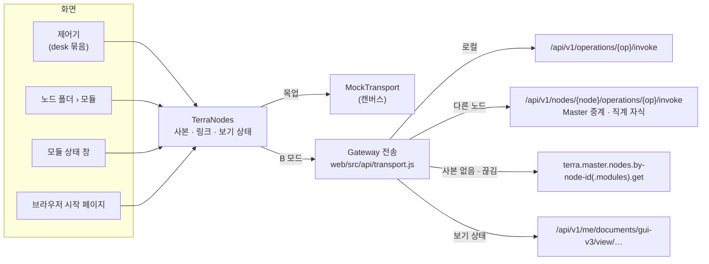

# 노드 데이터와 분할 — PA/EL

GUI v3는 여러 노드를 한 화면에서 다룬다. 노드에 딸린 값(설정 · 모듈 · 장치 · 자원 · 작업)은 **그 노드가 원본**이고, GUI는 사본만 든다.
다른 노드는 언제든 끊길 수 있으므로(꺼짐 · Master 중계 끊김), 끊겼을 때와 평소에 무엇을 고를지를 PACELC 로 정했다 — **PA/EL**.

## 1. 문제 — 제어기가 껐다 켜면 처음으로

0.2.0 의 제어기(노드 데스크톱, `NodeDesktopEmbed`)는 화면 상태와 노드 데이터를 모두 **창 자리(슬롯)의 인스턴스 상태**로 들고 있었다.

- 저장(`persist()`)은 '저장됨' 표시만 바꾸고 아무 데도 쓰지 않았다 → 닫았다 다시 열면 처음 화면
- 다시 열 때 다른 자리에 열리면 기본값, 다른 노드가 쓰던 자리에 열리면 **그 노드의 값이 섞였다**
- 원격 노드의 값도 시안 씨앗(`ndSeed`)에서 만들었다 — 그 노드에서 받아 오는 길이 없었다

## 2. 나눔 — 노드 데이터와 보기 상태

| | 노드 데이터 | 보기 상태 |
| --- | --- | --- |
| 무엇 | 설정 · 모듈 · 장치 · 자원 선언 · 작업 · WireGuard | 창 배치 · 바탕화면 · 아이콘 · 열린 앱 · 설정 탭 · 터미널 기록 |
| 원본 | 그 노드(Daemon) | GUI(사용자) |
| 가져오기 | 노드 데이터 층 `read(노드, 자원)` | `view('desk.<노드>')` |
| 저장 | 그 노드의 operation | 계정 문서 `me/documents/gui-v3/view/desk.<노드>` + 이 브라우저 사본 |
| 분할 때 | 마지막 사본 · 읽기 전용 | 그대로(로컬) |

제어기는 노드 키(`node-key`, 지도 노드 id)로 묶인다. 노드가 바뀌면 지금 보기 상태를 저장하고 그 노드 것을 불러온다 — 자리를 다른 노드가 다시 써도 섞이지 않는다.
보기 상태는 바뀌면 0.5초 뒤에 저장하고, 닫을 때(언마운트) 한 번 더 저장한다.

## 3. 노드 데이터 층 — `TerraNodes`

캔버스 보드 `TerraNodes.dc.html`(씬 · 전역 틀에 `quiet` 로 들어가 `window.TerraNodes` 를 세운다). 모든 화면이 이 층을 거친다.

| 자원 | operation | TTL | 끊겼을 때 사본이 없으면 |
| --- | --- | ---: | --- |
| `status` | `terra.daemon.status.get` | 5초 | `terra.master.nodes.by-node-id.get` |
| `config` | `terra.daemon.config.get` | 60초 | — |
| `modules` | `terra.daemon.modules.get` | 15초 | `terra.master.nodes.by-node-id.modules.get` |
| `offers` · `devices` · `tasks` · `svi` · `wg` | `terra.daemon.*` | 5–30초 | — |
| `desk` | 위 일곱을 함께 불러 제어기 모양으로(보드가 준 `shapes.desk`) | 15초 | — |

실제 응답은 보드가 등록한 모양 함수(`shapes`)가 화면 모양으로 바꾼다 — `modulehost.Status`(`state: running …`) → 모듈 목록(`st: run · stop · fail · restart`), `config` 문서 → 점 키, 작업 큐 → 작업 목록.
모르는 칸은 비워 둔다(지어내지 않는다). 일부 operation 이 실패해도 받은 것만으로 묶음을 만든다.

## 4. 정책 — PA/EL

### E(평소) → 지연

- `read()` 는 사본을 **바로** 돌려준다. 나이가 TTL 을 넘었으면 뒤에서 새로 받는다(stale-while-revalidate). 처음이면 '받는 중'
- `write()` 는 사본에 먼저 반영하고(낙관) 노드로 보낸다. 실패하면 사본을 되돌리고 화면이 '못 함 · 코드' 를 띄운다. 성공하면 다시 받아 맞춘다

### P(분할) → 가용성

분할로 보는 코드: `NODE_OFFLINE` · `RELAY_NOT_CONNECTED` · `NETWORK`(Gateway 에 못 닿음) · `TIMEOUT`(504) · `GATEWAY_UNREACHABLE`(502).

- 마지막 사본을 **나이 · 출처와 함께 읽기 전용**으로 보인다 — `⊘ 끊김 · 3분 전 사본 · 읽기 전용`
- 사본이 없으면 Master 가 마지막으로 관측한 값(`Master 관측`)
- **쓰기는 하지 않는다.** 쌓아 두었다가 돌아왔을 때 보내지 않는다 — 그 사이 노드에서 바뀐 것을 낡은 의도가 덮기 때문. 쓰기 단추는 잠기고 '노드와 끊김 — 읽기 전용(돌아오면 다시)'
- 예외: Master 가 원하는 상태(desired)로 받는 것(모듈 배포 지정)은 노드가 없어도 Master 에 쓴다 — 노드가 돌아오면 스스로 맞춘다
- 끊긴 노드 · 실패한 자원은 **5초에 한 번만** 다시 두드린다(그리기마다 부르지 않는다)

### 그 밖의 링크

| 상태 | 표시 | 쓰기 |
| --- | --- | --- |
| `local` | `⌂ 로컬` | 됨 |
| `online` | `⇄ 원격 · 방금` | 됨(로컬 전용 operation 26개는 잠김 — `op-scope.json`) |
| `offline` | `⊘ 끊김 · N분 전 사본 · 읽기 전용` | 안 됨 |
| `far` | `직접 닿지 않음 · <via> 경유 필요 · 읽기 전용`(`DELEGATION_REQUIRED`) | 안 됨 |
| `none` | `Terra 에 없는 노드 · 시안 자리`(`NODE_NOT_FOUND` · `NODE_UNMAPPED`) | 안 됨 |

## 5. 실행 모드 — A · B · demo

같은 웹 빌드가 어디서 열렸는지 보고 길을 고른다(`src/api/mode.js`). 주소 뒤 `?mode=app|shell` 로 고를 수도 있다.

| 모드 | 언제 | 자격 | 로그인 화면 | 보기 상태 문서 |
| --- | --- | --- | --- | --- |
| A — 앱 | 다른 셸(terra.web/frame)이 모듈 앱으로 감쌌다(부모가 다른 origin) | 셸이 준 앱 토큰 `Bearer tsa_…`, 401 이면 셸에게 새로 받아 한 번 더 | 건너뜀(셸이 이미 로그인) | `app:<앱 id>`(Gateway 가 고정) |
| B — 제품 셸 | 단독으로 열림(제품 셸의 첫 화면) | 스스로 로그인한 자격 핸들 `Handle …` | 씀 | `gui-v3` |
| demo | `?demo` | 없음(목업) | 씀(아무 값) | 이 브라우저 |

A 모드는 hello 를 마운트보다 먼저 보내고(셸이 15초 안에 init 을 주지 않으면 데이터 없이 연다), 토큰이 바뀌면 사본을 버린다. A 모드에서 Master 는 위임 문 37개만 열려 — 지도(`nodes.get`)는 되고 Tree 길(crossboundary)은 안 된다([[terra-reach|Terra 도달 분석]] §5).

## 5-1. B 모드 — 제품 셸로 로그인

[[terra-reach|Terra 도달 분석]]의 B 모드를 기본으로 한다. GUI v3 가 스스로 로그인한다.

1. 로그인 화면의 Login → `POST /api/v1/auth/credentials`(email · password) → **자격 핸들**(토큰은 Gateway 에 남는다)
2. 그 뒤 모든 호출에 `Authorization: Handle <id>` — 사용자 권한 전부(앱 스코프 토큰의 위임 문 37개 제한 없음)
3. 핸들은 이 탭(`sessionStorage`)에만. 로그아웃은 `DELETE /api/v1/auth/credentials` 로 Gateway 에서도 폐기하고 사본을 비운다
4. 로그인 전에는 노드를 두드리지 않는다(`UNAUTHENTICATED` 로 곧바로 답한다)
5. 실패 말 — `CREDENTIAL_REJECTED` 이메일 또는 비밀번호가 맞지 않아요 · `CREDENTIAL_UNAVAILABLE` Master 에 닿지 못해요 · `NETWORK` Gateway 에 닿지 못해요

비밀번호를 GUI 가 받으므로 **제품 셸로 띄울 때만** B 모드다(Windows WebView2 런처 · terra-shell 의 첫 화면). 다른 셸 안에 모듈 앱으로 들어가면 A 모드(스코프 토큰). 주소 뒤 `?demo` 는 Terra 없이 목업.

### 실제 지도 — Master 노드 목록

로그인되면 워프 전환 **전에** `terra.master.nodes.get` 과 로컬 `terra.daemon.status.get` 을 받아 `window.TerraTopology` 를 세운다(`src/api/topology.js`). 씬은 이것이 있으면 시안의 예시(SPECS · 트리마다 행성 6개) 대신 이것으로 항성계를 짓는다(`build` · `PLANETS` · `sceneMap` 이 `rev` 로 다시 짓는다).

| Master 노드 | 씬 |
| --- | --- |
| 다른 노드의 부모이거나 역할에 `tree` · `master` | 트리(항성). `parent_node_id` 로 트리끼리 잇고, 부모가 목록에 없으면 맨 위 |
| 나머지 | 그 부모 트리의 리프(행성) — 트리마다 12 개까지, 이름순 |
| 부모가 목록에 없는 리프 | 그 부모 id 로 이름 없는 트리 'Tree' 를 세워 그 아래 |
| 로컬 Daemon 의 `node_id` | `local` — 전역 틀 '⌖ 로컬' · 로컬 제어기 |

장면 노드는 Terra id(`rid`)를 들고, 전송은 그것으로 부른다. 4초 안에 목록을 못 받으면 시안 지도로 들어가고, 오면 바꾼다. 실제 지도의 노드는 지금 세션의 범위라 Tree 로그인 문이 서지 않는다.
목록을 못 받거나 시안 노드를 부르면(실제 지도 밖) 전에처럼 이름으로 묶고, 못 찾으면 `NODE_UNMAPPED`.

### 제어기 편집 → operation

보내기 전에 사본에 먼저 반영하고(낙관), 끝나면 그 노드에서 다시 받아 맞춘다(`write(…, { refresh })`). 입력 중인 초안(설정 값 · 별칭 글자 · 선언 초안)은 사본에만 있다.

| 화면 | operation |
| --- | --- |
| 모듈 › 시작 · 멈춤 · 다시 시작 · 제거 | `terra.daemon.modules.by-module-id.{start,stop,restart,uninstall}.post` |
| 모듈 › 설정 저장 | `…modules.by-module-id.config.patch { values }` |
| Tree 지정 › 동의 · 철회 | `…modules.offers.by-module-id.{consent,withdraw}.post` |
| 장치 › 승인 · 거절 · 켜기 · 끄기 · 점검 · 잊기 · 별칭(칸을 떠날 때) | `…io.devices.by-device-id.{approve,deny,enable,disable,probe,forget,alias}.post` |
| 자원 선언 › 선언(서비스 = `net` · 폴더 = `file`) · 선언 해제 · 은퇴 잊기 | `…svi.declarations.post` · `…by-family.by-name.undeclare.post` · `…retired.by-family.by-name.forget.post` |
| 서비스 터널 › 닫기 | `…service-tunnels.by-tunnel-id.close.post` |
| 작업 › 취소 | `…tasks.by-task-id.cancel.post` |
| 노드 설정 · 공유 폴더 › 저장 | `…config.patch { set, save: true }` — 이 노드에서만 |
| 노드 › 다시 시작 | `…restart.post` — 이 노드에서만 |

장치는 svi 선언으로 감싸지 않는다(장치 인벤토리가 승인된 장치를 자원으로 내놓는다) — 실제 노드에서 장치 선언은 막고 그렇게 말한다.

### 다른 Tree 로그인

앱 CSP(`connect-src 'self'`) 라 다른 Tree 의 Gateway 를 여기서 부를 수 없다. 그래서 **그 Tree 의 GUI(login_url)로 옮겨 가** 거기서 로그인한다 — 비밀번호는 그 Gateway 만 받는다.
길은 `terra.master.crossboundary.login-routes.get`(부모 · 형제 · 자식), 자식 Tree 는 Tree 로그인 창의 [주소 묻기]가 `…login-routes.by-node-id.resolve.post` 로 주소를 받는다. 주소가 없으면 '로그인 주소가 없음'. 우클릭 › Tree 로그인.

### 밀어 받기

로컬 Daemon 이벤트 스트림(`terra.daemon.events.get`, 스트림 · 이 노드에서만)을 연다(`src/api/push.js`). 이벤트가 오면 건드린 자원(이름으로: 모듈 · 작업 · 장치 · 설정 · 자원 선언 · 상태, 늘 desk)의 사본을 0.3초 묶어 곧바로 다시 받는다. 끊기면 5초부터 두 배씩 최대 60초 뒤 다시 연다. 원격 노드는 스트림이 없어 TTL 그대로.

## 6. 시험

| 어디서 | 무엇 |
| --- | --- |
| `npm test` — `tests/node-data.test.mjs` | 보드 `TerraNodes` 를 모듈로 굽고 PA/EL 을 본다: 처음 받는 중 → 사본 · TTL 안에선 다시 안 부름 · 끊기면 사본 읽기 전용 · 쓰기 거절(나가지 않음) · Master 관측 대체 · 낙관 반영과 되돌림 · 묶음 자원 · 오류 5초 쉼 · 노드별 보기 상태 |
| `npm test` — `src/api/transport.test.mjs` | 핸들 로그인 · 실패 말 · 로그아웃 폐기, Handle 헤더 · 502/504 이름 · `details.via`, 로컬/원격 길 · 노드 묶기 · `NODE_UNMAPPED` · 계정 문서 보기 상태, 로그인 전 차단 |
| `npm test` — `src/api/topology.test.mjs` · `push.test.mjs` | 노드 목록 → 트리 · 리프 · 경로 · 이름 없는 트리 · 12 개 한도 · 로컬 id / 이벤트 → 자원 · 묶어 다시 받기 · 멈춘 뒤 다시 열지 않음 |
| `node tests/smoke.mjs` | 가짜 Gateway 로 B 모드 끝까지: 틀린 비밀번호 말 → 로그인 → **지도 = 노드 목록**(트리 home · lab, 리프 ws-a · ws-b · cam, 로컬 ws-a) → 로컬 제어기 `로컬` · 노드 폴더 모듈 = 실제 응답 → 원격 제어기 노드 주소 호출 → 끊김 `읽기 전용` → 모듈 멈춤이 `stop.post` 로 → 화면 배치가 계정 문서로 → 자식 Tree 주소 묻기 → 그 Tree 의 GUI 로 옮겨 감 |
| 캔버스 | 우클릭 › '끊기 (시험)' · '잇기 (시험)', 보드 '노드 데이터 층'의 사본 표 |

## 7. 실 데이터 현황 (0.2.0)

A · B 모드에서 화면이 무엇을 실제 Terra 에서 읽고, 무엇이 아직 시안 값인가.

| 화면 | 실제 | 아직 시안 값 |
| --- | --- | --- |
| 지도 · 항성계 · 노드 제어 목록 | 트리 · 리프(Master 노드 목록), 로컬 노드 | 리소스 뷰의 위성(자원) — `RESOURCES()` 예시. 노드 제어 목록의 기능 · 데이터 폴더 |
| 전역 틀 기본 정보 · 대상 · 부하 | 경로 · 로컬 위치 | `연결됨 · Terra 코어 1.7.0` · `로그인 admin · 관리자` · 대상 표(상태 · 자원 · 가동) · CPU 42% · MEM 61% · NET 줄 |
| 노드 폴더 › 모듈 · 모듈 상태 창 머리 | 모듈 목록 · 상태 · 버전, 시작 · 멈춤 · 다시 시작 | 모듈 상태 창의 CPU · MEM · 가동 시간 · 경로 · 최근 로그 · 권한 · 내놓는 자원 · GUI 앱 목록(알려진 모듈의 시안 표) |
| 브라우저 창 | 모듈 상태(실행 중인가) | 시작 페이지의 앱 목록 · 앱 화면(시안 srcdoc) |
| 제어기(노드 데스크톱) | 모듈 · 설정 값 · 작업 · 장치 · 자원 선언 · WireGuard 읽기(응답 모양은 가정), 편집 → operation | 상단 바 시계 `10:36` · 알림 `2` · 계정 `stk`, 정보 탭(코어 · OS · 가동), 터미널 명령 답, 파일 관리자 목록, 모듈 로그 탭 · 기능 · 권한 · 앱 탭, 카탈로그 · 피어 · 등록 상태 · 공유 폴더 · 터널(묶음 응답에 없음) |
| 상태 창 · 설정 창 · 자원 창 · 자원 상태 창 | — | 전부 시안 값(노드 데이터 층을 아직 안 거침). 설정 창의 GUI 값(스킨 · 도움말 · 세션)은 이 브라우저 · 프로필 사진은 v3 백엔드 대신 이 브라우저(`terra.fs`) |
| Tree 로그인 창 | 실제 지도의 트리 → login-routes · resolve · 옮겨 가기 | 시안 노드(실제 지도 밖)는 시험 비밀번호 흉내 |
| 스타메이커 | — | GUI 것(이 브라우저에 저장) — 노드 데이터가 아니다 |

## 8. 다음

1. **7 의 시안 값을 걷어내기** — 상태 창(`status` · health) · 자원 창 · 자원 상태 창(svi · grants · handles) · 전역 틀 기본 정보(whoami · status · 자원 사용량) · 모듈 상태 창(by-module-id.get · logs.get · Gateway gui/apps)부터
2. 실제 Terra 에서 응답 모양 맞추기 — 장치 · 자원 선언 · WireGuard · 작업 · 오퍼의 응답 칸 이름은 계약에 스키마가 없어(봉투만) 가짜 Gateway 기준이다. 실제 노드에 붙여 `deskShape` 를 맞춘다
3. 손자 노드 — Master 는 직계 자식만 중계한다(`DELEGATION_REQUIRED · via`). 지도는 그 Master 의 등록 노드만 그리므로 자식 Tree 안은 그 Tree 의 GUI 로 간다
4. 모듈 GUI 목록을 Gateway `gui/apps` · `gui/remote/{node}/apps` 로(지금은 알려진 모듈의 시안 목록)
5. 원격 노드 밀어 받기 — Daemon 이벤트가 로컬 전용이라 지금은 TTL. Master 이벤트가 생기면 그것으로

## 관련 문서

- [[web-architecture|GUI v3 웹 구조]] — 보드 실행 · API 층
- [[terra-reach|Terra 도달 분석]] — 실행 모드 A · B · C, 길마다 규칙
- [[backend|v3 모듈 백엔드 설계]] — 노드에 붙는 GUI 데이터(프로필 · 노드 속성)
- [[settings-inventory|GUI v3 설정 종합]] — 저장 위치 원칙
