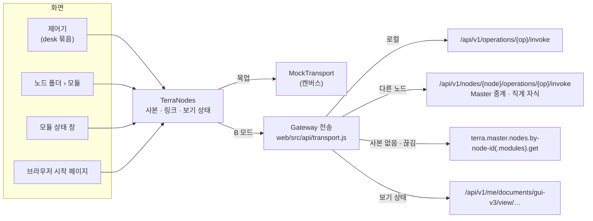

# 노드 데이터와 분할 — PA/EL

GUI v3는 여러 노드를 한 화면에서 다룬다. 노드에 딸린 값(설정 · 모듈 · 장치 · 자원 · 작업)은 **그 노드가 원본**이고, GUI는 사본만 든다.
다른 노드는 언제든 끊길 수 있으므로(꺼짐 · Master 중계 끊김), 끊겼을 때와 평소에 무엇을 고를지를 PACELC 로 정했다 — **PA/EL**.

## 1. 문제 — 제어기가 껐다 켜면 처음으로

0.2.0 의 제어기(노드 데스크톱, `NodeDesktopEmbed`)는 화면 상태와 노드 데이터를 모두 **창 자리(슬롯)의 인스턴스 상태**로 들고 있었다.

- 저장(`persist()`)은 '저장됨' 표시만 바꾸고 아무 데도 쓰지 않았다 → 닫았다 다시 열면 처음 화면
- 다시 열 때 다른 자리에 열리면 기본값, 다른 노드가 쓰던 자리에 열리면 **그 노드의 값이 섞였다**
- 원격 노드의 값도 시안 씨앗(`ndSeed`)에서 만들었다 — 그 노드에서 받아 오는 길이 없었다

## 2. 나눔 — 노드 데이터와 보기 상태

| | 노드 데이터 | 보기 상태 |
| --- | --- | --- |
| 무엇 | 설정 · 모듈 · 장치 · 자원 선언 · 작업 · WireGuard | 창 배치 · 바탕화면 · 아이콘 · 열린 앱 · 설정 탭 · 터미널 기록 |
| 원본 | 그 노드(Daemon) | GUI(사용자) |
| 가져오기 | 노드 데이터 층 `read(노드, 자원)` | `view('desk.<노드>')` |
| 저장 | 그 노드의 operation | 계정 문서 `me/documents/gui-v3/view/desk.<노드>` + 이 브라우저 사본 |
| 분할 때 | 마지막 사본 · 읽기 전용 | 그대로(로컬) |

제어기는 노드 키(`node-key`, 지도 노드 id)로 묶인다. 노드가 바뀌면 지금 보기 상태를 저장하고 그 노드 것을 불러온다 — 자리를 다른 노드가 다시 써도 섞이지 않는다.
보기 상태는 바뀌면 0.5초 뒤에 저장하고, 닫을 때(언마운트) 한 번 더 저장한다.

## 3. 노드 데이터 층 — `TerraNodes`

캔버스 보드 `TerraNodes.dc.html`(씬 · 전역 틀에 `quiet` 로 들어가 `window.TerraNodes` 를 세운다). 모든 화면이 이 층을 거친다.

| 자원 | operation | TTL | 끊겼을 때 사본이 없으면 |
| --- | --- | ---: | --- |
| `status` | `terra.daemon.status.get` | 5초 | `terra.master.nodes.by-node-id.get` |
| `config` | `terra.daemon.config.get` | 60초 | — |
| `modules` | `terra.daemon.modules.get` | 15초 | `terra.master.nodes.by-node-id.modules.get` |
| `offers` · `devices` · `tasks` · `svi` · `wg` | `terra.daemon.*` | 5–30초 | — |
| `desk` | 위 일곱을 함께 불러 제어기 모양으로(보드가 준 `shapes.desk`) | 15초 | — |

실제 응답은 보드가 등록한 모양 함수(`shapes`)가 화면 모양으로 바꾼다 — `modulehost.Status`(`state: running …`) → 모듈 목록(`st: run · stop · fail · restart`), `config` 문서 → 점 키, 작업 큐 → 작업 목록.
모르는 칸은 비워 둔다(지어내지 않는다). 일부 operation 이 실패해도 받은 것만으로 묶음을 만든다.

## 4. 정책 — PA/EL

### E(평소) → 지연

- `read()` 는 사본을 **바로** 돌려준다. 나이가 TTL 을 넘었으면 뒤에서 새로 받는다(stale-while-revalidate). 처음이면 '받는 중'
- `write()` 는 사본에 먼저 반영하고(낙관) 노드로 보낸다. 실패하면 사본을 되돌리고 화면이 '못 함 · 코드' 를 띄운다. 성공하면 다시 받아 맞춘다

### P(분할) → 가용성

분할로 보는 코드: `NODE_OFFLINE` · `RELAY_NOT_CONNECTED` · `NETWORK`(Gateway 에 못 닿음) · `TIMEOUT`(504) · `GATEWAY_UNREACHABLE`(502).

- 마지막 사본을 **나이 · 출처와 함께 읽기 전용**으로 보인다 — `⊘ 끊김 · 3분 전 사본 · 읽기 전용`
- 사본이 없으면 Master 가 마지막으로 관측한 값(`Master 관측`)
- **쓰기는 하지 않는다.** 쌓아 두었다가 돌아왔을 때 보내지 않는다 — 그 사이 노드에서 바뀐 것을 낡은 의도가 덮기 때문. 쓰기 단추는 잠기고 '노드와 끊김 — 읽기 전용(돌아오면 다시)'
- 예외: Master 가 원하는 상태(desired)로 받는 것(모듈 배포 지정)은 노드가 없어도 Master 에 쓴다 — 노드가 돌아오면 스스로 맞춘다
- 끊긴 노드 · 실패한 자원은 **5초에 한 번만** 다시 두드린다(그리기마다 부르지 않는다)

### 그 밖의 링크

| 상태 | 표시 | 쓰기 |
| --- | --- | --- |
| `local` | `⌂ 로컬` | 됨 |
| `online` | `⇄ 원격 · 방금` | 됨(로컬 전용 operation 26개는 잠김 — `op-scope.json`) |
| `offline` | `⊘ 끊김 · N분 전 사본 · 읽기 전용` | 안 됨 |
| `far` | `직접 닿지 않음 · <via> 경유 필요 · 읽기 전용`(`DELEGATION_REQUIRED`) | 안 됨 |
| `none` | `Terra 에 없는 노드 · 시안 자리`(`NODE_NOT_FOUND` · `NODE_UNMAPPED`) | 안 됨 |

## 5. B 모드 — 제품 셸로 로그인

[[terra-reach|Terra 도달 분석]]의 B 모드를 기본으로 한다. GUI v3 가 스스로 로그인한다.

1. 로그인 화면의 Login → `POST /api/v1/auth/credentials`(email · password) → **자격 핸들**(토큰은 Gateway 에 남는다)
2. 그 뒤 모든 호출에 `Authorization: Handle <id>` — 사용자 권한 전부(앱 스코프 토큰의 위임 문 37개 제한 없음)
3. 핸들은 이 탭(`sessionStorage`)에만. 로그아웃은 `DELETE /api/v1/auth/credentials` 로 Gateway 에서도 폐기하고 사본을 비운다
4. 로그인 전에는 노드를 두드리지 않는다(`UNAUTHENTICATED` 로 곧바로 답한다)
5. 실패 말 — `CREDENTIAL_REJECTED` 이메일 또는 비밀번호가 맞지 않아요 · `CREDENTIAL_UNAVAILABLE` Master 에 닿지 못해요 · `NETWORK` Gateway 에 닿지 못해요

비밀번호를 GUI 가 받으므로 **제품 셸로 띄울 때만** B 모드다(Windows WebView2 런처 · terra-shell 의 첫 화면). 다른 셸 안에 모듈 앱으로 들어가면 A 모드(스코프 토큰). 주소 뒤 `?demo` 는 Terra 없이 목업.

### 장면 노드 ↔ Terra 노드

지도 · 항성계는 아직 시안의 노드(`P2:01.01·a` …)를 그린다. 그래서 전송이 묶는다 — 장면의 로컬 노드 = 이 Gateway 의 노드, 나머지는 Master 노드 목록(`terra.master.nodes.get`)에서 이름(`display_name`)이 같은 노드. 못 찾으면 `NODE_UNMAPPED`.
지도를 Master 노드 목록으로 그리는 것은 다음 단계다.

## 6. 시험

| 어디서 | 무엇 |
| --- | --- |
| `npm test` — `tests/node-data.test.mjs` | 보드 `TerraNodes` 를 모듈로 굽고 PA/EL 을 본다: 처음 받는 중 → 사본 · TTL 안에선 다시 안 부름 · 끊기면 사본 읽기 전용 · 쓰기 거절(나가지 않음) · Master 관측 대체 · 낙관 반영과 되돌림 · 묶음 자원 · 오류 5초 쉼 · 노드별 보기 상태 |
| `npm test` — `src/api/transport.test.mjs` | 핸들 로그인 · 실패 말 · 로그아웃 폐기, Handle 헤더 · 502/504 이름 · `details.via`, 로컬/원격 길 · 노드 묶기 · `NODE_UNMAPPED` · 계정 문서 보기 상태, 로그인 전 차단 |
| `node tests/smoke.mjs` | 가짜 Gateway 로 B 모드 끝까지: 틀린 비밀번호 말 → 로그인 → 로컬 제어기 `로컬` · 노드 폴더 모듈 = 실제 응답 → 원격 제어기 노드 주소 호출 → 끊김 `읽기 전용` → 목록에 없는 노드 → 화면 배치가 계정 문서로 |
| 캔버스 | 우클릭 › '끊기 (시험)' · '잇기 (시험)', 보드 '노드 데이터 층'의 사본 표 |

## 7. 다음

1. 지도 · 노드 제어 목록을 Master 노드 목록(`terra.master.nodes.get`)으로 — 장면 노드 묶기를 없앤다
2. 제어기의 편집을 operation 으로 — 지금은 모듈 시작 · 멈춤 · 다시 시작(모듈 상태 창)과 작업 취소만 노드로 가고, 나머지 편집(설정 · 장치 · 자원 선언)은 사본 안 초안이다(`gui-v3.desk.patch`, 노드로 보내지 않음). `config.patch` · `io.devices.*` · `svi.declarations.*` 로
3. Tree 로그인(다른 Tree) — CSP(connect-src 'self') 때문에 그 Tree 의 `login_url` 로 옮겨 가는 길
4. 스트림(`events.get`) 으로 TTL 대신 밀어 받기

## 관련 문서

- [[web-architecture|GUI v3 웹 구조]] — 보드 실행 · API 층
- [[terra-reach|Terra 도달 분석]] — 실행 모드 A · B · C, 길마다 규칙
- [[backend|v3 모듈 백엔드 설계]] — 노드에 붙는 GUI 데이터(프로필 · 노드 속성)
- [[settings-inventory|GUI v3 설정 종합]] — 저장 위치 원칙
