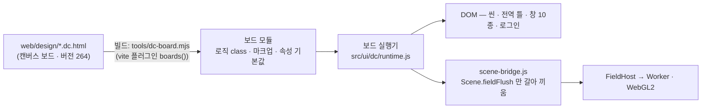
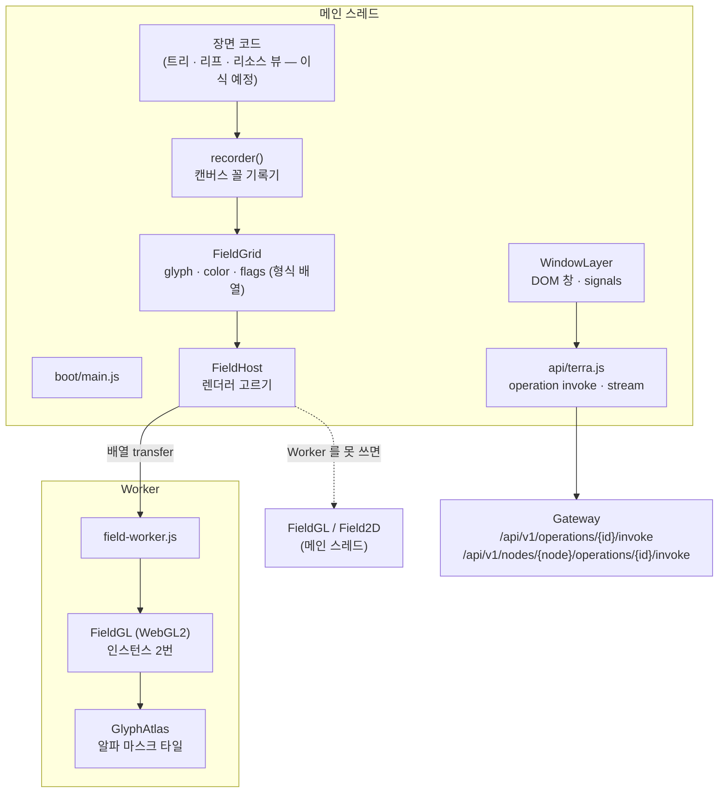

# GUI v3 웹 구조

**결정: 웹으로 간다.** 다른 엔진(Godot · Unity 따위)에서 만들어 웹으로 내보내지 않는다. 대신 웹 안에서 무거운 것(장면)을 GPU 층으로 떼고,
계산은 Worker 로, 창은 DOM 으로 둔다. 이 문서는 그 구조와 첫 단계(글자 장 렌더러)를 적는다.

## 1. 왜 웹인가

| 질문 | 답 |
| --- | --- |
| 화면이 어디서 도는가 | Gateway 가 앱마다 origin 을 나눠 내주는 **샌드박스 웹앱**(`contributions.gui.apps`)이다. 런처도 Windows 는 WebView2, 나머지는 브라우저 앱 모드다 — 결국 브라우저 |
| 다른 엔진의 웹 내보내기는 | 같은 브라우저에서 WASM + WebGL 로 돈다 — 쓸 수 있는 GPU 는 같다. 대신 런타임 수십 MB, 느린 첫 로딩, 한글 IME · 글자 · 복사 · 접근성의 약함, 모듈 GUI 앱(각자 웹앱)과 섞기 어려움을 떠안는다 |
| 창들은 | 설정 · 자원 · 모듈 창은 폼과 목록이다 — DOM 이 가장 잘한다 |
| 무거운 계산은 | Gateway 의 앱 capabilities 에 `workers` · `wasm` 이 있다. 필요할 때 웹 안에서 WASM 으로 |

부하는 엔진이 아니라 **그리는 방식**에서 나왔다 — 시안의 글자 장은 Canvas 2D 로 칸마다 CPU 가 그렸고, 창은 상태 하나에도 컴포넌트 전체를 다시 맞췄다.
그래서 고칠 곳도 그 둘이다.

## 2. 구조

> **0.2.0 — 시안을 그대로 돌린다.** 장면 · 전역 틀 · 창을 손으로 다시 짜지 않고, 캔버스 보드(`web/design/*.dc.html`)를 빌드 때 모듈로 바꿔
> 앱 안의 **보드 실행기**(`src/ui/dc/runtime.js`)로 띄운다. 시안과 웹이 같은 코드라 디자인을 고치면 웹이 그대로 따라온다.
> 장면 층은 그 위에서 바꿨다: 씬이 매 프레임 채우는 칸 기록을 [[#3. 장면 층 — 글자 장|GPU 렌더러]]로(§2.1).

### 2.1 보드 실행

| 부분 | 하는 일 |
| --- | --- |
| `tools/dc-board.mjs` | 보드 파일을 셋으로 — `<helmet>` 의 `<style>`(캔버스 저장소 글꼴 `/_blob/…` · 외부 글꼴 링크는 버림) · 마크업 · 로직 `<script>` 와 `data-props` 기본값. 로직은 **모듈 코드**가 된다(eval · `new Function` 없음 — 앱 CSP `script-src 'self'` 그대로). 보드마다 자기 모듈 범위라 맨 위 상수가 부딪치지 않는다 |
| `vite.config.js` `boards()` | `board:이름` · `virtual:boards`(씬에서 `dc-import` 로 닿는 보드 전부 — 지금 13개) |
| `src/ui/dc/runtime.js` | React 없는 실행기. `{{a.b}}` 값 경로(식 없음) · `<sc-if>` · `<sc-for>`(같은 자리 DOM 재사용) · `<dc-import>`(kebab → camel props, `hint-*` 버림) · `on*`(요소당 리스너 하나, 매 렌더 함수만 교체, onFocus/onBlur 는 거품). 템플릿이 보는 값 = `{ ...props, ...renderVals() }`, `setState` 는 바로 합치고 렌더는 마이크로태스크로 모은다. 수명: 안쪽 보드부터 `componentDidMount`, 떼면 `componentWillUnmount` |
| `src/scene/scene-bridge.js` | 씬 보드의 로직을 이어받아 **`fieldFlush` 만** 바꾼다 — 칸 기록(색 문자열 · 글자 · 굵기, `#bg` · `#hole`)을 `FieldGrid` 로 옮겨 `FieldHost` 에. 바탕 그림(`bgPaint`)은 ImageBitmap 으로 한 번 넘겨 셰이더가 칸 바탕에서 읽는다. GPU 가 서기 전 · 실패하면 시안의 2D 길 |

**메인 스레드에 남은 것(정직하게):** 장면 계산(트리 · 리프 · 리소스 뷰, 융기 · 워프, 노이즈)과 그 위 2D 층(전역 틀 글자 · 3D 구 · 선 · 창 효과)은 아직 메인 스레드다.
Worker 로 간 것은 **글자 장 그리기**(시안에서 가장 무거웠던 칸마다의 `drawImage`)다. 계산을 Worker 로 옮기려면 씬 코드에서 DOM 접근(캔버스 · 상태 · 창)을 떼어야 해서 다음 단계로 둔다(§9).

| 층 | 자리 | 하는 일 |
| --- | --- | --- |
| 장면 층 | `src/scene/` | 장면 코드가 칸 모델에 그리고, 렌더러가 GPU 로 낸다. 되면 Worker 의 OffscreenCanvas, 안 되면 메인의 WebGL2, 그것도 안 되면 Canvas 2D |
| 보드 | `src/ui/dc/` · `tools/dc-board.mjs` | 시안의 씬 · 전역 틀 · 창 보드를 그대로 띄운다(§2.1) |
| 창 층 | `src/ui/` | 장면 위 DOM 창. 지금 앱의 창은 시안의 창 관리(보드 안)를 그대로 쓴다. `WindowLayer`(signals)는 보드 밖 셸 화면용으로 남겨 둔다(§5) |
| API | `src/api/` | Gateway 하나로 operation 을 부른다. 원격 잠금 표는 Terra 계약에서 뽑는다 |
| 입구 | `src/boot/` | 씬 보드를 띄우고 GPU 다리를 건다. `?render=main` · `?gl=2d` · `?gpu=off`(시안 2D 그대로 — 비교용) |

## 3. 장면 층 — 글자 장

### 3.1 칸 모델

시안은 칸마다 문자열 셋(색 css · 글자 · 굵기)을 배열로 들었다. 웹 빌드는 같은 내용을 형식 배열로 든다 —
Worker 로 복사 없이 넘기고(transfer), GPU 버퍼에 그대로 올린다.

| 배열 | 꼴 | 뜻 |
| --- | --- | --- |
| `glyph` | Uint32 | 코드 포인트, 0 = 바탕만 |
| `color` | Uint32 | `0xRRGGBBAA` |
| `flags` | Uint8 | 비트 0–1 굵기(보통 · 볼드 · 틀 미디움 · 틀 볼드), 비트 2 구멍, 비트 3 넓은 글자 |

장면 코드는 바꾸지 않는다 — `recorder()` 가 캔버스와 같은 꼴(`fillStyle` · `font` · `fillText` · `clearRect`)을 내므로, 시안의 장면 코드를 옮겨 와 그대로 그린다.
DOM 을 쓰지 않아 Worker 에서도 돈다.

### 3.2 렌더러

| | 시안(Canvas 2D, `Field2D`) | 웹 빌드(WebGL2, `FieldGL`) |
| --- | --- | --- |
| 매 프레임 | 칸 1.3만 개를 지난 프레임과 견주고, 바뀐 칸만 바탕 사각형 + 글자 타일 붙이기 | 칸 데이터를 버퍼에 한 번(칸당 8바이트) 올리고 인스턴스 두 번(바탕 · 글자)으로 **통째로** |
| 타일 열쇠 | 글자 × **색** × 굵기 — 색이 흐르면 타일이 끝없이 늘어 색을 묶어야 했다(qcss) | 글자 × 굵기 — 색은 셰이더가 입힌다. 타일 수가 글자 종류 수에서 멈춘다 |
| 찌꺼기 | 비교가 놓친 칸에 남을 수 있어 매 프레임 가로줄 하나를 다시 그렸다(보험) | 통째로 그리므로 생기지 않는다 |
| 칸 경계 | 기기 픽셀로 반올림 | 같은 규칙(셰이더의 `floor(c · cw · dpr + 0.5)`) — 배율 1.25 · 1.5 화면에서도 칸이 픽셀에 맞는다 |
| 글자 샘플 | `drawImage` 1:1 | `texelFetch` 1:1 — 필터링으로 번지지 않는다 |

같은 프레임을 두 렌더러로 그려 픽셀을 견줬다(1440×900 일부, 'labels' 부하): 평균 차이 0.6 / 1020(배율 1) · 0.38(배율 2),
크게 다른 픽셀 0개(배율 1) · 27개/92만(배율 2, 한글 가장자리 안티에일리어싱). 눈으로 같은 화면이다.

### 3.3 Worker

`FieldHost` 가 캔버스를 `transferControlToOffscreen()` 으로 Worker 에 넘긴다. 메인 스레드에 남는 일은 칸 배열 복사(13만 바이트 남짓)와 `postMessage` 뿐이다.
버퍼는 두 벌을 돌려 쓰고(ping-pong), 두 벌이 다 나가 있으면 그 프레임은 건너뛴다(`dropped`).

Worker 는 앱 origin 의 파일로 띄운다 — Gateway 앱 CSP(`script-src 'self'`)가 이미 허락하므로 `capabilities: ["workers"]`(blob: Worker 용)가 **필요 없다**.
Vite 가 `new Worker(new URL('./field-worker.js', import.meta.url), { type: 'module' })` 꼴을 보고 따로 굽는다(`ui/assets/field-worker-*.js`).

**다음 단계** — 장면 계산(트리 배치 · 융기 · 워프 · 노이즈)도 Worker 로. 장면 코드는 기록기에 그리므로 그대로 옮겨진다. 그러면 메인은 입력(카메라 · 포인터 · 데이터)만 보낸다.
JS 로 모자란 곳이 측정으로 드러나면 그 부분만 Rust/C++ → WASM(`capabilities: ["wasm"]`).

## 4. 측정

`npm run bench`(= `node tools/bench-field.mjs`) — 같은 부하(`src/scene/workload.js`)를 렌더러마다 같은 프레임 수만큼 그리고 시간을 잰다.

| 부하 | 뜻 |
| --- | --- |
| `idle` | 바탕 노이즈만 천천히(칸 2% 남짓이 바뀜) — 로그인 대기 · 가만히 있는 뷰 |
| `mask` | 색이 연속으로 흐름(칸 대부분이 매 프레임 바뀜) — 융기 · 워프 · 진입 · 하이라이트 |
| `labels` | `mask` + 한글 이름표 · 창 자리 구멍 |

이 저장소의 실행 환경(GPU 없는 헤드리스 Chromium, GL = SwiftShader 소프트웨어)에서 1440×900 · 배율 1 · 칸 13,000개 · 60프레임의 중앙값(p95):

| 부하 | 렌더러 · 자리 | 기록(장면 코드) ms | **그리기 — 메인 스레드 ms** | Worker 안 ms |
| --- | --- | --- | --- | --- |
| idle | Canvas 2D · 메인 | 4.6 | 0.6 (1.5) | — |
| idle | WebGL2 · Worker | 5.2 | **0.2** (4.1) | 1.5 |
| mask | Canvas 2D · 메인 | 10.4 | 7.1 (13.2) | — |
| mask | WebGL2 · Worker | 10.6 | **0.2** (1.2) | 4.0 |
| labels | Canvas 2D · 메인 | 9.5 | 5.2 (12.6) | — |
| labels | WebGL2 · Worker | 9.7 | **0.2** (3.6) | 2.7 |

읽는 법:

- **메인 스레드의 그리기 비용**은 색이 흐르는 장면(mask · labels)에서 5–7ms → 0.2ms 로 준다. 창 · 입력이 쓰는 스레드가 그만큼 빈다. Worker 안의 GL 호출은 1.5–4ms(소프트웨어 GL 포함)다.
- **프레임 간격**은 이 환경에서 믿을 수 없어 표에서 뺐다 — 소프트웨어 GL 의 합성이 프레임마다 수백 ms 씩 튄다(실 GPU 에서는 생기지 않는 비용). 실제 화면의 프레임 시간은 GPU 가 있는 기기에서 `npm run bench -- --gpu --dpr 1,2` 로 잰다.
- **남은 큰 비용은 장면 코드 자체(기록 5–10ms)** 다 — 칸마다 색 문자열을 만들고 푸는 일이 대부분이다. 두 갈래로 줄인다: ① 장면 계산을 Worker 로 옮겨 메인에서 뺀다(§3.3 다음 단계), ② 뜨거운 줄은 `fillStyle` 에 숫자(0xRRGGBBAA)를 넣어 문자열을 건너뛴다(기록기가 받는다).
- 배율 2 는 이 환경에서 소프트웨어 GL 이 너무 느려 표에 넣지 않았다 — 실 GPU 측정과 함께 채운다.

## 5. 창 층

| 파일 | 하는 일 |
| --- | --- |
| `ui/signals.js` | `signal` · `computed` · `effect` · `batch` · `scope` · `untrack`. 바깥 라이브러리 없이 — 더 커지면 같은 이름의 Solid · Preact signals 로 바꾼다 |
| `ui/dom.js` | `h()` — 함수인 속성 · 자식은 그 자리만 고친다. `keyed()` — 열쇠가 같은 줄은 다시 만들지 않는다. 빠진 줄의 효과는 `scope` 로 끈다 |
| `ui/window-layer.js` | 창 종류마다 자리 수(ctl 6 · star 1 · conf 1 · stat 3 · share 1 · res 3), 같은 대상은 창 하나, 다 차면 가장 뒤 창 최소화, 계단식 배치 — 시안의 `ctlOpenWin` 규칙 그대로. 위치는 `transform` 으로만(배치 다시 계산 없음), 창마다 `contain: layout paint` |

1초마다 흐르는 값(자원 상태 창의 그래프 · 상태 창)은 그 값에 묶인 DOM 자리만 고친다. 긴 목록(장치 · 모듈 · 로그)은 보이는 줄만 그린다(가상 목록 — 다음).

**0.2.0:** 앱의 창(제어기 · 스타메이커 · 설정 · 상태 · 자원 · 자원 상태 · Tree 로그인 · 모듈 상태 · 브라우저)은 시안의 창 관리(전역 틀의 `ctlOpenWin` — 자리 0–20, 레거시 생성 · 소거 효과, 최소화 판)를 보드 실행기로 그대로 띄운 DOM 창이다. 위 `WindowLayer` 는 같은 규칙의 signals 판으로, 씬 밖 화면(설치 · 진단 따위)이 생기면 쓴다.

## 6. API

| 파일 | 하는 일 |
| --- | --- |
| `api/terra.js` | `invoke(id, input, { node })` — 이 노드는 `/api/v1/operations/{id}/invoke`, 다른 노드는 `/api/v1/nodes/{node}/operations/{id}/invoke`(Master 중계). `stream()` — 티켓(30초) → WebSocket |
| `api/op-scope.json` | Daemon operation 78개의 원격 개방(`availability.scopes`) · 권한 · 위험도. **그 노드에서만인 것 26개** — 원격 제어기의 잠금 표시가 읽는다. `tools/gen-op-scope.mjs --terra <체크아웃>` 이 Terra 계약에서 뽑고, `--check` 로 어긋남을 본다 |
| `api/node-data.js` | v3 백엔드 — 프로필 · 노드 속성([[backend\|백엔드 설계]]) |

`canRemote(id)` 가 false 인 operation 을 다른 노드로 부르면 나가기 전에 `LOCAL_ONLY` 로 멈춘다.

명령 실행(`terra.daemon.commands.execute`)은 `command` 와 `args` 를 **빈칸으로 이어 붙여 시스템 셸에 한 줄로** 넘긴다(계약 설명).
그래서 제어기의 "파일에서 설치"(`terra module install <파일> --grant-reviewed …`)는 경로를 셸에 맞게 감싼다 — `shellArg()` · `moduleInstallCommand()`.

## 7. 앱 · 포장

| 항목 | 값 |
| --- | --- |
| 앱 | `contributions.gui.apps[0]` — `lab.stellaxia.gui-v3.web`, `static`, `ui/index.html`, `sandboxed`, capabilities 없음 |
| 빌드 | `web/` → `../ui`(Vite, `base: './'` — Gateway 가 `/api/v1/gui/apps/<앱 id>/files/` 아래에서 낸다). `ui/` 는 산출물이라 커밋하지 않는다 |
| 글꼴 | 앱 CSP 가 `font-src 'self' data:` 라 앱 안에서 낸다(`src/ui/fonts.css`): Geist · Geist Mono(OFL, @fontsource). 한글은 시안의 **GmarketSans 자리에 Pretendard Variable(OFL, dynamic subset 92조각)** — GmarketSans 파일은 배포 조건을 확인한 뒤 같은 이름으로 바꿔 넣는다(보드의 글꼴 스택을 고치지 않으려고 이름을 그대로 둔다) |
| 런처 | 지금 있는 것 — Windows WebView2 런처, 그 밖은 terra-shell(브라우저 앱 모드). 별도 엔진 · Electron · Tauri 없음 |

## 8. 시험

| 명령 | 보는 것 |
| --- | --- |
| `npm test` | 칸 모델 · 색 · 기록기 · 타일 배치 · 부하 · signals · 창 자리 규칙 · operation 호출 · 원격 잠금 · 셸 인자 · 백엔드 클라이언트 · **보드 → 모듈(씬에서 닿는 보드 전부가 모듈 문법으로 맞는지)** (브라우저 없이) |
| `node tests/smoke.mjs` | 구운 `ui/` 를 Gateway 와 같은 CSP 로 내고 Chromium 으로 연다 — 씬 보드(보드 24개 인스턴스)가 Worker+WebGL2 · 메인 WebGL2 · Canvas 2D 세 길로 서는지, 로그인 → 트리 뷰, 제어기 창, 모듈 상태 › GUI ↗ → 브라우저 창, 오류가 없는지 |
| `npm run bench` | 렌더러 비교(§4) |

## 9. 다음

0.2.0 에서 시안 전체(씬 · 전역 틀 · 창)가 웹 빌드에서 돈다. 남은 것:

1. 장면 계산을 Worker 로 — 씬 코드의 DOM 접근(캔버스 · `setState` · 창)을 떼어 칸 기록 계산만 Worker 에서. 지금은 그리기만 Worker
2. 전역 틀 글자 층(`data-gf`)과 로그인 장면의 글자 장도 같은 GPU 렌더러로, 별 · 궤도 · 행성(3D 2D 층)을 같은 GL 층으로
3. 시안의 예시 값을 api 호출로 — 로그인 · Tree 로그인(Gateway auth) · 모듈 상태(daemon modules) · 브라우저(Gateway gui/apps) · 제어기 앱
4. GmarketSans 파일 · 가상 목록 · 실 GPU 에서 `npm run bench -- --gpu`

## 관련 문서

- [[docs/README|GUI v3 문서 MOC]]
- [[backend|v3 모듈 백엔드 설계]] — 계약 · 저장 규칙
- [[menu-hierarchy|메뉴 계층 설계]] — 창 갈래
- [[settings-inventory|GUI v3 설정 종합]] — 저장 위치 원칙
