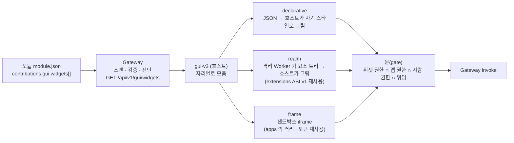

# 제안 — 모듈이 GUI 에 컴포넌트(위젯)를 넣는 길

> 이 문서는 **코어(Terra)가 읽고 구현하도록** 쓴 제안이다. §7 이 코어가 할 일 목록(완료 조건 포함), §8 이 gui-v3 가 할 일이다.
> 읽는 순서: §1 한 줄 → §2 지금 Terra 에 있는 것 → §4 세 종류 → §5 매니페스트 → §7 코어 할 일.

## 1. 한 줄

모듈이 **창 하나를 통째로**(`contributions.gui.apps`) 넣는 길은 있지만, GUI 의 **정해진 자리(slot)에 작은 컴포넌트**(전역 틀 칸 · 상태 창 카드 · 우클릭 항목 · 바탕화면 위젯 · 값 뷰어)를 넣는 길은 없다.
`contributions.gui.widgets[]` 를 새로 두고, 위젯을 **선언형 · realm · frame** 세 종류로 받아, 권한은 지금의 문(위임 · 앱 권한 · 사람 권한)을 그대로 지나게 한다.

## 2. 지금 Terra 에 있는 것 (실측)

| 무엇 | 어디 | 상태 |
| --- | --- | --- |
| `contributions.gui.scenes` | Gateway `gui.go` · `GET /api/v1/gui/scenes` | 됨 — 모듈의 **전체 화면** Scene |
| `contributions.gui.apps` | `gui_apps.go` · `GET /api/v1/gui/apps` · `…/files/{path}` · 원격 `GET /api/v1/gui/remote/{node}/apps` · 앱 토큰 `POST …/remote/{node}/{module}/{app}/token` | 됨 — 창 하나(static · window · proxy), `isolation: sandboxed`, `embed`, 앱 권한으로 좁힌 토큰. gui-v3 가 모듈 GUI 창으로 쓴다 |
| `contributions.gui.renderers` | `gui.go` | 스캔은 됨 |
| `contributions.gui.extensions` | `gui_extensions.go` · `GET /api/v1/gui/extensions` · `…/{id}/bundle` | 됨 — Scene Player 용. kind 7개(behavior · animation · renderer · function · library · module-adapter · storage-adapter), 번들은 **격리 Worker realm**(ABI v1)에서 평가, realm 은 요소 트리만 내고 신뢰된 호스트가 그린다(WS6 · D-12). **설치 = 선언 권한 허용**, Scene 이 선언 안 하면 `EXTENSION_PERMISSION_UNDECLARED` |
| Scene Slot 에 다른 모듈의 Fragment 기여 | 설계만(`terra-module-data-contract-ui-contribution-detailed-design` §17 `fragment`) | **구현된 적 없음** — 실험 결과 `CONTRIBUTION_FRAGMENT_MISSING`(`terra-module-gui-contribution-path-judgment` §10.2) |
| 판단 문서 권고 | `terra-module-gui-contribution-path-judgment` §8 A안 | 모듈 GUI 기본 = 계약 파생, 탈출구 = 자유 저작 App, Scene 은 제품 base 화면 |

빈칸은 하나다: **모듈 → 다른 화면(gui-v3)의 작은 자리**. Scene Slot 기여(Fragment)는 Scene Player 화면에만 해당하고 gui-v3 는 Scene Player 가 아니라서(캔버스 보드 · 창 층 DOM) 그 길로도 닿지 않는다.
이 제안은 Scene 경로를 살리자는 것이 아니다 — **이미 선 두 부품(apps 의 격리 · 토큰, extensions 의 realm)을 재사용**해 작은 자리를 연다.

## 3. 자리(slot) — gui-v3 가 여는 곳

자리 id 는 `<호스트>.<자리>` — 호스트가 gui-v3 이면 `v3.` 를 붙인다(다른 GUI 가 같은 자리를 정의할 수 있게).

| 자리 id | 화면 | 크기(px) | 호스트가 넘기는 맥락 |
| --- | --- | --- | --- |
| `v3.frame.panel` | 전역 틀 정보 칸 한 줄 묶음 | 가로 맞춤 × 3–8줄 | 고른 노드 id |
| `v3.node.menu` | 노드 우클릭 항목(눌러 위젯 · 창 열기) | 항목 1줄 | 노드 id · 종류(tree · leaf · res) |
| `v3.node.status.card` | 상태 창 아래 카드 | 520 × 80–240 | 노드 id |
| `v3.desk.widget` | 제어기 바탕화면 위젯 | 160–480 × 120–360 | 노드 id |
| `v3.desk.dock` | 제어기 아래 바 단추 → 창 | 단추 1 | 노드 id |
| `v3.alarm.kind` | 알림 종류(모듈이 낸 사건을 알림 줄로) | 줄 1 | 노드 id · 사건 |
| `v3.svi.viewer` | 자원 상태 창 값 뷰어(형식별) | 560 × 200–360 | 자원 id · 끝점 · `output_schema` |

자리마다 **크기 상한 · 맥락**은 호스트가 정한다(위젯은 그 안에서 그린다). 같은 자리에 여럿이면 `order` → 모듈 id 순.

## 4. 위젯 세 종류



| 종류 | 모듈이 주는 것 | 실행 | 모양 | 쓸 때 |
| --- | --- | --- | --- | --- |
| **declarative** (기본) | JSON — 데이터 op · 갱신 주기 · 표시 형식(값 · 막대 · 목록 · 표 · 스파크라인 · 단추) · 칸 이름 | 코드 없음. 호스트가 op 를 부르고 그린다 | **호스트 스타일 그대로**(라벨식 문구 · 레거시 선) | 상태 카드 · 정보 칸 · 단순 조작 단추 — 대부분 |
| **realm** | JS 번들 1개(CommonJS · ABI v1) — 입력 맥락 · 데이터 → 요소 트리 | 격리 Worker realm(전역 없음, 네트워크 없음). op 는 호스트에 요청해서만 | 호스트가 요소 트리를 자기 컴포넌트로 그림 | 계산이 필요한 표시(그래프 가공 · 형식 해석) · **값 뷰어 렌더러** |
| **frame** (탈출구) | `ui/` 의 HTML(앱 자산처럼) | 샌드박스 iframe, 위젯 토큰(앱 토큰과 같은 길, 위젯 권한으로 좁힘) | 모듈 마음대로(호스트는 테마 변수만 넘김) | 대화창(Terra Agent) · 미리보기 · 자유 화면 |

**하지 않는 것**: 모듈 코드를 호스트 문맥에서 그대로 실행(사용자 세션 권한을 그대로 가져감), 다른 모듈의 위젯 덮어쓰기 · 숨기기, 위젯끼리 직접 통신(1차 범위 밖).

## 5. 매니페스트 — `contributions.gui.widgets[]`

| 칸 | 필수 | 뜻 |
| --- | --- | --- |
| `id` | ✓ | 모듈 안에서 유일. 전역 id = `<moduleId>/<id>` |
| `slot` | ✓ | §3 자리 id(여럿이면 배열). 모르는 자리는 진단(`GUI_WIDGET_SLOT_UNKNOWN` — 호스트가 판정, Gateway 는 통과) |
| `kind` | ✓ | `declarative` · `realm` · `frame` |
| `title` | ✓ | 자리 머리 · 메뉴 이름(짧게, 라벨식) |
| `permissions` |  | 위젯이 부를 op 의 권한. **앱 권한 · 사람 권한과 교집합** — 넓힐 수 없다 |
| `source` | declarative | `{ op, input?, every? }` — 읽기 op(위험도 read 만). 쓰기는 `actions[]` |
| `view` | declarative | `{ type: value\|bar\|list\|table\|spark, fields[], units? }` |
| `actions` |  | `[{ label, op, input?, confirm? }]` — 쓰기 op. 위험도 write 이상은 호스트의 공용 확인 단계를 반드시 거침 |
| `entry` | realm · frame | 모듈 디렉터리 안 경로(탈출 금지 — Scene · extension 과 같은 `resolveWithin`) |
| `abi` | realm | `1`(extensions ABI v1) |
| `accepts` | `v3.svi.viewer` 자리 | 받는 `output_schema` 무늬(예 `terra.video.*`) |
| `size` |  | `[w, h]` 바람 — 호스트 상한 안에서 |
| `order` |  | 같은 자리 안 순서(작을수록 앞) |
| `products` |  | `leaf` · `tree`(없으면 모듈 compatibility) |

```json
"contributions": { "gui": { "widgets": [
  { "id": "status", "slot": "v3.node.status.card", "kind": "declarative", "title": "카메라",
    "permissions": ["node.read"],
    "source": { "op": "io.lab.camera.devices.get", "every": "10s" },
    "view": { "type": "list", "fields": ["name", "state", "fps"] },
    "actions": [ { "label": "다시 시작", "op": "io.lab.camera.devices.restart.post", "confirm": true } ] },
  { "id": "h264", "slot": "v3.svi.viewer", "kind": "realm", "title": "h264 영상",
    "entry": "ui/widgets/h264.js", "abi": 1, "accepts": ["terra.video.*"] },
  { "id": "chat", "slot": ["v3.frame.panel", "v3.desk.widget"], "kind": "frame", "title": "에이전트",
    "entry": "ui/chat.html", "size": [360, 320], "permissions": ["node.read"] }
]}}
```

## 6. 권한 · 감사

- **실효 권한 = 위젯 `permissions` ∩ 그 GUI 앱의 권한 ∩ 사람의 권한 ∩ (원격이면) 위임 · 도달 범위.** 위젯은 GUI 보다 넓을 수 없다.
- declarative · realm 의 op 호출은 **호스트가 대신** 부른다 — 호스트의 문(gui-v3 `src/api/gates.js` · Gateway 판정)을 그대로 지나고, 잠기면 `잠김 : <원인> — <op>` 로 보인다.
- frame 은 iframe 이 Gateway 에 직접 부른다 — **위젯 토큰**(앱 토큰과 같은 발급 길, 권한 = 위 교집합, 만료 짧게)으로.
- 감사: 위젯이 부른 호출은 대리인 표지 `widget:<moduleId>/<id>` 를 단다(앱 토큰의 delegate 처럼) — 누가(사람) · 어디서(위젯) 불렀는지가 남는다.
- 설치 = 선언 허용(extensions 와 같은 원칙). 단, 쓰기 `actions` 는 사람이 누를 때만 · 확인 단계를 지난다 — 위젯이 스스로 쓰기를 하지 않는다.

## 7. 코어(Terra)가 할 일

| # | 할 일 | 완료 조건 |
| --- | --- | --- |
| **C1** | Gateway 가 `contributions.gui.widgets[]` 를 스캔 · 검증 · 진단 — `GET /api/v1/gui/widgets` (`gui_extensions.go` 와 같은 자리, 같은 재스캔 규칙) | 필수 칸 · `kind` · `entry` 탈출 · 파일 존재를 검사하고 위반은 `/api/v1/gui/diagnostics` 와 같은 꼴로. 목록 항목 = 선언 + `moduleId` · `moduleVersion` · `products` |
| **C2** | 자산 서빙 — realm 번들 `GET /api/v1/gui/widgets/{id}/bundle`(extensions bundle 과 같은 한 파일 규칙), frame 자산 `GET /api/v1/gui/widgets/{id}/files/{path}`(apps files 와 같은 origin · CSP 규칙) | 다른 모듈 디렉터리 · 상위 경로 접근 불가 시험 |
| **C3** | 원격 노드 위젯 — `GET /api/v1/gui/remote/{node}/widgets` (`gui_remote.go` 와 같은 중계) | 그 노드가 보고한 위젯만, 도달 범위 밖이면 빈 목록 + 사유 |
| **C4** | frame 위젯 토큰 — 앱 토큰 발급(`gui_remote_token.go`)을 위젯 id 로 확장, 권한 = §6 교집합 | 위젯 선언보다 넓은 op 는 403, 토큰 만료 · 폐기 시험 |
| **C5** | 감사 표지 — 위젯 경로로 들어온 invoke 에 `widget:<moduleId>/<id>` 대리인 표지 | 감사 기록에서 사람 · 위젯이 함께 보인다 |
| **C6** | 매니페스트 문서 · 검사 — 매니페스트 v2 문서에 `widgets` 모양, `terra module validate` 가 같은 검사 | 잘못된 선언이 설치 전에 잡힌다 |
| (선택) **C7** | realm 실행기를 Scene Player 밖에서도 — `@terra/player` 의 Worker realm(ABI v1) 을 독립 패키지로 | gui-v3 가 Player 없이 realm 을 띄울 수 있다(없으면 gui-v3 가 사본을 둔다) |

열지 않는 것: Gateway 가 위젯을 그리거나 자리를 아는 것(자리는 호스트 몫 — Gateway 는 선언을 실어 나르기만), 위젯 전용 권한 체계(기존 권한 이름만 쓴다).

## 8. gui-v3 가 할 일 (코어와 병행)

1. 자리 일곱 곳(§3)에 **기여 꽂는 칸** — 기여가 없으면 비어 있고 화면은 그대로.
2. `src/api/widgets.js` — `GET /api/v1/gui/widgets`(+ 원격) 를 읽어 자리별 목록, 순서 · 크기 상한 · 모르는 자리 진단.
3. declarative 렌더러 — 표시 형식 다섯(값 · 막대 · 목록 · 표 · 스파크라인) + 단추, 화면 문구 규칙(라벨식)을 따른다.
4. realm 호스트 — Worker realm 을 띄우고 요소 트리를 창 층 DOM 으로(Player 코드 재사용 또는 C7).
5. frame 호스트 — 앱 창과 같은 샌드박스 iframe, 테마 변수 전달, 위젯 토큰.
6. 모든 호출은 문(`TerraGate`)과 공용 확인 단계를 지난다.
7. 시안 모드: 예시 위젯 셋(카메라 카드 · 값 뷰어 · 대화창 틀)으로 자리를 보여 준다 — 실제 모드에서 새지 않게.

C1 · C2 전까지 gui-v3 는 시안 모드에서만 자리를 보인다. C1 이 서면 declarative 부터 실제로 붙는다(C2 없이도 됨).

## 9. 첫 실사용자

판단 문서의 지적 그대로 — **쓰는 사람이 없는 기여 경로는 검증되지 않는다.** 처음부터 둘을 실제로 붙인다.

| 모듈 | 위젯 | 종류 · 자리 | 검증하는 것 |
| --- | --- | --- | --- |
| `lab.stellaxia.agent`(Terra Agent) | 대화창 | frame · `v3.frame.panel` · `v3.desk.widget` | frame 격리 · 위젯 토큰 · 감사 표지 |
| (카메라 류 모듈) | 상태 카드 + h264 값 뷰어 | declarative · `v3.node.status.card`, realm · `v3.svi.viewer` | 선언형 렌더 · realm 렌더러 · `accepts` |

## 10. 열린 결정

| # | 결정할 것 | 선택지 | 권고 |
| --- | --- | --- | --- |
| W1 | 새 키냐 기존 키냐 | `gui.widgets[]` 새로 / `gui.extensions[]` 에 kind `widget` 더하기 | **새 키** — extensions 는 Scene 이 id 로 거는 의존(`SceneExtensionRef`)이고, 위젯은 호스트가 자리로 거는 기여라 소비 방식이 다르다. realm 번들 규칙만 공유 |
| W2 | 자리 id 를 누가 정의하나 | 호스트별 / 코어 공용 표 | **호스트별**(`v3.` 접두) — 코어는 실어 나르기만 |
| W3 | declarative 표시 형식 | 다섯 + 단추 / 더 많이 | 다섯부터, 실사용으로 늘림 |
| W4 | 원격 노드 위젯을 보일지 | 로컬만 / 도달 범위 안 전부 | 도달 범위 안 전부(문이 가린다) |
| W5 | frame 위젯 토큰 수명 | 창 열림 동안 / 고정 만료 | 고정 짧은 만료 + 창이 열려 있으면 갱신 |

## 11. 관련

- Terra: `docs/modules/terra-gui/design/terra-module-gui-contribution-path-judgment.md` · `terra-module-data-contract-ui-contribution-detailed-design.md` §17–18 · `terra-scene-extension-execution-detailed-design.md`(WS6 · realm ABI v1) · Gateway `gui_apps.go` · `gui_extensions.go` · `gui_remote*.go`
- gui-v3: [[web-architecture|웹 구조]] · [[terra-reach|도달 분석]] · [[desk-flows|문(gate) · 공용 확인 단계]] · [[svi-view|값 보기 — h264 등 못 푸는 형식]]
