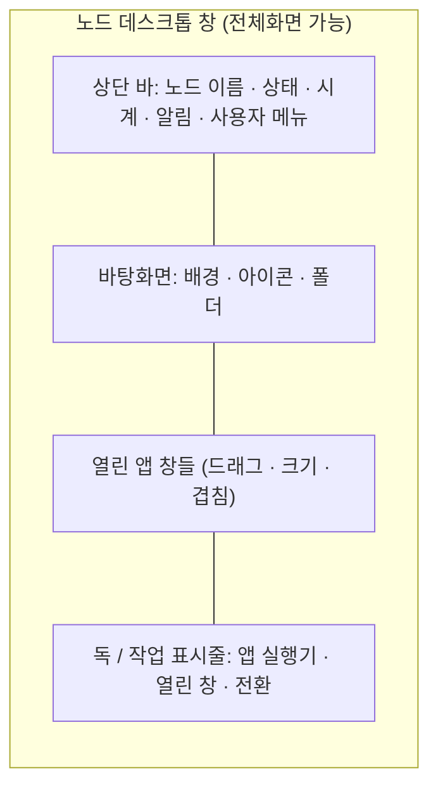

# 노드 데스크톱 — 노드 하나를 위한 창

> [!NOTE] 상태
> 아이디어 정리 + 첫 디자인 보드(`web/design/NodeDesktop.dc.html`)다. 구현은 아직 없다. §9의 결정은 2026-10-13에 정했고, 남은 질문만 §10에 둔다.

## 1. 한 줄

**맵은 노드들 전체를 보는 화면이고, 노드 데스크톱은 노드 하나 안으로 들어가 그 노드의 자원 · 설정 · 파일 · 작업을 다루는 창이다.** 모양은 일반 데스크톱(Ubuntu · Windows)을 닮는다. 하지만 OS를 흉내 내는 것이 아니라, *노드를 관리하는 일을 데스크톱이라는 익숙한 틀로 풀어 놓은 것*이다.

| | 맵 | 노드 데스크톱 |
| --- | --- | --- |
| 범위 | 모든 노드 · 연결 · 건물 · 도로 | **노드 하나** |
| 비유 | 지도 · 관제실 | 그 노드의 바탕화면 |
| 하는 일 | 무엇이 어디에 있고 어떻게 이어졌는지 본다 | 그 노드의 자원 · 설정 · 파일 · 작업을 만진다 |
| 진입 | 첫 화면 | 맵에서 노드를 열면 창으로 뜬다 (전체화면 가능) |

현재의 관리 노드 창(프사 · MAP 탭)이 하던 "노드 상세"를 이 창이 이어받는다.

## 2. 원칙

1. **데스크톱은 틀이고, 안의 앱은 Terra 일이다.** 창 만들기 · 드래그 · 크기 조절 · 최소화 · 전체화면은 OS처럼 되지만, 창 안에서 하는 일은 모두 Terra 노드 작업이다. 셸이나 임의 프로그램 실행을 약속하지 않는다.
2. **노드 하나에 묶인다.** 창은 대상 노드를 하나 갖고, 그 안의 모든 앱이 같은 대상을 본다. 다른 노드를 보려면 창의 노드를 바꾸거나 새 창을 연다.
3. **권한이 화면에 보인다.** 못 하는 일은 숨기지 않고 잠근다(자물쇠 · 이유 한 줄). 권한 없음 · 지원 안 함 · 노드에 닿지 않음을 [[helm-apps-integration|조타륜 앱 연동]] §1.3의 같은 말로 보인다.
4. **지어내지 않는다.** 실서비스에서 값이 없으면 빈 상태나 "닿지 않았다"로 보인다([[implementation-backlog|백로그]] UP-14). 데모 값은 디자인 보드 안에서만 쓴다.
5. **같은 앱을 두 군데서 쓰지 않는다.** 조타륜 앱(SVI 자원 · 폴더 · 전송 · 터널 · WireGuard · 작업 · 모듈)은 이미 있다. 데스크톱은 이것들을 *창 앱으로 다시 입힌 것*이고, 같은 API를 쓴다.

## 3. 화면 구성

- **상단 바** — 좌: 노드 이름 · 연결 상태 점, 가운데: (선택) 열린 창 제목, 우: 알림 · 시계 · 사용자. 노드가 닿지 않으면 바가 먼저 알려 준다.
- **바탕화면** — 배경 이미지 · 단색, 아이콘 격자. 아이콘은 *앱 바로가기*와 *폴더 · 파일 바로가기* 두 가지다. 드래그로 옮기고 이름을 바꾼다.
- **창** — 제목줄 · 최소화 · 최대화 · 닫기, 가장자리 크기 조절, 포커스 시 맨 앞. 같은 앱을 여러 창으로 열 수 있는 앱과 하나만 되는 앱을 구분한다.
- **독 / 작업 표시줄** — 앱 실행기와 열린 창 목록. 위치(아래 · 왼쪽)는 설정에서 고른다.
- **전체화면** — 창 하나가 화면을 채우는 최대화와, 데스크톱 자체가 브라우저 전체를 채우는 전체화면을 따로 둔다.
- **우클릭 메뉴** — 바탕화면(새 폴더 · 배경 바꾸기 · 설정), 아이콘(열기 · 이름 바꾸기 · 지우기), 창 제목줄.

## 4. 앱 목록 (1차 구상)

기존 조타륜 앱을 뼈대로 하고, 설정류와 파일 관리를 더한다. "지금 있음"은 이미 API와 화면이 있어 입히기만 하면 되는 것이다.

| 묶음 | 앱 | 하는 일 | 바탕 | 지금 |
| --- | --- | --- | --- | --- |
| **자원** | 자원 보기 (`svi`) | 이 노드의 SVI 자원 · 흐름 열기 · 닫기 | [[helm-apps-integration\|조타륜 앱]] §2.1 | 있음 |
| | 자원 선언 (`decl`) | 이 노드가 내놓는 자원 선언 | §2.2 | 있음 |
| | 허가 · 연결 (`grant`) | 자원별 허가, 입출력 연결 [[implementation-backlog\|설정 창]] | §2.3 · UP-25 | 있음 |
| | I/O 장치 (`io`) | 장치 목록 · 상태 | §2.4 | 있음 |
| **파일** | 파일 관리자 | 공유 폴더 · 폴더 보관함 둘러보기, 올리기 · 내려받기 | §2.5 | 있음 |
| | 전송 | 진행 · 멈춤 · 이어서 | §2.5 · UP-22 | 있음 |
| | 메모장 | 노드 안의 짧은 글 | 메모장 연동 | 있음 |
| **네트워크** | 서비스 터널 | 터널 열기 · 닫기 | §2.6 | 있음 |
| | WireGuard | 피어 보기 · 추가 | §2.7 | 있음 |
| | 네트워크 설정 | 주소 · 이름 · 연결 방식 (아래 §5) | 일부 | **새로** |
| **작업** | 작업 관리자 | 명령 · 작업 목록 · 취소 · 로그 | §2.8 | 있음 |
| | 터미널 | **Terra 연결**로 노드에서 명령을 돌린다(`process.execute`). 권한 밖 명령은 `forbidden` | §2.8 | 디자인 보드에 데모 |
| **모듈** | 모듈 | 설치 · 시작 · 멈춤 · 설정 | §2.9 | 있음 |
| **설정** | 설정 | 바탕화면 · 네트워크 · Terra (아래 §5) | 일부 | **새로** |
| | 정보 | 노드 신원 · 버전 · 가동 시간 · 코어 업데이트 상태 | 일부 | **새로** |

사용자 · 권한(M-1), 코어 업데이트(M-3), Fleet(M-4), Tree의 Tree(M-5)는 **이 데스크톱에 두지 않는다.** 클러스터 관리라 노드 하나의 범위가 아니므로 맵의 별도 화면(기능칸)으로 둔다(§9).

## 5. 설정 앱

일반 → 네트워크 → Terra 순서로 왼쪽 목록을 둔다.

| 구역 | 항목 | 비고 |
| --- | --- | --- |
| **바탕화면** | 배경(이미지 · 단색 · 노드 색), 아이콘 크기, 격자 맞춤, 독 위치 · 자동 숨김 | 화면 전용 — 노드에 쓰지 않고 이 브라우저에 저장 |
| **모양** | 밝게 · 어둡게, 강조색, 글꼴 크기, 움직임 줄이기 | 접근성 항목 포함 |
| **창** | 열릴 때 위치, 창 맞춤(가장자리에 끌면 반쪽), 전체화면 단축키 | |
| **알림** | 어떤 알림을 상단 바에 보일지 | 알림 임계값(M-7)은 Terra 쪽 결정 대기 |
| **네트워크** | 노드 주소 · 연결 상태, WireGuard, 서비스 터널, 접속 허용 범위 | 노드 쓰기는 `node.config` 권한 |
| **Terra** | 노드 이름 · 부모, 등록 상태, 모듈 · 코어 버전, 자원 정책, 허가 기본값, 로그 수준 | 노드 쓰기는 권한 확인 후 |
| **계정** | 지금 로그인한 사용자, 토큰 수명, 로그아웃 | 사용자 관리는 관리자 앱 |
| **정보** | 장치 정보 | 읽기 전용 |

**저장 위치를 구분해 보인다.** 바탕화면 · 모양 · 창은 "이 브라우저에만"(브라우저 저장), 네트워크 · Terra는 "노드에 적용"이다. 둘을 같은 스위치처럼 보이면 사용자가 헷갈린다.

## 6. 창 시스템의 동작 규칙

| 동작 | 규칙 |
| --- | --- |
| 새 창 | 앱 아이콘 더블클릭 · 독 클릭 · 우클릭 메뉴 · 단축키. 앱마다 "여러 창 허용" 여부 |
| 드래그 | 제목줄로 이동, 화면 밖으로 완전히 나가지 않게 가둔다 |
| 크기 | 가장자리 · 모서리, 앱별 최소 크기. 더블클릭 제목줄은 최대화 |
| 겹침 | 포커스 순서(z-order), 클릭하면 맨 앞 |
| 최소화 | 독으로 줄어든다. 독 클릭으로 복원 |
| 맞춤 | 가장자리로 끌면 반쪽 · 모서리는 1/4 |
| 전환 | `Alt+Tab` 비슷한 창 전환기 |
| 닫기 | 저장 안 한 것이 있으면 한 번 묻는다(메모장 · 설정) |
| 상태 복원 | 창 위치 · 열린 앱 · 아이콘 배치를 이 브라우저에 저장해 다시 열 때 되돌린다 |
| 터치 | 작은 화면에서는 창이 항상 최대화, 독은 아래 고정 |

## 7. 맵과 어떻게 이어지나

- **맵 → 데스크톱:** 노드를 열면 이 창이 뜬다. 지금의 관리 노드 창이 있던 자리다. 창은 맵 위에 떠도 되고 전체화면으로 키워도 된다.
- **데스크톱 → 맵:** 상단 바의 노드 이름을 누르면 맵에서 그 노드로 이동한다.
- **여러 노드:** 노드마다 데스크톱 창을 따로 열 수 있다. 창 제목에 노드 이름이 들어가고 색으로 구분한다.
- **연결 설정:** 입출력 설정 창(UP-25)은 맵과 데스크톱 양쪽에서 열린다. 한쪽에서 바꾸면 다른 쪽도 같이 바뀐다.

## 8. 단계

1. **디자인 보드** — `web/design`에 새 보드 `NodeDesktop.dc.html`. 바탕화면 · 상단 바 · 독 · 창 시스템과 앱 3~4개(설정 · 파일 관리자 · 작업 관리자 · 자원 보기)만 데모로. 캔버스에 올린다.
2. **창 시스템 구현** — 위의 §6 규칙. 상태는 [[node-screen-code-structure|노드 화면 코드 구조]]의 화면 객체에 붙인다(별도 모듈로 만들지 않는다).
3. **앱 입히기** — 기존 조타륜 앱을 창 앱으로. API는 그대로.
4. **설정 앱의 노드 쓰기** — 권한 · 잠금 처리와 함께.
5. **관리자 앱** — PF-1 해소 뒤.

## 9. 정한 것 (2026-10-13)

| 질문 | 결정 |
| --- | --- |
| 터미널 | **둔다.** Terra 연결로 노드에서 명령을 돌린다. 권한은 노드 계정의 `process.execute` 등을 따르고, 권한 밖은 "권한 없음"으로 보인다. **감사 기록**은 수정할 수 없는 Terra 폴더에 쌓고 용량 제한을 둔다(§9.2) |
| 데스크톱 상태 저장 | **노드 계정에 저장.** 바탕화면 · 모양 · 창 배치 · 아이콘 위치를 계정 단위로 둔다. 상단 바에 "노드 계정에 저장됨 / 저장하는 중"을 보인다. 동기화와 편집 락은 §9.1 |
| 바탕화면 아이콘 | **둘 다.** 실제 폴더 · 파일을 둘 수 있고, 모듈이나 Terra 전용 기능은 **화면 전용 바로가기**(모서리에 화살표 배지)로 둔다. 바로가기를 지워도 앱 · 파일은 그대로, 실제 파일을 지우면 노드에서 사라지므로 지우기 단추가 다르게 보인다 |
| 관리자 앱(사용자 · 코어 업데이트 · Fleet · Tree의 Tree) | **맵의 별도 화면(기능칸)** 으로 둔다. 클러스터 관리라 노드 데스크톱에 넣지 않는다 |
| 아이콘 | **크기는 늘 같다**(설정에서도 바꾸지 않는다). 칸에 고정되고 **왼쪽 위 칸이 (0, 0)** 이다. 끌면 가장 가까운 빈 칸에 붙는다. 창이 좁아져 가려지면 **아래(와 오른쪽)에 스크롤 바**가 생긴다 |
| 창 크기 | **베이스 창(노드 데스크톱) 크기에 비례**한다. 앱마다 비율(너비 · 높이)과 **최소 크기**(예: 터미널 380×240)를 두고, 전체화면으로 키우면 같이 커진다. 최소 밑으로는 줄지 않는다 |

### 9.1 동기화와 편집 락

노드 하나가 기준이다. 데스크톱 상태(배치 · 아이콘 · 설정)는 **노드 계정에 저장된 문서 하나**이고, 열린 창은 그 사본을 본다.

- **읽기:** 여러 기기가 같은 문서를 연다. 노드가 바꿈 이벤트를 주면 열려 있는 쪽도 바로 따라간다.
- **쓰기:** 고치기 시작하면 그 계정 문서에 **편집 락**(임대 · 하트비트로 갱신, 끊기면 만료)을 건다. 락을 쥔 창만 쓸 수 있고, 다른 기기는 "다른 기기에서 편집 중" 읽기 전용으로 열리며 *넘겨받기*를 누를 수 있다.
- **범위:** 락은 *데스크톱 문서*에만 건다. 노드의 자원 · 작업 자체는 노드가 기준이라 따로 락이 필요 없다.
- 이렇게 하면 "마지막 저장이 이기는지 병합하는지"를 따로 정하지 않아도 된다.

### 9.2 터미널 감사 기록

- 터미널이 돌린 명령(시각 · 계정 · 노드 · 명령 · 결과 코드)을 **수정할 수 없는 Terra 폴더**에 덧붙이기만 한다. 사용자 계정은 지우거나 고칠 수 없다.
- **용량 제한**이 있다. 한도의 80%에서 경고하고, 한도에 닿으면 오래된 묶음부터 밀어낸다(밀어내는 일은 Terra만 한다).

## 10. 남은 질문

1. **저장 장소.** 노드 계정에 쓰는 전용 API가 없다. 처음에는 계정 홈의 파일 하나(`.terra/desktop/<노드>.json`)를 기존 파일 operation으로 읽고 쓰고, 나중에 전용 operation으로 옮기는 안을 Terra와 확인한다. 락도 같은 폴더의 락 파일 + 임대로 시작한다.
2. **감사 기록 한도에 닿으면.** 오래된 것을 밀어내는 안(위)과, 터미널을 막는 안(기록 못 하면 실행 못 함). 위 안으로 정했지만 보안 요구가 크면 바꾼다.
3. **노드 전환.** 한 데스크톱에서 대상 노드를 바꾸게 할지, 노드마다 창을 따로 열게 할지. 노드마다 따로 여는 쪽을 권한다(배치 · 락 · 바탕화면이 노드별이라서).
4. **모듈 설치와 바탕화면 놓기.** 앱 목록(런처)을 두고, 설치된 모듈의 앱이 거기 나타나게 하며, 바탕화면에는 끌어다 놓거나 우클릭 "바탕화면에 두기"로 바로가기를 만든다. 모듈 *카탈로그 · 배포*는 클러스터 관리라(M-2) 이 데스크톱 밖이다. 아직 보드에 없다.
5. **모바일.** 작은 화면에서 데스크톱 은유를 유지할지, 목록 화면으로 접을지.
6. **기능칸.** 맵의 별도 기능칸(관리자 화면)의 자리와 이름.

## 11. 디자인 보드

`web/design/NodeDesktop.dc.html` — Play로 동작한다.

- 맵 위에 뜬 노드 창, 전체화면 전환
- 창 이동 · 크기 조절 · 최대화 · 최소화 · 닫기 · 겹침 순서, 독 실행기
- 바탕화면 아이콘은 칸에 고정(왼쪽 위 (0, 0)), 끌면 빈 칸에 붙고 더블클릭으로 연다. 우클릭 메뉴(새 폴더 · 배경 · 터미널 · 설정)
- 앱 창 크기는 베이스 창에 비례하고 최소 크기가 있다. 가려진 아이콘은 스크롤 바로 닿는다
- 앱: 터미널(명령 몇 개), 파일 관리자(실제 / 바로가기 구분), 설정(바탕화면 · 모양 · 네트워크 · Terra · 계정 · 정보), 작업 관리자, 자원 보기, 모듈
- 데모 값은 보드 안에서만 쓰는 예시다

## 12. 관련 문서

- [[node-screen-ui-spec|노드 화면 UI 명세]] — 지금 맵 · 관리 노드 창의 규칙
- [[helm-apps-integration|조타륜 앱 · 폴더 보관함 연동]] — 앱별 API · 권한 · 응답
- [[onboarding-gap-analysis|온보딩 · 관리 화면 공백 분석]] — 관리자 앱 후보(M-1 · M-3 · M-4 · M-5)
- [[implementation-backlog|구현 백로그]] — 설정 창(UP-25) · 전송(UP-22) · PF-1
