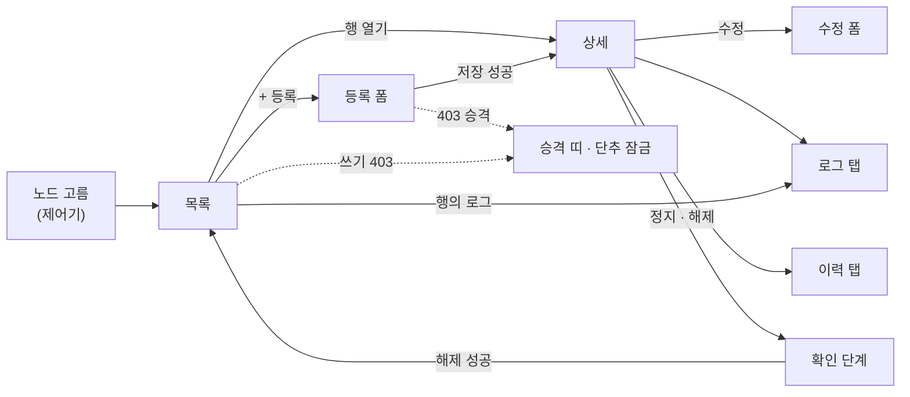
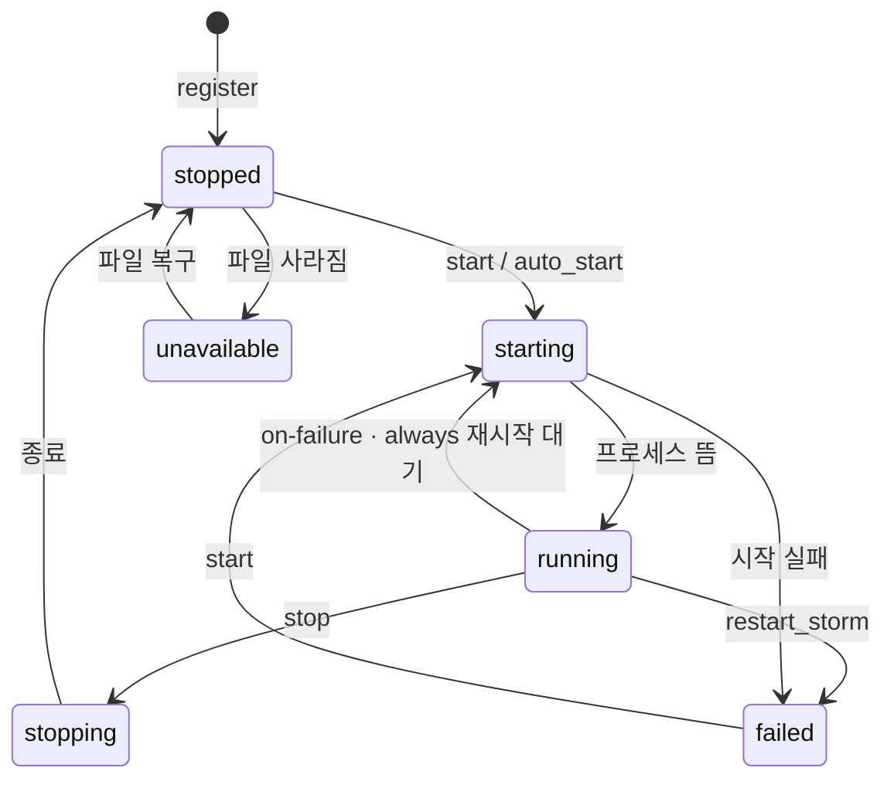
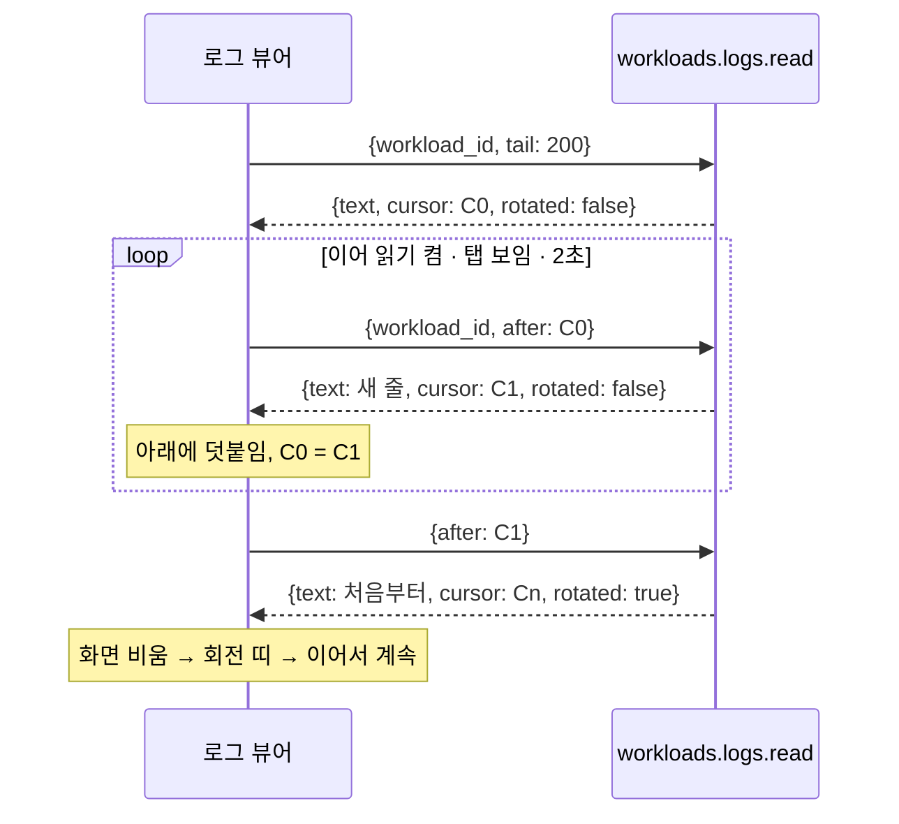

# Workload GUI 화면 설계

Terra 를 모르는 프로그램을 경로로 참조 등록하고 시작 · 정지 · 로그 · 상태 · 이력을 다루는 **단일 노드 supervisor**([[README]])의 GUI 설계다. 소스는 바꾸지 않았고, 이 문서와 [[gui-mockup.html|목업]]만 새로 만들었다.

표기: **[확인함]** 계약 · 코드 · gui-v3 문서에서 직접 읽음 / **[추정]** 읽은 것에서 이끌어 냄, 실행으로 확인 안 함 / **[제안]** 이 설계의 결정.

> **주의 — 이름만 같은 것.** gui-v3 의 `web/src/scene/workload.js` 는 글자 장 렌더러 비교용 **벤치마크 부하**(idle · mask · labels)이고 이 모듈과 무관하다. [확인함] 지금 gui-v3 에는 이 모듈을 부르는 화면이 **없다**(gui-v3 안 `lab.stellaxia.workload` 참조 0건, `APP_PERMS` 에 `workload.*` 없음).

## 1. gui-v3 의 설계 규칙 (확인함)

| 항목 | 규칙 | 출처 |
| --- | --- | --- |
| 화면 원본 | 캔버스 보드 `web/design/*.dc.html` — 보드마다 `canvas.json` 에 `x · y · w · h · title · is_interactive` 한 줄. 창 보드는 폭 560–860, 높이 540–760 | `web/README.md` · `canvas.json` |
| 시안 방식 | 캔버스에는 Gateway 가 없어 목업 전송으로 저장을 흉내 내고, 실제 웹 빌드가 같은 보드를 띄워 operation 에 붙인다(`?demo` 로 목업) | `web/README.md` |
| 보드 굽기 | `build/parts/<보드>/{markup.html, style.css, script.js}` → `build_parts.py` | `web/README.md` |
| 창 | 시안의 레거시 사각 틀 — 1px 선, 머리줄 `>_ 이름 종류`, 종류별 자리 수(ctl 6 · stat 3 …), 같은 대상은 창 하나 | `web/src/ui/window-layer.js` · base.css `.tw` |
| 토큰 | `--t-*`(다크 기본, `:root[data-theme="light"]`), 창 보드는 `var(--t-*, 다크값)` 로 읽음. 글자 대비 4.5:1 이상 | `base.css` · [[visual-system]] §1 |
| 상태 표시 | 색만으로 말하지 않고 글자도(이름표 · 태그 · 점 옆 글). 창 안 단추 최소 24×24, `:focus-visible` 2px | [[visual-system]] §6 |
| 빈 상태 | `StateBand` 네 가지: **받는 중 / 없음 / 못 봤음 / 끊김** — "없음"과 "못 봤음"을 섞지 않는다 | `StateBand.dc.html` |
| 위험한 쓰기 | 공용 확인 단계 `ask(spec)` — 위험도 칩(읽기 · 쓰기 · 위험) · 무엇 · 어디에 · 기록 · 되돌리기 · 결과. 문이 닫히면 "잠김 : 원인 — op" | [[desk-flows]] §1 · `gates.js` |
| 호출 | `createTerra().invoke(opId, input, { node })`, 사람 권한(`whoami.permissions`)과 앱 권한의 교집합. 모듈 op 는 gui-v3 가 막지 않고 Gateway 응답을 옮김 | `gates.js` |
| 화면 문구 | 라벨식(명사형) 문구 | [[module-gui-widgets]] §8 |
| 모듈이 GUI 를 넣는 길 | `contributions.gui.apps`(창 하나, `isolation: sandboxed`) 는 **있음**, 작은 자리(widget)는 **제안 단계** | [[module-gui-widgets]] §2 |

## 2. 설계 결정

| # | 결정 | 이유 |
| --- | --- | --- |
| D1 | **노드를 먼저 고르고** 그 노드의 workload 창을 연다 — 제어기(노드 데스크톱) 앱 `workload` **[제안]** | 참조 등록은 `scope: node-local`, 없는 id 는 "이 노드에 없다". 노드 범위 → 창이라는 [[menu-hierarchy]]의 방향과 같다 |
| D2 | 창 하나에 **목록 ⇄ 상세 ⇄ 폼** 을 같은 창 안에서 바꾸고, **로그 · 이력은 상세의 탭**(+ 목록 행의 '로그' 바로가기) **[제안]** | 창 종류마다 자리 수가 한정된다(window-layer). 같은 대상은 창 하나 규칙 |
| D3 | 보드 이름 `Workload.dc.html`, 기본 크기 860×640 **[제안]** | 설정 창 · 자원 창(860×600)과 같은 급 |
| D4 | 환경 선언값은 **키만** 보인다. 입력 칸은 password 형, 저장 뒤엔 `키 + 값 숨김` | NFR-13 · 요구사항. 단 계약상 값이 응답으로 돌아옴 → 간극 G4 |
| D5 | drift 는 **경고 칩(노랑)** 이지 오류가 아니다. 단추를 막지 않는다 | README "drift는 표시" (D-16) |
| D6 | 승격 거부는 **창 위 띠 + 4개 단추 잠금**, 정지 · 해제 · 읽기는 열어 둠 | `elevation.go` 의 열린/닫힌 목록 그대로 |
| D7 | 일괄 작업 · 스트리밍은 **만들지 않는다** (계약에 없음) | §8 |
| D8 | 이력은 최신이 위 — API 는 오래된 것부터라 화면에서 뒤집음 | `store.events` 가 "newest limit, oldest first" |
| D9 | 정지 · 해제는 공용 확인 단계를 거침, 시작 · 재시작은 바로 | 해제는 로그 · 이력까지 지우고 되돌릴 수 없음. `workload.manage` 는 risk **dangerous** |
| D10 | 시안 모드(`?demo`)에서는 가짜 응답으로 같은 화면을 보임 | gui-v3 의 시안 방식 |

## 3. 상태 어휘와 배지 (확인함)

`status` 6개는 코어 모듈 상태와 같은 말이다(model.go). 색 + 기호 + 글자 셋으로 표시한다.

| status | 기호 · 색 토큰 | 뜻 · 화면 처리 |
| --- | --- | --- |
| `running` | ● `--t-ok` | 실행 중. 시작 잠김, 정지 · 재시작 열림 |
| `starting` | ◐ `--t-info` | 시작 중 **또는 재시작 대기(backoff)** [확인함: supervisor 가 backoff 동안 `starting` 으로 둠]. 칩 "재시작 대기"는 `instance` 없음 + `last_exit` 있음으로 **[추정]** 판단 |
| `stopping` | ◐ `--t-warn` | 정지 중. 조작 단추 잠깐 잠금 |
| `stopped` | ■ `--t-off` | 정지됨. 시작 열림 |
| `failed` | ✕ `--t-err2` | 실행 실패 · 재시작 폭풍으로 멈춤. 이력 바로가기 노출 |
| `unavailable` | ⚠ `--t-warn` 점선 | 등록은 있는데 실행 파일이 없음(FR-B8). 시작 잠김, 해제는 열림 |

> [확인함] 프로세스가 끝나면 서버는 `instance` 를 비운다(`e.w.Instance = nil`). 그래서 **failed · 재시작 대기 · stopped 에서는 `restart_count` 를 응답으로 알 수 없다** → 목록의 재시작 칸은 그때 `—`(간극 G3).

## 4. 화면 ↔ operationId ↔ 권한

접두 `lab.stellaxia.workload.` 는 생략. 권한: `workload.read`(risk read) · `workload.manage`(risk **dangerous**). [확인함: 계약의 `security.permissions`]

| 화면 · 요소 | operationId | 권한 | 호출 시점 · 입력 | 쓰는 응답 필드 · 비고 |
| --- | --- | --- | --- | --- |
| (공통) 모듈 준비 확인 | `health.get` | 없음(`[]`) | 창을 열 때 1회 | `status ok/degraded`, `version`. `elevated` 같은 필드는 **없음** |
| 목록 | `workloads.list` | read | 열 때 + 5초 폴링(보일 때만) | `items[]`: id · display_name · status · instance(pid · restart_count) · last_exit · source.drift · spec.restart. `scope: node-local` 칩 |
| 목록 drift 채움 | `workloads.status.get` | read | 화면에 올라온 행마다 1회 | `drift`. 목록의 `source.drift` 는 서버가 **계산하지 않음** [확인함: `list()` 에 해시 계산 없음, `get()`·status 에만] |
| 목록 행 · 상세의 시작 | `workloads.start` | manage ★ | 단추 | 응답 `status · instance`. ★ = 승격 가드 대상 |
| 목록 행 · 상세의 재시작 | `workloads.restart` | manage ★ | 단추 | 같음 |
| 목록 행 · 상세의 정지 | `workloads.stop` | manage | 확인 단계 → `timeout_seconds`(1–300, 기본 10) | `exit_code · forced · duration_ms` 를 결과 줄에 |
| 상세 | `workloads.get` | read | 열 때 1회 | spec · source(digest_now 포함) · instance · last_exit · created/updated |
| 상세 갱신 | `workloads.status.get` | read | 5초 폴링 | `status · instance · last_exit · drift` 만(가벼움) |
| 등록 폼 | `workloads.register` | manage ★ | 저장 | 입력 = CLI 플래그와 같은 필드(§5). 성공 시 응답으로 상세 열기 |
| 수정 폼 | `workloads.update` | manage ★ | 저장(바꾼 칸만) | 실행 중에도 가능, **다음 시작부터 적용** [확인함] |
| 해제 | `workloads.delete` | manage | 확인 단계 → `force` | 로그 · 이력도 지움. `{removed:true}` |
| 로그 뷰어 | `workloads.logs.read` | read | 처음 `tail`, 이어서 `after=cursor` 폴링 | `text · cursor · rotated` |
| 이력 | `workloads.events.list` | read | 탭 열 때 `limit` | `items[]{at, kind, detail}` 오래된 것부터 |
| 승격 거부 띠 | (별도 op 없음) | — | 위 ★ 호출의 403 `WORKLOAD_DAEMON_ELEVATED` 로 감지 | 간극 G1 |
| 빈 · 오류 상태 | (각 호출의 오류) | — | — | §9 |

**gui-v3 쪽 권한 연결 [확인함 + 제안].** gui-v3 앱(`lab.stellaxia.gui-v3.web`)이 선언한 권한은 `session.identity · node.read · node.control · node.config · file.* · process.execute · module.manage` 뿐이다. 앱 토큰은 "사용자 ∩ 앱 권한"이므로 `workload.read` · `workload.manage` 를 `gui.apps[0].permissions` 에 추가하지 않으면 Gateway 가 403 으로 막는다(`gates.js` 는 모듈 op 를 막지 않고 응답을 옮길 뿐). 사람 권한은 `whoami.permissions` 로 미리 읽어 단추를 잠글 수 있다(`잠김 : workload.manage 권한 없음`).

### 4.1 CLI 와 화면의 대응 [확인함: module.json `contributions.cli`]

| CLI | 화면 | 비고 |
| --- | --- | --- |
| `workload register <id> --exec --name --dir --arg* --env* --no-env-snapshot --restart --max-restarts --backoff-ms --auto-start --force` | 등록 폼 | `--no-env-snapshot` 은 GUI 가 스냅샷을 보내지 않으므로 칸을 두지 않음 |
| `workload set <id> --name --dir --arg* --env* --restart --max-restarts --backoff-ms --auto-start` | 수정 폼 | CLI 는 `--auto-start` 켜기만. API 는 `auto_start:false` 가능 → GUI 는 체크박스 양방향 |
| `workload list / get / status` | 목록 / 상세 / 상세 폴링 | |
| `workload start / stop --timeout / restart` | 단추 | |
| `workload rm --force` | 해제 | |
| `workload logs --tail --after` | 로그 뷰어 | `-f` 없음 |
| `workload events --limit` | 이력 | |

## 5. 화면별 설계

[[gui-mockup.html|목업]]의 탭 순서와 같다.

### 5.1 목록

- 칼럼: **이름**(display_name + id 작게) · **상태 배지** · **재시작**(`instance.restart_count`, 없으면 `—`) · **drift** · **마지막 종료**(`code N` + 시각, 0 이 아니면 err 칩) · 행 단추.
- 머리: 화면 안 거르기(이름 · id · 상태 — 서버 필터는 계약에 없음), `+ 등록`, `scope: node-local` 칩, "N건 · 방금 받음".
- 행 단추는 상태로 정한다: running → 재시작 · 정지, stopped/failed → 시작, unavailable → 시작 잠김(툴팁 "실행 파일이 없어 시작할 수 없음") + 해제.
- 정렬은 id 순(서버가 id 로 정렬해 줌 [확인함]). 사용자 정렬은 화면 안에서만.
- 모바일 폭(≤720px): 표가 카드 줄로 바뀌고 칼럼 이름이 값 앞에 붙는다.
- 재시작 칸 · drift 칸의 데이터 한계는 §3 · G2 · G3. drift 가 아직 안 채워진 행은 `—`.
- 갱신: 5초 폴링, 탭이 안 보이면 멈춤, 값이 바뀔 때만 다시 그림(gui-v3 지도 갱신 규칙과 같음). 연결이 끊기면 마지막 사본 + **끊김** 띠.

### 5.2 상세

- 머리줄: `>_ 이름  Workload 상세` + 상태 배지. 아래 단추줄: 시작 · 재시작 · 정지… · 수정 · 해제… · (오른쪽) 로그 ▸ · 이력 ▸.
- 2열(모바일 1열) 섹션:
  - **instance** — status · pid · started_at(+ 화면 계산 가동 시간) · restart_count(이 실행 사이클). 프로세스가 없으면 "실행 중 아님".
  - **last_exit** — code(그대로) · forced · at. `forced:true` 는 "강제 종료" 설명을 붙임(Windows 는 늘 강제). 없으면 "아직 종료한 적 없음".
  - **source** — exec_path · 등록 시 해시 · 지금 해시 · `drift` 경고 칩. drift 이면 위에 **drift 띠**: "등록한 뒤 실행 파일이 바뀌었습니다. 막지는 않고 알려 드립니다." 해시가 비면(`digest_now` 없음) 상태가 unavailable 이므로 "파일 없음".
  - **spec** — args(칩) · working_dir · env(방식 칩 `shell-snapshot`/`declared` + **키 칩만**) · restart(정책 · 최대 · backoff) · auto_start.
- 푸터: id · driver · created_at · updated_at.
- 새 파일을 기준으로 삼는 길은 **정지 → 같은 id 로 교체 등록(`force`)** — register 가 해시를 다시 잰다 [확인함: `service.register`]. update 에는 exec_path 가 없다(간극 G6).

### 5.3 등록 · 수정 폼

필드 이름은 CLI 플래그와 같게 라벨 아래 작게 `--flag` 로 적는다.

| 칸 | register | update | 검사(클라이언트) · 기본값 |
| --- | --- | --- | --- |
| workload id `--id` | 필수 | 읽기 전용 | `^local\.[a-z0-9][a-z0-9._-]{0,120}$`. 틀리면 칸 아래 "local. 로 시작해야 합니다" |
| 이름 `--name` | 선택 | 가능 | 비우면 id 에서 `local.` 뗀 것 |
| 실행 파일 `--exec` | 필수 | 읽기 전용 | 절대경로(`/…` 또는 `C:\…`). 서버가 존재 · 실행 가능도 확인 |
| 인자 `--arg`(여러 번) | 가능 | 가능 | 한 칸 = 인자 하나, 공백으로 쪼개지 않음. 추가 · 삭제 단추 |
| 작업 디렉터리 `--dir` | 가능 | 가능 | 비우면 실행 파일 폴더 |
| 환경 선언값 `--env KEY=VALUE` | 가능 | 가능 | **키 입력 + password 형 값 입력**. `TERRA_` 접두는 저장 시 조용히 버려지므로 입력 중 경고 |
| 재시작 정책 `--restart` | never·on-failure·always | 같음 | 기본 never |
| 최대 재시작 `--max-restarts` | 정수 ≥ 0 | 같음 | 기본 3 |
| backoff `--backoff-ms` | 정수 ≥ 0 | 같음 | 기본 1000, 두 배씩 30초 상한(도움말) |
| 자동 시작 `--auto-start` | 체크 | 체크(켜기 · 끄기) | 기본 끔 |
| 교체 `--force` | `ALREADY_EXISTS` 를 받은 뒤에만 나타남 | — | 실행 중이면 `RUNNING` |

환경 선언값 처리 규칙 **[제안]**:

1. 등록 폼에서는 값을 password 형으로 받고 저장하면 화면에서 버린다. 상세 · 수정 폼에는 **키 칩 + "값 숨김 · 저장됨"** 만 둔다.
2. [확인함] `update` 의 `env` 는 **선언값 전체를 통째로 바꾼다**(`Overrides = filterSecrets(o)`) — 부분 수정이 아니다. 그래서 수정 폼이 일부 키만 바꾸려면 안 바뀐 키의 값도 다시 보내야 한다. GUI 는 `get` 응답으로 받은 값을 **메모리에만** 쥐고(표시 안 함) 바뀐 키만 새 값으로 덮어 다시 보낸다. 값이 필요 없는 흐름(키 삭제 · 추가)은 이대로 됨.
3. 셸 환경 스냅샷(`env_snapshot`)은 브라우저가 읽을 수 없어 **보내지 않는다.** 그래서 GUI 로 등록한 건 `env.mode = declared`. 칩으로 "환경 방식: declared (안전 키 + 선언값)"을 늘 보여 준다. 스냅샷이 있는 등록을 수정해도 스냅샷은 유지된다(`env_snapshot` 미전송 시 [확인함]: 기존 파일 그대로).
4. 비밀을 넣지 말라는 안내를 칸 아래에 둔다 — 계약이 `overrides` 값을 응답에 돌려주기 때문(G4).

저장 단추 행: `검사 보기`(시안 전용) · 취소 · 등록/저장. 수정 모드에서 실행 중이면 "다음 시작부터 적용됩니다. 저장 뒤 재시작해야 반영" 띠.

### 5.4 로그 뷰어

- **처음 읽기**: `tail`(50 · 200 · 1000, 기본 200). 응답의 `cursor` 를 저장한다.
- **이어 읽기(기본 켬)**: 2초마다 `after=cursor`. 응답 `cursor` 로 갱신. 새 줄은 잠깐 강조. "맨 아래 고정"은 스크롤이 맨 아래에서 벗어나면 자동으로 꺼지고, 아래로 내리면 다시 켜짐. 탭이 안 보이면 폴링 정지, 돌아오면 즉시 1회. 오류면 2→4→8초 … 상한 30초.
- **tail 과 after 는 함께 못 쓴다** [확인함: `tail > 0` 이면 after 무시]. 첫 읽기 이후엔 tail 을 보내지 않는다. 빈 응답은 아무것도 안 덧붙임(`cursor` 는 그대로 크기).
- **rotated 알림**: `rotated:true` 면 서버가 처음부터 읽어 돌려준 것이다. 화면을 비우고 노랑 띠 "로그가 2 MiB 를 넘어 회전되었습니다. 처음부터 다시 읽었고 그 사이 일부 줄은 없을 수 있습니다". 닫기 단추. 이전 장(`current.log.1`)은 이 계약으로 읽을 수 없다.
- 화면 쪽 도구: 줄바꿈 · 화면 안 찾기(강조) · 화면 지우기 · 처음부터 다시(tail). 화면은 **마지막 5,000줄**만 쥐고 앞을 버린다 **[제안]**.
- 표시: 한 덩어리 글. stdout · stderr 구분과 줄별 시각은 응답에 **없음**(§8). 고정폭 글꼴, `role="log"`, `aria-live="off"`(읽어 주지 않음 — 스크린리더 폭주 방지).
- [확인함] 회전 판정은 `after > 현재 파일 크기` 일 때만이다. 회전 직후 새 파일이 이미 옛 커서보다 커졌다면 신호 없이 줄이 빠진다 [추정: 2 MiB 회전 뒤 폴링 간격 안에 그만큼 쌓이면 가능, 드묾]. 간극 G7.
- 로그 없음: "로그가 아직 없습니다"(없음 띠) — 파일이 없으면 서버가 빈 text · cursor 0 을 돌려준다 [확인함].

### 5.5 이력 타임라인

- 최신이 위인 세로 타임라인. 점 색은 kind 로: started(ok) · registered/updated(info) · stopped(off) · exited(종료 코드 ≠ 0 이면 err, 0 이면 중립) · restart_storm · start_failed · restart_failed(err, 점 채움) · auto_start_skipped(warn).
- 각 줄: 시각(상대 + 절대 UTC) · kind(굵게) · 상세 한 줄. [확인함 — 코드의 detail 모양] `started{pid, restart_count}` · `exited{code, forced, duration_ms}` · `stopped{forced}` · `restart_storm{code:"WORKLOAD_RESTART_STORM", consecutive, last_exit_code}` · `start_failed{error}` · `restart_failed{error}` · `auto_start_skipped{code, reason}` · `registered{exec_path}` · `updated{}`(상세 없음).
- 모르는 kind 는 중립 점 + detail JSON 한 줄(계약이 `…` 로 열려 있음).
- 거르기(화면 안): 전체 · 오류만 · 시작/종료. 건수 선택 50 · 100(기본) · 500 · 1000 = `limit`. 서버는 **기간 · 커서 · 종류 필터를 받지 않는다** — 끝에 "받은 N건의 끝. 더 옛 이력은 건수를 늘려서만"을 둔다(G8).
- `restart_storm` 은 한 줄 요약 띠로 상세 상단에도 올린다("재시작 폭풍으로 멈춤 · 연속 3회 · 마지막 종료 코드 1").

### 5.6 승격 데몬 거부 상태

[확인함: `elevation.go`, README] 이 모듈의 프로세스가 승격(Windows 토큰 TokenElevation · Linux euid 0 — 판별 실패도 승격으로 간주)이면 `register · update · start · restart` 가 403 `WORKLOAD_DAEMON_ELEVATED`. `list · get · status · logs · events · stop · delete` 는 된다.

- **띠**(노랑, 창 맨 위): "승격 데몬 — Terra 데몬이 관리자/root 로 돌고 있어 등록 · 수정 · 시작 · 재시작이 막혔습니다. 정지 · 해제는 됩니다." 아래 줄: "데몬을 비승격으로 돌리면 저절로 풀립니다 — 이 화면에서 풀 방법은 없습니다." 서버 message 가 "could not determine …" 로 시작하면(판별 실패) 그 문장을 그대로 한 줄 덧붙임.
- **비활성 단추**(`aria-disabled`, 점선 · 흐림, 툴팁 `잠김 : 데몬 승격 — 등록 · 수정 · 시작 · 재시작 불가`): `+ 등록` · 수정 · 시작 · 재시작 · 폼의 저장. 눌러도 아무 호출도 하지 않는다. 열린 것(정지 · 해제 · 모든 읽기)은 그대로 — 승격 아래 남은 등록을 치우는 길이므로 해제를 눈에 띄게 둔다.
- 폼 화면은 열 수 있되 저장만 잠긴다(미리 채워 두고 풀리면 바로 저장하게).
- **감지 시점 [제안]**: 승격 여부를 읽는 op 가 없다(`health.get` 은 status · version 뿐). ① 쓰기 ★ 가 한 번 403 으로 거부되면 그 노드에 띠 + 잠금을 세운다. ② 잠긴 동안은 단추를 눌렀을 때만 재확인한다(30초 폴링으로 쓰기를 부르지 않는다). ③ 띠가 선 동안 `health.get` 은 계속 폴링하되 이것으로는 풀림을 알 수 없으므로 "다시 확인" 단추(→ 가장 가벼운 ★ 재시도)를 둔다. 근본 해법은 `health.get` 에 `elevated` 추가(G1).
- 일반 `WORKLOAD_PERMISSION_DENIED`(사람 권한 없음)와 다른 띠다 — 하나는 "누가 풀어 줄 수 있나: 데몬 운영자", 다른 하나는 "관리자에게 권한 요청".

### 5.7 빈 상태 · 오류 상태

StateBand 네 가지에 맞춘다.

| 상황 | 띠 | 문구 |
| --- | --- | --- |
| 첫 로드 | 받는 중 | "workload 목록을 받는 중…" |
| 등록 0건 | 없음(빈 상태 카드) | "등록된 workload 가 없습니다 — 이 노드에 Terra 를 모르는 프로그램을 경로로 등록하면 여기서 시작 · 정지 · 로그를 봅니다." + CLI 예 `terra workload register local.my-app --exec /path/to/app` + `+ 첫 workload 등록` |
| 거르기 결과 0건 | 없음 | "이 거르기에 맞는 항목이 없습니다" + 거르기 지우기 |
| 읽기 실패 | 못 봤음 | "workload 목록을 받지 못했습니다" + 다시 시도 |
| 사본이 있는 채 끊김 | 끊김 | "N초 전 사본 · 읽기 전용" |
| `workload.read` 없음 | 잠김(못 봤음 색) | "workload 를 볼 권한이 없습니다 — workload.read 가 필요합니다" |
| 로그 없음 | 없음 | "로그가 아직 없습니다" |

**WORKLOAD_\* 코드별 문구** [확인함: 계약 `errors`의 코드 · HTTP · retryable, 문구는 제안]. 띠 앞 태그 · 머리 문구 · 아래 줄(할 일) · 단추. 서버 `message` 는 접어 둔 "자세히" 에 그대로 둔다.

| 코드 | HTTP | 재시도 | 쓰이는 곳 | 태그 · 머리 문구 | 할 일 줄 · 단추 |
| --- | --- | --- | --- | --- | --- |
| `WORKLOAD_UNAVAILABLE` | 503 | 가능 | 모든 호출 | 못 봤음 · "모듈이 아직 준비 중입니다" | "조금 뒤 자동으로 다시 시도합니다 (5 → 10 → 30초)" · 다시 시도 |
| `WORKLOAD_NOT_FOUND` | 404 | 아님 | get · 조작 · 로그 · 이력 | 없음 · "이 노드에는 그런 등록이 없습니다" | "다른 노드에서 등록한 것이면 그 노드에서 보세요. 참조 등록은 등록한 노드에서만 유효합니다." · 목록으로 |
| `WORKLOAD_ALREADY_EXISTS` | 409 | 아님 | register | 이미 있음 · "같은 id 가 이미 등록돼 있습니다" | "다른 id 를 쓰거나, 실행 중이 아니면 '교체' 를 켜서 다시 저장하세요." · 교체로 저장(체크 노출) |
| `WORKLOAD_ID_INVALID` | 400 | 아님 | register · update | 입력 오류 · "id 는 local. 로 시작해야 합니다" | 규칙 안내, 칸으로 이동. 다른 입력값(restart 정책 · env 형식 `KEY=VALUE`)도 같은 코드라 message 를 덧붙임 |
| `WORKLOAD_EXEC_NOT_FOUND` | 400 | 아님 | register | 실행 파일 없음 · "그 경로에 파일이 없습니다" | "절대경로인지, 디렉터리가 아닌 파일인지 확인하세요." · 칸으로 이동 |
| `WORKLOAD_EXEC_NOT_EXECUTABLE` | 400 | 아님 | register · start · restart | 실행 불가 · "파일은 있지만 실행할 수 없습니다" | "실행 권한 또는 실행 형식을 확인하세요." |
| `WORKLOAD_EXEC_MISSING` | 409 | 아님 | start · restart | 원본 사라짐 · "등록한 뒤 실행 파일이 사라졌습니다" | "파일을 되돌리거나 같은 id 로 다시 등록(교체)하세요. 상태는 unavailable." · 교체 등록 열기 |
| `WORKLOAD_RUNNING` | 409 | 아님 | register(교체) · delete | 실행 중 · "실행 중이라 이 조작을 할 수 없습니다" | "정지한 뒤 다시 하거나, 해제는 '정지한 뒤 해제' 로 강제할 수 있습니다." · 정지 |
| `WORKLOAD_PERMISSION_DENIED` | 403 | 아님 | manage 조작 | 권한 없음 · "workload.manage 권한이 없습니다" | "존재 여부는 알려 주지 않습니다. 관리자에게 권한을 요청하세요." |
| `WORKLOAD_DAEMON_ELEVATED` | 403 | 아님 | register · update · start · restart | 승격 데몬 · §5.6 띠 | "데몬을 비승격으로 돌린 뒤 다시 시도하세요. 정지 · 해제는 됩니다." |

- 입력 오류(400)는 폼의 해당 칸 아래에 붙이고, 409 는 띠, 403 승격은 창 띠, 404 는 화면 전환(목록으로).
- 계약 밖 오류(Gateway 401 · 네트워크 · 타임아웃)는 "못 봤음 · 응답이 없습니다" 로 묶는다.
- 읽기 op 에는 `WORKLOAD_PERMISSION_DENIED` 가 선언돼 있지 않다 [확인함] → 읽기의 403 은 일반 403 으로 받아 "잠김 · workload.read 필요" 로 보인다.
- `restart_storm` 이벤트의 `code` `WORKLOAD_RESTART_STORM` 은 계약 `errors` 에 없는 이벤트 안의 값이다(G9).

## 6. 폴링 · 갱신 정책 **[제안]**

| 대상 | 주기 | 조건 |
| --- | --- | --- |
| list | 5초 | 목록 창이 보일 때 |
| status.get | 5초 | 상세가 보일 때. get 은 열 때 + 저장 · 조작 직후 |
| logs.read | 2초 | 로그 탭이 보이고 "이어 읽기" 켬 |
| events.list | 열 때 + 5초(탭 보일 때) | 새 이벤트가 위에 붙음. 같은 `at+kind` 중복은 이벤트에 id 가 없어 건수 기준으로 통째 교체 |
| health.get | 창 열 때 1회 | degraded 면 노랑 칩 |

조작 직후에는 응답으로 행을 즉시 갱신하고 다음 폴링을 앞당긴다. 모든 폴링은 탭이 숨으면 멈추고 오류면 지수 후퇴(상한 30초).

## 7. 토큰 · 접근성 · 반응형

- 토큰: gui-v3 `base.css` 의 `--t-bg · --t-sf · --t-text · --t-mut · --t-key · --t-hint · --t-off · --t-acc · --t-hi · --t-ok · --t-info · --t-warn · --t-err · --t-err2 · --t-line-rgb · --t-halo` 값을 목업에 그대로 복사(다크 기본, 라이트 값 `:root[data-theme="light"]`, 목업은 `prefers-color-scheme` 도 따름). 실제 보드는 `var(--t-*, 다크값)` 꼴로 쓴다.
- 상태는 색 + 기호 + 글자 + 테두리 모양(unavailable 은 점선)으로 중복 표시. 단추 최소 24×24, 초점 윤곽 2px, 잠긴 단추는 `aria-disabled` + 툴팁 사유(`잠김 : 원인`).
- 모션: `prefers-reduced-motion` 에서 점멸 · 전환 끔.
- 모바일: 탭 가로 스크롤, 표는 카드 줄, 폼은 1열, 띠는 단추를 아래로 감쌈. 목업은 375px 폭에서 가로 넘침 없음을 Playwright 로 확인.
- 글꼴: 목업은 외부 로드 없이 시스템 고정폭 스택(`Geist Mono, GmarketSans, Noto Sans KR, ui-monospace …`). 실제 보드는 gui-v3 가 번들한 글꼴을 쓴다.

## 8. 계약에 없음 (GUI 에 두지 않거나 화면 안 대체)

| 요구처럼 보이는 것 | 상태 | GUI 처리 |
| --- | --- | --- |
| `logs -f` 스트리밍 · WebSocket/SSE | **계약에 없음** (README: 요청/응답 operation) | `after` 커서 폴링(5.4) |
| 일괄 시작 · 정지 · 재시작 · 해제 · 다중 선택 | **계약에 없음** | 단추 없음. (제안: 클라이언트가 단건을 순차 호출하는 "전체 정지"는 부분 실패 처리가 필요해 1차 범위 밖) |
| 서버측 목록 필터 · 정렬 · 페이지 | **계약에 없음** | 화면 안 거르기 |
| 이력 기간 · 커서 · 종류 필터 · 이벤트 id | **계약에 없음**(`limit` 만) | 화면 안 거르기, 건수 선택 |
| 로그 stdout/stderr 구분 · 줄별 시각 · 이전 장(.1) 읽기 · 로그 지우기/다운로드 | **계약에 없음** | 화면 안 도구만(찾기 · 지우기 = 화면만) |
| 로그 `limit`(바이트 상한) | **계약에 없음**(after 이후 전부) | 화면 5,000줄 유지 |
| 실행 파일 경로 변경(update) | **계약에 없음**(update 에 exec_path 없음) | 교체 등록(`force`) 안내 |
| 실행 중 변경 즉시 반영 | 없음(다음 시작부터) | 폼에 띠 |
| 승격 여부 사전 조회 | **계약에 없음** | 쓰기 403 으로 감지 |
| 환경 값 확인 · 스냅샷 키 편집 · 셸 스냅샷 전송 | 값은 보이지 않음 · 브라우저가 셸 환경을 못 읽음 | 키만, `declared` |
| 시작 대기(readiness) · 헬스체크 · 리소스(CPU/MEM) · 포트 | **계약에 없음** | 표시 안 함 |
| 다른 노드 workload 조회 · 원격 실행 | M2~, `scope: node-local` | 노드를 고른 뒤 그 노드 것만 |
| 알림 · 구독 · 푸시(상태 변화 알림) | **계약에 없음** | gui-v3 알림 창이 `modules.get` 을 읽는 방식과 별개. 폴링으로만 반영 |
| `workload.read/manage` 를 사용자에게 부여하는 화면 | README: 정책이 이 PR 밖 | 권한이 없으면 잠금 사유만 표시 |

## 9. 코어 · 모듈에 요청할 간극

| # | GUI 가 필요 | 지금 | 영향 · 제안 |
| --- | --- | --- | --- |
| G1 | 승격 여부를 **쓰기 전에** 앎 | `health.get` = `{status, version}` | 첫 거부 뒤에야 띠. 제안: `health.get` 에 `elevated: boolean` |
| G2 | 목록의 **drift** | 목록은 해시를 계산하지 않아 `source.drift` 가 늘 저장값(false) [확인함] | 행마다 `status.get` N+1. 제안: list 가 drift 를 계산(비용: 파일 해시 N 개) 하거나 stat(mtime · size) 비교 필드 |
| G3 | failed · 재시작 대기 · stopped 의 **재시작 횟수** | 프로세스가 끝나면 `instance` 가 비워짐 | 목록 `—`. 제안: `spec` 옆에 `restart_state{count, consecutive}` 또는 instance 를 남김 |
| G4 | 환경 선언값의 **값 비노출** | `spec.env.overrides` 가 응답에 값째 돌아옴(계약 · 코드). README 는 "응답에는 키 이름만"이라 하나 이는 스냅샷 한정으로 읽힘 | GUI 는 표시하지 않지만 전송 · 로그에는 남음. 제안: 응답은 `override_keys` 만, `update.env` 는 키별 병합/삭제(`env_remove`)로 |
| G5 | `app` 권한 | gui-v3 `module.json` 앱 권한에 `workload.*` 없음 | 그대로면 GUI 호출이 403. 제안: `gui.apps[0].permissions` 에 `workload.read · workload.manage` 추가(코어에 앱 권한 목록 · `APP_PERMS` 시험 동기화 포함) — gui-v3 쪽 작업 |
| G6 | exec_path 변경 · 해시 재기준(re-baseline) | update 에 없음 | 교체 등록(정지 필요)만 가능. 제안: update 에 `exec_path` 또는 `rebaseline: true` |
| G7 | 로그 회전 **누락 없이** 감지 | `after > size` 일 때만 `rotated` | 드문 무신호 누락. 제안: 응답에 파일 세대 번호(`generation`)를 담아 비교 |
| G8 | 이력 커서 · 이벤트 id · kind 열거 | `limit` 만, kind 는 설명문 속 예시 | 폴링 중복 제거를 건수 교체로 우회. 제안: `after_id`, `kind` enum(`auto_start_skipped · start_failed · restart_failed` 포함) |
| G9 | `restart_storm` 의 사유 코드 | 이벤트 detail 에만 `WORKLOAD_RESTART_STORM` | 계약 `errors` 에 없는 문자열. 이벤트 detail 스키마를 계약에 적을 것 |
| G10 | 일괄 · 스트리밍 | §8 | 요구가 생기면 `workloads.batch.*` / 로그 stream op |

## 10. 구현 경로 **[제안]**

1. `web/design/Workload.dc.html` 보드 + `canvas.json` 항목(860×640) + `build/parts/workload/{markup.html, style.css, script.js}` — 이 문서 §5 의 화면을 보드 하나의 탭 영역으로.
2. `web/src/api/workload.js` — 12 op 래퍼(`createTerra().invoke`), 폴링 · 후퇴 · 오류 → §5.7 문구 매핑. 시험은 가짜 invoke 로 커서 · rotated · 승격 403 경로.
3. 시안 모드(`?demo`)의 가짜 서버는 이 목업의 `srvTail/srvAfter`(바이트 커서 · 회전) 모델을 재사용.
4. 제어기 앱 목록에 `workload` 진입 추가, `ctlOpenWin(node, R, 'ctl', 'workload:<id>')` 의 `launch` 속성으로 상세로 바로 열기([[global-windows]] §2 와 같은 방식).
5. G5(앱 권한)는 코드 전에 먼저 — 없으면 실제 모드에서 전부 403.

작은 자리(상태 카드)로 넣는 길은 [[module-gui-widgets]] 의 declarative 위젯(`v3.node.status.card`, `workloads.list` 를 `every: 10s`)으로 별도 가능하나, 위젯 C1~C6 이 서기 전에는 쓸 수 없다 [확인함: 제안 단계].

## 11. 목업

[[gui-mockup.html]] — 외부 의존 없는 단일 HTML. 탭 7개(목록 · 상세 · 등록/수정 · 로그 · 이력 · 승격 거부 · 빈/오류). 위쪽 "시안 조작"의 두 체크박스로 **승격 데몬** · **manage 권한 없음** 상태를 모든 탭에 걸어 볼 수 있고, 로그 탭은 가짜 서버(바이트 커서 · 2초 폴링 · 회전 시뮬레이션)로 동작한다. 테마 단추는 시스템 → 라이트 → 다크 순환. Playwright(chromium, deviceScaleFactor 1)로 1100px 다크 · 라이트, 375px 모바일에서 7개 탭을 캡처해 가로 넘침 · 콘솔 오류 없음을 확인했다.
