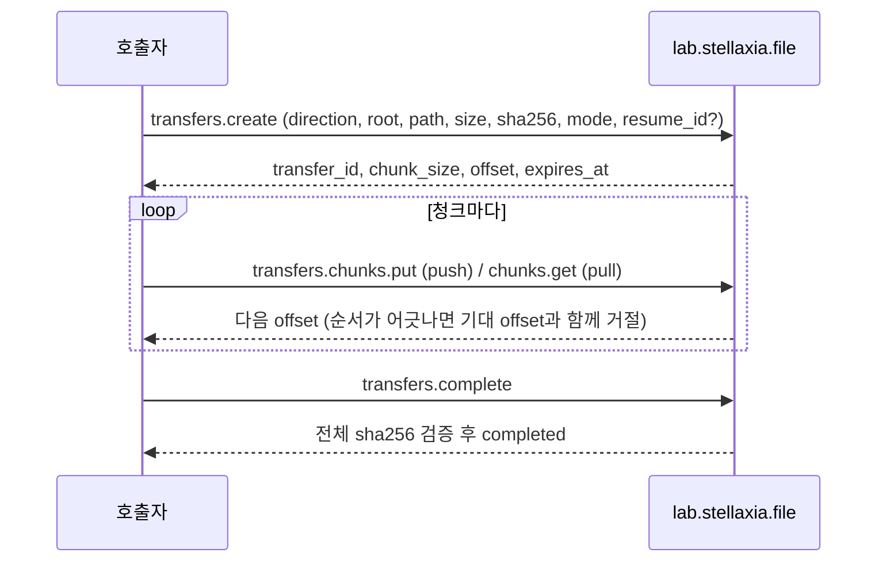

# lab.stellaxia.file (Terra File)

노드(leaf)가 공유한 폴더를 목록·조회·읽기·쓰기·관리하고, 큰 파일은 재개 가능한 청크 전송으로 주고받는 서비스 모듈이다. 경로 봉쇄는 Go의 `os.Root`가 커널 수준에서 수행한다.

> 이 문서는 소스(`src/`), `module.json`, `contracts/api/terra-api.json`에서 읽은 내용만 사실로 적는다. 코드에서 확인하지 못한 내용은 **(추정)** 으로 표시한다. 기준 시점의 모듈 버전은 `module.json`의 `0.3.2`, 계약 버전은 `0.2.1`이다.

## 1. 목적

- 호스트가 이 모듈에 허가한 공유 폴더(root)를 나열하고, 그 안의 디렉터리·항목을 다룬다.
- 작은 구간은 전송 없이 `entries.read` / `entries.write`로 직접 읽고 쓴다.
- 큰 파일은 `transfers.*`로 청크 단위 push(올리기)·pull(받기)을 하며, 중단 후 `resume_id`로 이어갈 수 있다.
- 데몬의 data_plane/storage에서 분리된 두 번째 코어 축소 대상이다(계약 설명 기준). 청크 크기·전송 상한은 이제 이 모듈이 소유한다(`src/main.go` 주석).

## 2. module.json 요약

| 항목 | 값 |
| --- | --- |
| id | `lab.stellaxia.file` |
| name / kind | Terra File / `service` |
| version | `0.3.2` |
| 호환 | products `leaf`, os `linux`·`windows` |
| 진입점(process) | `bin/linux-amd64/terra-file`, `bin/linux-arm64/terra-file`, `bin/windows-amd64/terra-file.exe` |
| 제공 capability | `lab.stellaxia.file` `0.1.0` |
| 계약 | `contracts/api/terra-api.json` |
| 권한 `storage` | `module-data`, `shared-roots` |
| readiness | operation `lab.stellaxia.file.roots.list`, 버전 범위 `>=0.1.0 <1.0.0`, timeout 15000 ms |
| update | `start-before-stop`, drain timeout 30000 ms, rollback `true` |

- `module-data`: 전송 상태(체크포인트)를 모듈 자신의 데이터 디렉터리에 둔다. 공유 폴더 안에는 두지 않는다.
- `shared-roots`: 호스트가 허가한 공유 폴더 목록을 환경변수로 받는다. 허가가 없어도 모듈은 기동하며 빈 root 목록을 답한다(`main.go`).
- 바이너리는 릴리스 때 `src/`에서 빌드되어 `bin/<target>/`에 들어가며(`.gitignore`가 `/bin/`을 제외), 원본은 `src/` + `module.json` + `contracts/`이다.

HTTP 경로 접두사는 `/api/modules/lab.stellaxia.file/v1`(`api.go`)이다.

## 3. Operation 19개

권한은 계약의 `security.permissions` 값이다. 모든 operation의 인증은 `workload-identity`이다. 정확한 입출력 스키마는 계약 파일이 기준이다.

| # | operation (접두사 `lab.stellaxia.file.` 생략) | 권한 | 역할 |
| --- | --- | --- | --- |
| 1 | `roots.list` | file.read | 이 노드가 공유한 폴더 나열(readiness 용도) |
| 2 | `entries.list` | file.read | 한 디렉터리 나열 |
| 3 | `entries.stat` | file.read | 항목 하나 조회 |
| 4 | `entries.read` | file.read | 파일의 한 구간을 전송 없이 읽기 |
| 5 | `entries.write` | file.write | 파일의 한 구간을 전송 없이 쓰기(exclusive·sha256 선택) |
| 6 | `entries.truncate` | file.write | 파일을 지정 크기로 자르거나 늘리기 |
| 7 | `entries.mkdir` | file.write | 디렉터리 만들기(`parents` 지원) |
| 8 | `entries.rename` | file.write | 같은 공유 폴더 안에서 이름·위치 변경 |
| 9 | `entries.remove` | file.write | 항목 삭제(위험 등급, 확인 필수, 비어 있지 않으면 `recursive` 필요) |
| 10 | `transfers.list` | file.read | 이 노드가 아는 전송 나열 |
| 11 | `transfers.get` | file.read | 전송 하나의 상태와 재개 지점 조회 |
| 12 | `transfers.create` | file.write | 전송 합의(방향 선택). pull이라도 이 operation은 file.write |
| 13 | `transfers.chunks.put` | file.write | push 전송의 청크 하나 쓰기 |
| 14 | `transfers.chunks.get` | file.read | pull 전송의 청크 하나 읽기 |
| 15 | `transfers.complete` | file.write | 전송 검증 후 닫기 |
| 16 | `transfers.abort` | file.write | 전송 중단(위험 등급, 감사 필수) |
| 17 | `transfers.pulls.create` | file.read | pull 전송만 열기 |
| 18 | `transfers.pulls.complete` | file.read | pull 전송 닫기(push는 거절) |
| 19 | `transfers.pulls.abort` | file.read | pull 전송 중단(push는 거절, 감사 필수) |

읽기만 허락된 호출자는 `transfers.create` 대신 `transfers.pulls.*`를 쓴다(계약의 `file.write` 권한 설명). `entries.write`·`truncate`·`mkdir`·`rename`·`remove`와 `transfers.abort`·`pulls.abort`는 `audit.required: true`이다.

오류 코드는 계약 `errors`에 정의되어 있다(예: `PATH_DENIED` 403, `ROOT_NOT_FOUND` 404, `FILE_NOT_FOUND` 404, `FILE_TARGET_EXISTS` 409, `FILE_RECURSIVE_REQUIRED` 400, `FILE_CHECKSUM_MISMATCH` 409 등). 전송 쪽 코드(`TRANSFER_EXPIRED`, `CHUNK_OUT_OF_ORDER`, `CHUNK_CHECKSUM_MISMATCH`, `CHECKSUM_MISMATCH`, `TRANSFER_TOO_LARGE`, `TRANSFER_WRONG_STATE`, `TRANSFER_NOT_FOUND`)는 `api.go`의 `writeStoreError`에서 매핑된다.

## 4. 전송 프로토콜



(`pulls.*`는 같은 흐름에서 file.read만으로 쓰는 pull 전용 입구다.)

- **청크 크기**: 기본 `262144`바이트(256 KiB). 상한 `640 * 1024`바이트(640 KiB). 상한은 Gateway가 invoke 본문을 1 MiB에서 자르고 base64가 4/3 비용을 치르는 점에서 역산한 값이다(`main.go` 주석). 상한을 넘기거나 양수가 아닌 값이면 모듈이 기동 시점에 실패한다.
- **환경변수**
  - `TERRA_FILE_CHUNK_SIZE_BYTES`: 청크 크기(바이트). 숫자가 아니면 기동 실패.
  - `TERRA_FILE_MAX_TRANSFER_MB`: 한 전송의 최대 크기(MB). 기본 `10240`. 파싱 불가·양수 아님이면 기본값으로 대체한다. 상한 검사는 prepare 시점에 한다.
- **mode**: `create`(기본, 대상이 있으면 `FILE_TARGET_EXISTS`)와 `overwrite`.
- **resume_id**: 기존 체크포인트를 이어받는다. 체크포인트의 root·path·direction이 요청과 같아야 하며, 이미 `completed`이면 거절한다. 재개하면 만료 시각이 새로 계산된다.
- **TTL**: 준비된 전송은 기본 1시간(`time.Hour`) 동안 쓸 수 있다. 만료되어도 체크포인트는 남는다(`transfer.go` 주석).
- **상태**: `prepared` → `transferring` → `verifying` → `completed`, 또는 `aborted`.
- **순서·무결성**: 청크는 현재 offset에서 이어져야 하며, 어긋나면 기대 offset과 함께 거절한다. 청크별 digest를 보내면 불일치 시 거절한다. pull은 prepare 때 파일의 sha256을 계산해 두므로, 받는 쪽이 전송 중 변경된 파일을 구분할 수 있다.
- 전송 상태는 모듈 data 디렉터리(`modulesdk.DataDir`)에 저장되어 재시작 후에도 이어갈 수 있다.

## 5. 경로 봉쇄 (os.Root)

- 공유 폴더마다 `os.OpenRoot`로 핸들을 하나 열고(`store.NewManager`), 모든 읽기·쓰기·이름 변경·삭제가 그 핸들을 통해 이루어진다.
- 경로 검사와 열기가 한 동작이므로, 검사 후 심볼릭 링크를 바꿔치기하는 경쟁 구간이 없다(`store.go` 머리 주석). 이전 코어 구현은 링크를 해석해 검사한 뒤 따로 열었다.
- 절대 경로, 상위 이동(`..`), 밖을 가리키는 심볼릭 링크는 `PATH_DENIED`(403)로 거절된다(계약).
- `rename`에는 공유 폴더 간 이동이 없다. 봉쇄는 공유 폴더 단위다(`store.go` 주석).
- `os.Root`에는 Truncate가 없어, 봉쇄된 핸들로 열어서 자른다(`store.go` 주석).

## 6. 패키지 구조와 시험

```
leaf/lab.stellaxia.file/
  module.json
  contracts/api/terra-api.json
  src/
    main.go        진입점: 환경변수, 공유 root 열기, 전송 관리자·서버 구성
    api.go         HTTP 핸들러, 오류 매핑 (/api/modules/lab.stellaxia.file/v1)
    store/         공유 폴더 접근(os.Root), 목록·읽기·쓰기·삭제·이름 변경·체크섬
    transfer/      전송 기록·상태·청크 수락/제공·재개·만료
```

시험(`go test` 함수 개수, 기준 시점):

| 위치 | 파일 | 함수 수 |
| --- | --- | --- |
| `src/` | `api_test.go` | 2 |
| `src/` | `entries_read_test.go` | 4 |
| `src/` | `entries_shape_test.go` | 7 |
| `src/` | `entries_write_test.go` | 8 |
| `src/` | `transfers_abort_test.go` | 6 |
| `src/` | `transfers_pull_test.go` | 4 |
| `src/store/` | `store_test.go` | 13 |
| `src/transfer/` | `transfer_test.go` | 13 |

## 7. 빌드·시험

```bash
cd src && go test ./...
```

- Go `1.25` (`src/go.mod`의 `go 1.25.0`). 의존성은 `github.com/StellaxiaLab/terra-sdk v0.1.0`.
- 문서 작성 시점에 위 명령으로 세 패키지가 모두 통과했다.
- 배포용 바이너리는 릴리스 과정에서 `bin/<target>/`로 빌드된다(`.gitignore` 주석에 따르면 `build-release.ps1`의 `Build-ExternalModules`). 이 문서는 릴리스 절차를 다루지 않는다.

## 8. 개명 이력

- `io.terra.file` → `lab.stellaxia.file`: 커밋 `5ff932c`(`feat(modules): rename the nine io.terra.* modules to lab.stellaxia.*`, ADR-MD-002 v1.2). 디렉터리, id, operationId, capability id, API 경로, Go 모듈 경로가 함께 바뀌고 minor 버전이 올랐다.
- **데이터 디렉터리 migration 코드는 없다.** 데이터 디렉터리는 `modulesdk.DataDir("lab.stellaxia.file")`로 열며, 이전 id의 디렉터리를 옮기거나 읽는 코드는 소스에서 찾지 못했다. 따라서 개명 전 id로 남은 전송 체크포인트가 새 id에서 이어지는지는 **(추정) 이어지지 않는다**.
- 개명 이후 이 모듈의 변경: `7733626`(모든 operation을 cluster scope에 개방), `c2a5664`(데이터 없는 `entries.write` 거절).

## 9. 알려진 한계

- 다른 에이전트가 수정 중인 항목이 있다. 아래는 **수정 진행 중이며, 이 문서 기준 시점 이전의 동작**이다. 병합 후 이 절을 갱신해야 한다.
  - `overwrite` 모드 동작
  - 입력 검증
  - 심볼릭 링크 삭제
  - 이름에 `:`가 들어간 경우의 처리
- 웹 화면(PR #201)은 **개발 중(미병합 PR)** 이며 기본 브랜치에는 아직 없다.
- 공유 폴더 간 `rename`은 지원하지 않는다.
- 단일 전송은 `TERRA_FILE_MAX_TRANSFER_MB`(기본 10240 MB)를 넘을 수 없다.
- 청크 크기 상한 640 KiB는 Gateway의 본문 제한(1 MiB)에 묶여 있다.
